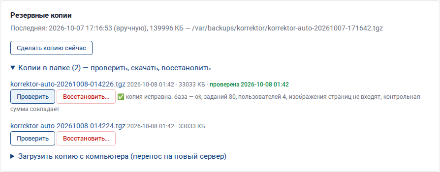

# Администрирование и безопасность

## 1. Служба и журнал

Корректор работает как служба systemd `korrektor`. Она запускается при включении сервера и перезапускается при сбое.

```bash
korrektor status          # состояние
korrektor logs 200        # последние строки журнала
korrektor follow          # журнал в реальном времени
sudo korrektor restart    # перезапуск после изменения korrektor.env
```

Журнал каждого задания хранится в `/var/lib/korrektor/jobs/<номер>/job.log` и показывается на странице задания в реальном времени («Журнал обработки»): этапы с длительностью, подробности каждой проверки, каждый запрос к языковой модели и ход ожидания ответа, предупреждения и ошибки с причиной. Те же строки дублируются в журнал службы с пометкой `job <номер>:` — `korrektor logs | grep "job 128:"`. Если этап идет дольше минуты без записей, раз в минуту добавляется строка «этап … идет N мин». Подробный журнал службы включается в `/etc/korrektor/korrektor.env`: `KORREKTOR_LOG=DEBUG`, затем `sudo korrektor restart` (или настройкой «Подробность журнала» без перезапуска).

**Необработанные ошибки.** Если запрос к сервису завершился внутренней ошибкой, пользователь видит страницу «Внутренняя ошибка» (в REST API — JSON) с **номером ошибки**, например `a3f09c1e`. Подробности с трассировкой записаны в журнал службы: `korrektor logs 2000 | grep a3f09c1e`. Ошибки в запросах (неверный номер задания, неверные параметры, нет прав) показываются понятной страницей на русском, в REST API — `{"error": "…"}`.

**Устойчивость обработки.** Сбой одной проверки (например, словаря или сверки со справочником) не останавливает задание: проверка пропускается, а пропуск указан в журнале, на странице задания и в шапке отчета. Ошибки языковой модели тоже не роняют задание (см. [Установка, п. 5](installation.md#5-подключение-языковой-модели)). Если задание все же завершилось с ошибкой, причина и этап видны на странице задания, а трассировка — в его журнале.

**Задание — отдельный процесс.** Каждое задание (и сводка пакета) обрабатывается отдельным процессом `python -m app.worker`, а не внутри веб-сервера: номер процесса указан в первой строке журнала задания. Если библиотека разбора PDF аварийно завершится на «трудном» файле или системе не хватит памяти, завершится только этот процесс — задание получит понятную ошибку («аварийное завершение процесса обработки (SIGSEGV)» или «принудительно завершен системой (SIGKILL)»), а сервис продолжит работать. Память, занятая обработкой, возвращается системе по окончании задания. Если служба трижды подряд останавливалась во время одного и того же задания, после запуска оно не ставится в очередь снова, а получает статус «Ошибка» — перезапустите его кнопкой «Проверить заново» после выяснения причины. Для отладки можно вернуть обработку внутри веб-сервера: `KORREKTOR_JOB_PROCESS=0` в `korrektor.env`.

## 2. Файл korrektor.env

```ini
KORREKTOR_ADMIN_PASSWORD=...   # пароль входа
KORREKTOR_SECRET=...           # ключ подписи сеансов (смена выводит всех пользователей)
KORREKTOR_DATA=/var/lib/korrektor
KORREKTOR_HOST=0.0.0.0         # 127.0.0.1 — доступ только через nginx
KORREKTOR_PORT=8080
KORREKTOR_LOG=INFO
```

После изменения: `sudo korrektor restart`.

## 3. Файлы задания

| Файл | Содержимое |
|---|---|
| `source.pdf` | загруженный документ |
| `dump.json` | результат `extract.py`: строки, координаты, кандидаты |
| `pages/p001.png …` | изображения страниц |
| `state.json` | замечания с отметками, шапка, результат проверки (записывается атомарно) |
| `stats.json` | сводка для аналитики (создается автоматически, можно удалять) |
| `source.docx`, `source.odt`… | исходный документ Word; рядом — `source.pdf`, полученный через LibreOffice |
| `timing.json` | длительность этапов обработки |
| `findings.json` | данные отчета в формате мастер-промпта (п. 7.1) |
| `*_корректура.docx` | отчет |
| `*_пометки.pdf`, `*.xlsx`, `*.csv` | дополнительные форматы |
| `extract.log`, `verify.log`, `job.log` | журналы этапов; `job.log` — журнал обработки задания (виден на странице и скачивается ссылкой «Скачать журнал») |

Эти файлы позволяют повторить любой шаг вручную, как в мастер-промпте:

```bash
cd /var/lib/korrektor/jobs/12
sudo -u korrektor /opt/korrektor/venv/bin/python /opt/korrektor/app/pipeline/scripts/verify.py *_корректура.docx findings.json dump.json
```

## 4. Безопасность

| Мера | Как настроить |
|---|---|
| Пароль входа | задается при установке; смена — `sudo korrektor passwd` (завершает все открытые сеансы). Настройка «Требовать вход по паролю» выключает вход (только для изолированной сети). |
| Роли | автор, корректор, руководитель, администратор: настройки, пользователи и журнал — только администратору; утверждение документов — руководителю (см. [Пользователи, роли и журнал](users.md)) |
| Разделение обязанностей | при согласовании автор не согласует свой документ, руководитель не утверждает то, что сам согласовал (настройка «Разрешить согласовывать свои документы» выключена) |
| Вход по сертификату | смарт-карта или токен через nginx; заголовки сертификата принимаются только с секретом прокси (см. [Пользователи, п. 5](users.md#вход-по-сертификату-смарт-карте)) |
| Вход через домен | LDAP / Active Directory по `ldaps://` или STARTTLS; пароли сотрудников в Корректоре не хранятся |
| Пароли локальных пользователей | хранятся только в виде хэша PBKDF2-SHA256 (200 000 итераций, соль); требование — от 8 символов, буквы и цифры |
| Журнал действий | входы, загрузки, удаления, отметки, изменения настроек и пользователей; выгрузка CSV |
| Перебор пароля | после 5 неверных попыток подряд вход под этим логином с этого адреса блокируется на 5 минут, после 30 — весь адрес; попытка занимается до проверки, поэтому параллельные запросы ограничение не обходят; каждая неверная попытка отвечает с задержкой 1 с. Так же ограничены коды второго фактора, отключение второго фактора и смена пароля в профиле |
| Двухфакторный вход | код TOTP из приложения, обязательный для выбранных ролей (см. [Пользователи, п. 7](users.md#7-двухфакторный-вход)) |
| Ключ сеансов | `KORREKTOR_SECRET` из korrektor.env (команды `korrektor backup/restore` читают его из файла, в списке процессов он не виден); если не задан (ручной запуск) — случайный ключ создается один раз в файле `.secret` папки данных |
| Межсайтовые запросы (CSRF) | изменения и вход из браузера принимаются только со страниц самого сервиса (проверка заголовков Origin/Referer), в том числе в режиме без входа; cookie с флагами HttpOnly, SameSite=Lax, Secure — при HTTPS |
| Токен REST API | открывает только адреса `/api/…` и `/metrics` с правами корректора; настройки и ключи через токен недоступны |
| Адрес клиента | заголовок X-Real-IP учитывается только от nginx на этом же сервере — подделать адрес и обойти блокировку перебора нельзя |
| Загрузка файлов | лимит на файл («Максимальный размер файла») и на всю загрузку (×3, включая распакованное содержимое архивов; не больше 200 документов за раз); при ошибке на середине уже созданные задания удаляются |
| Огромные страницы | изображения страниц и OCR строятся не больше ~36 млн пикселей — страница 5×5 м не исчерпает память |
| Резервные копии | ключ подписи сеансов (`.secret`) в копию не входит; архивы перед обновлением и удалением доступны только root; с паролем шифрования копии шифруются AES-256-GCM (см. [п. 9](#шифрование-копий)) |
| Выгрузки Excel/CSV | тексты из PDF, начинающиеся с «=», «+», «-», «@», выгружаются с апострофом — Excel не выполнит их как формулу |
| HTTPS | nginx + сертификат (см. [Установка, п. 6](installation.md#6-nginx-и-https)) |
| Доступ только через nginx | `KORREKTOR_HOST=127.0.0.1` |
| Ограничение по сети | настройки «Разрешенные сети» и «Сети для администрирования» (см. [Пользователи, п. 9](users.md#9-ограничение-по-сетям)) и/или брандмауэр: `sudo ufw allow from 10.0.0.0/24 to any port 80` |
| Срок хранения документов | Настройки → Система → «Хранить задания, дней» (для конфиденциальных документов — 1–7) |
| Ключи API | хранятся в `/var/lib/korrektor/settings.json` с правами 600, в интерфейсе скрыты; выгрузка настроек по умолчанию без ключей |
| Изоляция службы | отдельный пользователь `korrektor`, `NoNewPrivileges`, `ProtectSystem=full`, `ProtectHome`, запись только в папку данных |
| Передача документов наружу | только при облачном провайдере ИИ или публичном LanguageTool; для полной изоляции — Ollama и локальный LanguageTool |

### Куда уходят данные

| Компонент | Данные покидают сервер? |
|---|---|
| Извлечение, правила, Hunspell, OCR, сборка отчета | нет |
| LanguageTool локальный | нет |
| LanguageTool публичный (api.languagetool.org) | да, строки текста |
| ИИ: Ollama | нет (если Ollama в вашей сети) |
| ИИ: Anthropic, OpenAI-совместимые | да, текст страниц порциями |

## 5. Производительность

| Документ | Только правила | Правила + ИИ (облако) |
|---|---|---|
| 12 страниц | 3–5 с | 30–60 с |
| 54 страницы, таблицы | 15–25 с | 2–5 мин |
| 70 страниц, графики | 20–40 с | 3–6 мин |

С локальной моделью (Ollama) время зависит от видеокарты: модель 32B на видеокарте 24 ГБ читает мастер-промпт с шестью страницами за 40–90 с и пишет ответ со скоростью 15–30 токенов в секунду — каталог на 54 страницы проверяется за 15–40 минут; на процессоре — в 5–20 раз дольше. Сколько занимает каждая часть, видно в журнале задания («первый знак через N с», «чтение промпта», «генерация»).

Ускорение: настройка «Одновременных заданий» (по числу ядер, затем перезапуск), «Параллельных запросов» к облачному ИИ, меньшее «Разрешение изображений страниц». Для Ollama — модель целиком в видеопамяти (журнал предупреждает, если часть модели работает на процессоре) и «Держать модель в памяти» не меньше 30 минут.

## 6. Мастер-промпт

Встроенный мастер-промпт лежит в `/opt/korrektor/app/prompts/MASTER-PROMPT_CORRECTOR_v5.7.md`. Свой вариант загружается в **Настройки → Мастер-промпт** и сохраняется в папке данных как `/var/lib/korrektor/custom_prompt.md` (переживает обновления и пересоздание Docker-контейнера; при обновлении с версий до 1.2 переносится автоматически). Скрипты `extract.py`, `build.py`, `verify.py` остаются встроенными: правила оформления и 25 проверок не меняются при загрузке другого промпта. Чтобы обновить скрипты, выпустите новую версию сервиса (папка `app/pipeline/scripts/`).

## 7. Мониторинг

Подробные метрики для Prometheus — адрес `/metrics` (см. [Уведомления и интеграции, п. 6](integrations.md#10-мониторинг-метрики-prometheus)).

`GET /api/health` отвечает `{"status":"ok","version":"…","build":"…"}` (номер версии и сборка — коммит и дата) без авторизации — подходит для Zabbix, Prometheus blackbox, Uptime Kuma.

```bash
curl -fs http://korrektor.local/api/health || echo "Корректор недоступен"
```

## 8. Разработка и выпуск новой версии

```bash
cd korrektor
python3 -m venv venv && . venv/bin/activate && pip install -r requirements.txt
KORREKTOR_DATA=./data KORREKTOR_ADMIN_PASSWORD=dev uvicorn app.main:app --reload --port 8080
```

| Задача | Где менять |
|---|---|
| Новая настройка | `app/settings_schema.py` (страница и справочник строятся автоматически; справочник — `python3 scripts/gen_settings_doc.py`) |
| Новое правило | `app/pipeline/autofix.py`, вызов в `app/pipeline/run.py`, название и источник для аналитики — `RULES` в `app/analytics.py` |
| Аналитика и тренды | расчеты — `app/analytics.py`, графики — `app/static/js/charts.js` (Chart.js), страницы — `app/templates/analytics.html`, `trends.html` |
| Пользователи, роли, LDAP, журнал | `app/users.py`, страницы — `app/admin.py`, `app/templates/admin_*.html`, `account.html` |
| Уведомления, сводка | `app/notify.py` |
| Сравнение версий | `app/compare.py`, `app/templates/compare.html` |
| Документы Word | `app/pipeline/office.py`, правки в Word — `app/pipeline/docx_review.py` |
| Единый вход | `app/oidc.py` |
| Резервные копии | `app/backup.py` |
| Темная тема | переменные в начале `app/static/css/style.css`, блок «темная тема»; палитра графиков — `PAL` в `charts.js` |
| Оформление | `app/static/css/style.css`, шаблоны `app/templates/` |
| Документация | `docs/*.md`, схемы `docs/diagrams/*.mmd` |
| Версия | файл `VERSION` |

Документация одним файлом: Word — `python3 scripts/build_docs.py` (нужен pandoc), PDF — печать страницы `/docs/all` в браузере («Сохранить как PDF», поля по умолчанию, с фоном).

Перед выпуском: `python3 -m pytest -q tests/` — все тесты должны пройти.

Сборка дистрибутива: `bash scripts/make_bundle.sh` → `dist/korrektor-<версия>.tar.gz` и `dist/korrektor-<версия>-installer.sh`.

## 9. Резервное копирование и восстановление

### Копии по расписанию

Настройки → «Система и безопасность»: **«Резервное копирование по расписанию»**, папка, час, число хранимых копий, копировать ли изображения страниц.

- Каждый день в заданный час создается архив `korrektor-auto-ГГГГММДД-ЧЧММСС.tgz`: задания и отчеты, настройки, пользователи, журнал, свой мастер-промпт, справочник продукции и файл korrektor.env. База копируется согласованным снимком, даже если в это время идет работа.
- Рядом с архивом записывается контрольная сумма `….tgz.sha256` — по ней проверка находит поврежденный или измененный файл.
- Старые архивы сверх заданного числа удаляются. Архивы доступны только службе и администраторам сервера.
- В настройках видно время и размер последней копии и ошибку, если копия не создана; кнопка **«Сделать копию сейчас»**.
- Папка по умолчанию — `/var/backups/korrektor` (установщик дает службе право записи). Для сетевого диска смонтируйте его в Linux, например в `/mnt/backup`, создайте папку с правом записи для пользователя `korrektor` и укажите ее в настройке.

### Проверка и восстановление в интерфейсе



В списке **«Копии в папке»** у каждой копии три действия:

- **Скачать** — щелчок по имени файла.
- **Проверить** — проверка целостности без восстановления: архив читается целиком (сжатие и контрольные суммы tar), сверяется SHA-256, база открывается и проходит `PRAGMA integrity_check`, файл настроек разбирается. Результат — «копия исправна: заданий N, пользователей M» или список проблем; дата последней успешной проверки остается в списке.
- **Восстановить…** — после ввода слова `ВОССТАНОВИТЬ`:
    1. копия проверяется (поврежденная не восстанавливается);
    2. очередь проверок останавливается, сервис ждет окончания текущей проверки; изменяющие запросы на это время отклоняются с просьбой повторить через минуту;
    3. текущие данные сохраняются **страховочной копией** — она появится в списке, и к прежнему состоянию можно вернуться так же;
    4. заменяются база (задания, пользователи, журнал), папки заданий и пакетов, настройки, мастер-промпт, справочник продукции;
    5. при любой ошибке на середине все возвращается как было.

Сеансы пользователей и ключ подписи не меняются; второй фактор встроенного администратора сохраняется. Если изображения страниц не входили в копию, они строятся заново при первом просмотре страницы.

**Перенос на новый сервер**: установите Корректор, войдите администратором, раскройте **«Загрузить копию с компьютера»**, выберите архив — он будет проверен и появится в списке; затем «Восстановить…».

### Из командной строки

```bash
sudo korrektor backup                         # копия сейчас (тот же формат, что по расписанию)
sudo korrektor verify /var/backups/korrektor/korrektor-auto-20261008-020000.tgz
sudo korrektor restore /var/backups/korrektor/korrektor-auto-20261008-020000.tgz
sudo korrektor restore архив.tgz --with-env   # и файл настроек службы korrektor.env
```

`restore` останавливает службу, проверяет копию, делает страховочную копию, восстанавливает данные и запускает службу.

**В Docker** проще и безопаснее восстанавливать из интерфейса: очередь проверок останавливается сама. Из командной строки — только при остановленной службе, одноразовым контейнером с теми же томами (не `docker compose exec` в работающий контейнер: служба в это время пишет в базу):

```bash
docker compose stop korrektor
docker compose run --rm --no-deps korrektor python -m app.backup verify /var/backups/korrektor/korrektor-auto-20261008-020000.tgz
docker compose run --rm --no-deps korrektor python -m app.backup restore /var/backups/korrektor/korrektor-auto-20261008-020000.tgz
docker compose start korrektor
```

Для зашифрованной копии добавьте пароль: `docker compose run --rm --no-deps -e KORREKTOR_BACKUP_PASSWORD='…' korrektor python -m app.backup restore ….tgz.enc`.

### Шифрование копий

Если в настройке **«Пароль шифрования резервных копий»** (Настройки → «Система и безопасность») задан пароль, все новые копии — по расписанию, кнопкой и `korrektor backup` — шифруются и получают расширение `.tgz.enc`. Такую копию на сетевом диске, в облаке или на флешке нельзя прочитать без пароля.

- Алгоритм: AES-256-GCM (шифрование с проверкой целостности — любое изменение файла обнаруживается), ключ получается из пароля функцией scrypt (N = 2¹⁵) со случайной солью для каждой копии.
- Проверка, восстановление в интерфейсе и `korrektor verify | restore` используют пароль из настроек; в командной строке его можно передать переменной `KORREKTOR_BACKUP_PASSWORD`.
- В незашифрованной копии файл настроек службы сохраняется без пароля администратора и ключа сеансов; в зашифрованной — полностью (восстанавливается ключом `--with-env`).
- Расшифровать копию вручную (например, чтобы достать один отчет): `sudo -u korrektor KORREKTOR_BACKUP_PASSWORD='…' /opt/korrektor/venv/bin/python -m app.backup decrypt копия.tgz.enc копия.tgz` (из папки `/opt/korrektor`).

!!! warning "Пароль не восстанавливается"
    Без пароля зашифрованную копию восстановить невозможно — ни администратору, ни разработчику. Сохраните пароль в менеджере паролей или сейфе. Смена пароля не перешифровывает старые копии: для них нужен прежний пароль.

## 10. Демонстрационные данные

Чтобы показать разделы «Аналитика» и «Тренды» до того, как накопится история, создайте демо-задания. Скрипт берет уже проверенные документы и делает их «исторические» копии за прошедшие месяцы с разными версиями, отметками корректора и долей исправленных ошибок. В названии каждой копии стоит «(демо)», пакет — `demo-…`.

```bash
# сначала проверьте хотя бы один документ, затем:
sudo -u korrektor /opt/korrektor/venv/bin/python /opt/korrektor/scripts/demo_data.py \
     --data /var/lib/korrektor --count 60 --days 300
# удалить все демо-задания:
sudo -u korrektor /opt/korrektor/venv/bin/python /opt/korrektor/scripts/demo_data.py --data /var/lib/korrektor --remove
```

Если срок хранения заданий меньше `--days`, скрипт устанавливает «Хранить задания, дней» = 0, иначе служба удалила бы демо-задания с прошлыми датами. После показа удалите демо-данные и верните срок хранения. Изображения страниц не копируются, а связываются жесткими ссылками — место на диске почти не расходуется.

## 11. Автоматические тесты

В папке `tests/` — модульные тесты (защита от открытого перенаправления, пароли и ключи сеансов, формульная инъекция, шаблон имени отчета, расчеты аналитики и трендов) и сквозной тест: вход, загрузка синтетического PDF с заведомыми ошибками, проверка найденных правил, отчет 25/25, правки, пересборка, аналитика, тренды, выгрузки, массовая отметка, белый список, глоссарий, защита от CSRF, ограничения токена, «zip-бомба». Тесты версии 1.4 проверяют двухфакторный вход (эталон RFC 6238, повтор кода, резервные коды, обязательное подключение, параллельный перебор), разделение по отделам, напоминания, стандарт оформления и справочник продукции, резервную копию, проверку целостности, восстановление и откат при сбое, отчет для руководства; версии 1.5 — сверку таблиц, автообновление справочника, ограничение по сетям, контроль разбора, Битрикс24.

Тесты версии 1.6:

- скрипт правок InDesign — выполняется в Node.js на модели объектов InDesign (`tests/js/indesign_mock.js`): выбор места по окружению, неоднозначные и уже исправленные места, отметки условным текстом, режим «только принятые»;
- согласование: этапы, разделение обязанностей, сроки, история, перепроверка;
- нумерация рисунков и таблиц, одинаковые изображения, сверка языковых версий;
- вход по сертификату (разбор имени владельца, секрет прокси, создание учетной записи), шифрование копий (неверный пароль, поврежденный файл);
- работа с языковой моделью на поддельном сервере (`tests/test_ai.py`): поток OpenAI, Anthropic и Ollama, тайм-аут ожидания и простоя с разрывом соединения, повторы и Retry-After, фатальные ошибки (ключ, квота, модель не найдена, веб-страница вместо API), деление части при обрезанном ответе и переполнении контекста, подстройка параметров (max_completion_tokens, лимит ответа), предварительная загрузка модели и контекст Ollama, общий лимит прохода, остановка;
- журнал в реальном времени, кнопка «Остановить» (из очереди и во время запроса к модели), задание при отказе модели, страницы ошибок и номер необработанной ошибки (`tests/test_live.py`).

Всего 104 теста.

```bash
cd korrektor
pip install pytest
python3 -m pytest -q tests/
```

Тесты используют временную папку данных и не трогают рабочие задания. Запускайте их перед выпуском каждой новой версии.
