# Аналитика отчетов

Раздел **«Аналитика»** собирает все проверенные документы в одну картину: сколько ошибок и каких, где они встречаются, кто их находит (правила, словарь, языковая модель), насколько полезны замечания и как работает машинная проверка отчетов. Любой график превращается в таблицу, выгружается в Excel или картинку, а нажатие на столбец сразу фильтрует всю страницу.

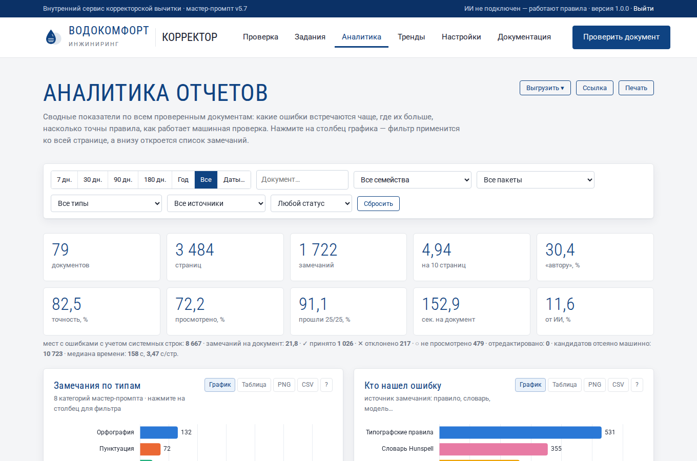

## 1. Откуда берутся данные

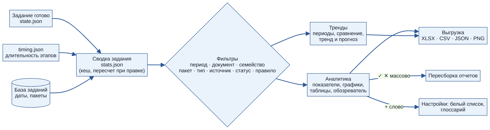

- В расчет попадают **задания в статусе «Готово»**. Задания с ошибкой показываются отдельной цифрой под показателями.
- Для каждого задания один раз составляется сводка (файл `stats.json` в папке задания). Если вы отметили замечание ✓ или ✕, исправили его или пересобрали отчет, сводка пересчитывается автоматически.
- Время обработки берется из базы заданий (начало и окончание), длительность этапов — из файла `timing.json`. Для заданий, созданных версией 1.0.0, длительность этапов неизвестна, и они в график этапов не входят.
- Задания, удаленные вручную или по сроку хранения («Хранить задания, дней»), из аналитики исчезают. Для долгой истории увеличьте срок хранения.

!!! note "Демонстрационные данные"
    Чтобы посмотреть, как выглядят графики, когда проверок много, администратор может создать демо-задания (см. [Администрирование, п. 9](administration.md#9-демонстрационные-данные)). В названии таких заданий стоит слово «демо».

## 2. Фильтры

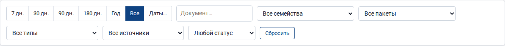

Панель фильтров закреплена вверху страницы и действует на все показатели и графики сразу.

| Фильтр | Что делает |
|---|---|
| **Период** | 7, 30, 90, 180 дней, год, все время или «Даты…» — свой интервал. Считается по дате загрузки документа |
| **Документ** | часть названия файла, например «SPL» или «Москва» |
| **Семейство** | все версии одного документа: «Каталог_v2», «Каталог_v3» и «Каталог (1)» объединяются в семейство «каталог». Показываются семейства, где больше одной версии |
| **Пакет** | документы, загруженные вместе |
| **Тип** | одна из 8 категорий мастер-промпта |
| **Источник** | кто нашел ошибку: типографские правила, коды и алфавиты, стандарты компании, проверка данных, словарь Hunspell, LanguageTool, языковая модель, сравнение пакета |
| **Статус** | ✓ принято, ✕ отклонено, ○ не просмотрено |

Нажатие на столбец графика или на ячейку тепловой карты добавляет фильтр. Активные фильтры видны «пилюлями» под панелью; ✕ на пилюле убирает фильтр, кнопка **«Сбросить»** — все фильтры сразу.

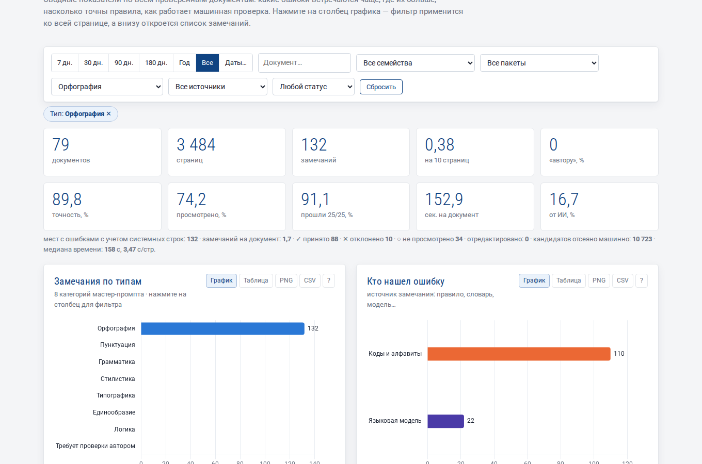

Фильтры хранятся в адресной строке. Кнопка **«Ссылка»** копирует адрес: коллега откроет ту же картину с теми же фильтрами. Ссылку можно добавить в закладки, например «Орфография за 30 дней».

## 3. Показатели

Десять плиток вверху страницы; при наведении на плитку появляется подсказка.

| Плитка | Как считается | Как читать |
|---|---|---|
| **документов** | число готовых заданий | объем работы |
| **страниц** | сумма страниц | объем работы |
| **замечаний** | строк в отчетах (системная строка — одна) | |
| **на 10 страниц** | замечаний × 10 / страниц | **главный показатель качества**: позволяет сравнивать документы разного объема. Типичные значения: 2–5 — аккуратный документ, больше 10 — нужна серьезная вычитка |
| **«автору», %** | доля «Требует проверки автором» | высокая доля — много мест, где сервис не уверен: слова вне словаря, неподтвержденные кандидаты. Пополните белый список и глоссарий |
| **точность, %** | принято / (принято + отклонено) | насколько замечания полезны. Ниже 70 % — какие-то правила ошибаются на ваших документах (см. «Точность правил») |
| **просмотрено, %** | (принято + отклонено) / все замечания | сколько замечаний корректор отметил ✓ или ✕. Точность надежна, когда просмотрено хотя бы 30–50 % |
| **прошли 25/25, %** | доля отчетов, прошедших все проверки оформления | должно быть 100 %; меньше — см. график «Машинная проверка отчетов» |
| **сек. на документ** | среднее время от начала обработки до отчета | время ожидания в очереди не входит |
| **от ИИ, %** | доля замечаний языковой модели | 0, если модель не подключена |

Строка под плитками добавляет: число мест с учетом системных строк (одна системная строка «70 раз» дает 70 мест), замечаний на документ, разбивку решений корректора, число отредактированных замечаний, число кандидатов, отсеянных машинно, медиану времени и секунд на страницу.

## 4. Графики

У каждого графика справа вверху кнопки:

- **График / Таблица** — переключить вид. Таблица показывает те же числа: удобно для точных значений и для чтения экранным диктором.
- **PNG** — скачать картинку графика (для презентации или письма).
- **CSV** — скачать данные графика (открывается в Excel).
- **?** — короткая подсказка, как читать график.

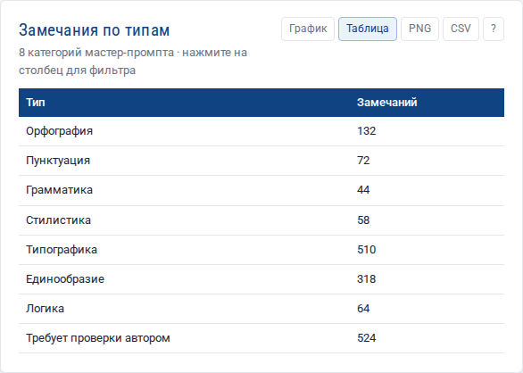

Цвета закреплены за категориями: «Орфография» всегда синяя, «Типографика» — розовая, и так далее, на всех графиках и при любых фильтрах. Цвет статуса всегда сопровождается значком и подписью (✓ принято, ✕ отклонено, ○ не просмотрено), поэтому графики читаются и при нарушениях цветового зрения, и при черно-белой печати.

### 4.1. Замечания по типам

Восемь категорий мастер-промпта. Нажмите на столбец, чтобы оставить только этот тип: вся страница и обозреватель внизу покажут, например, только «Логику».

### 4.2. Кто нашел ошибку

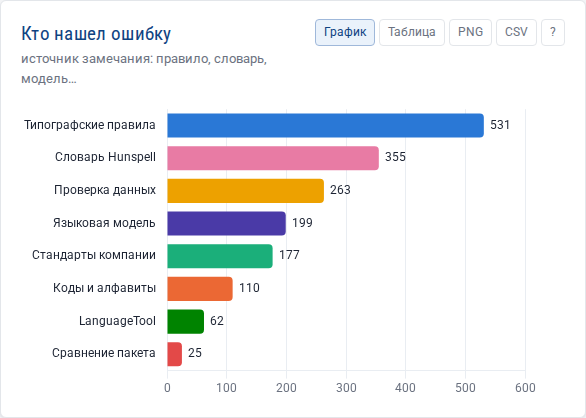

Вклад каждого механизма проверки. Помогает решить, стоит ли подключать языковую модель или LanguageTool: если без них «Языковая модель» пуста, а «Требует проверки автором» велика — модель окупится.

### 4.3. Решения корректора, единичные и системные

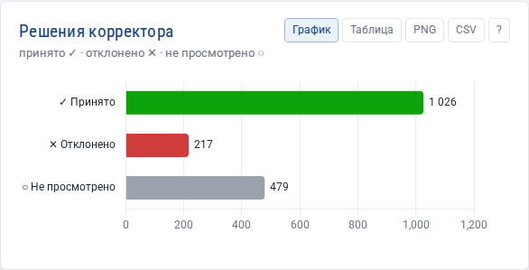

Сколько замечаний принято, отклонено и еще не просмотрено. Нажатие на столбец фильтрует по статусу: например, «○ Не просмотрено» покажет, что осталось разобрать. График «Единичные и системные» показывает, сколько строк отчета — системные (одна строка на 5 и больше одинаковых мест).

### 4.4. Топ-15 правил

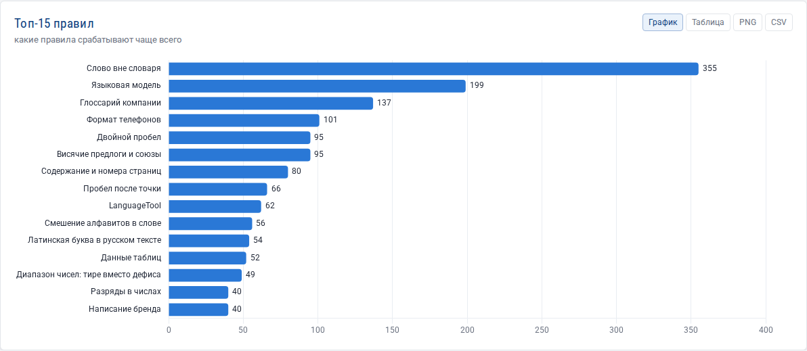

Какие проверки срабатывают чаще всего. Нажатие на столбец фильтрует по правилу. Частые правила — первые кандидаты в памятку верстальщику: «диапазоны — через короткое тире», «телефоны — без скобок».

### 4.5. Плотность ошибок по документам

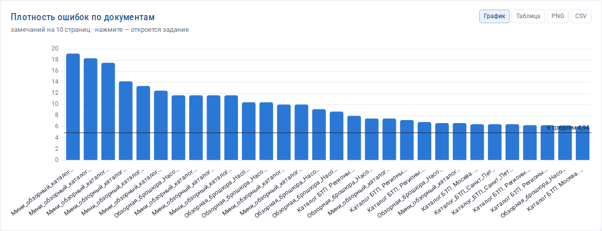

30 документов с наибольшей плотностью ошибок; черная линия — среднее значение. Нажатие на столбец открывает задание. В табличном виде — все документы с датой, числом страниц и замечаний.

### 4.6. Документ × тип ошибки

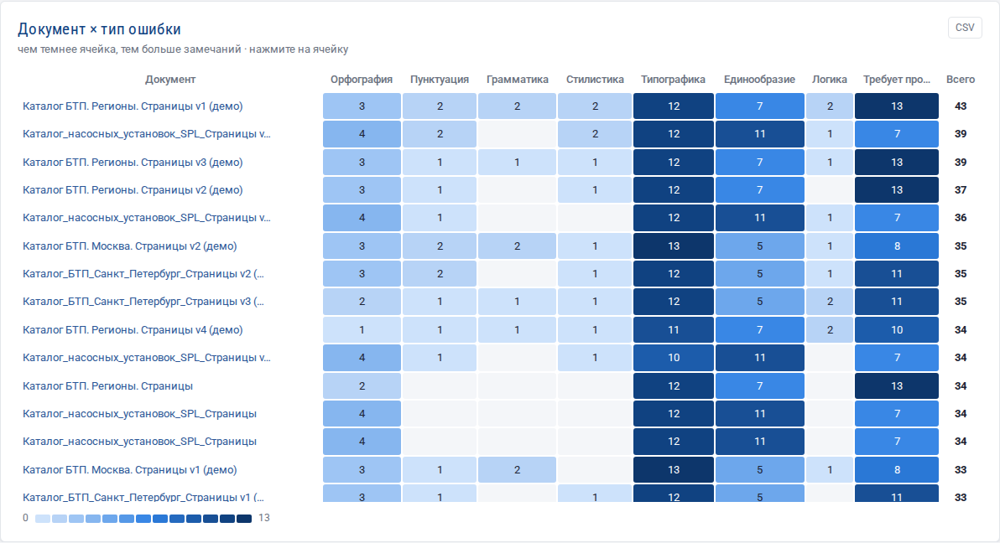

Тепловая карта: строки — документы (30 с наибольшим числом замечаний), столбцы — типы. Чем темнее ячейка, тем больше замечаний. Сразу видно, у какого документа проблемы с единообразием, а у какого — с типографикой. Нажатие на ячейку оставляет этот документ и этот тип, а обозреватель внизу показывает сами замечания.

### 4.7. Где в документе ошибки

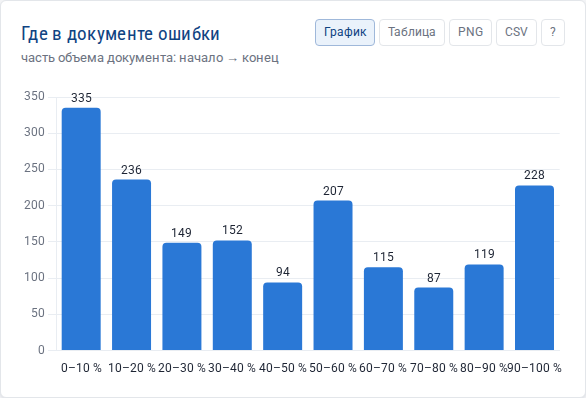

Документ делится на 10 равных частей: первые 10 % страниц, следующие 10 % и так далее. Если ошибки скопились в конце, документ, скорее всего, вычитывали с начала и не дошли до последних разделов. Если в начале — проверьте титул, содержание и вводные страницы.

### 4.8. Замечаний на документ, объем документов

Две гистограммы: сколько документов попало в диапазоны «0–4 замечания», «5–9» и т. д., и сколько документов какого объема проверяется.

### 4.9. Время обработки и этапы

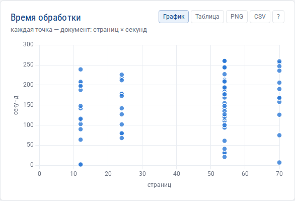

Каждая точка — документ: по горизонтали страницы, по вертикали секунды. Точки высоко над общей массой — документы, которые обрабатывались дольше обычного (крупные изображения, языковая модель). Нажатие на точку открывает задание.

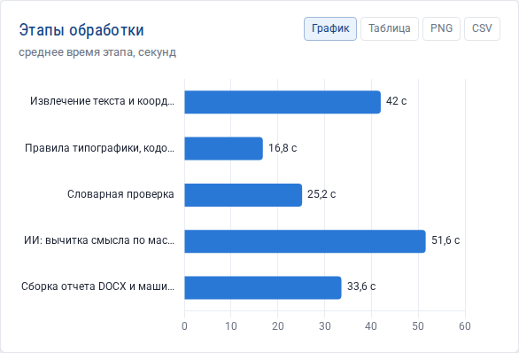

«Этапы обработки» показывают среднее время каждого этапа: извлечение текста, правила, словарь, языковая модель, сборка отчета. Если дольше всего идет «ИИ», увеличьте «Параллельных запросов» в настройках; если «Изображения страниц» — уменьшите «Разрешение изображений страниц».

### 4.10. Предпечатная и машинная проверка

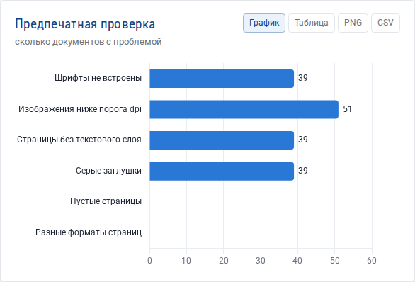

Сколько документов имеют невстроенные шрифты, изображения ниже порога dpi, страницы без текстового слоя, серые заглушки, пустые страницы, разные форматы страниц. Это проблемы макета, а не текста: передайте их верстальщику.

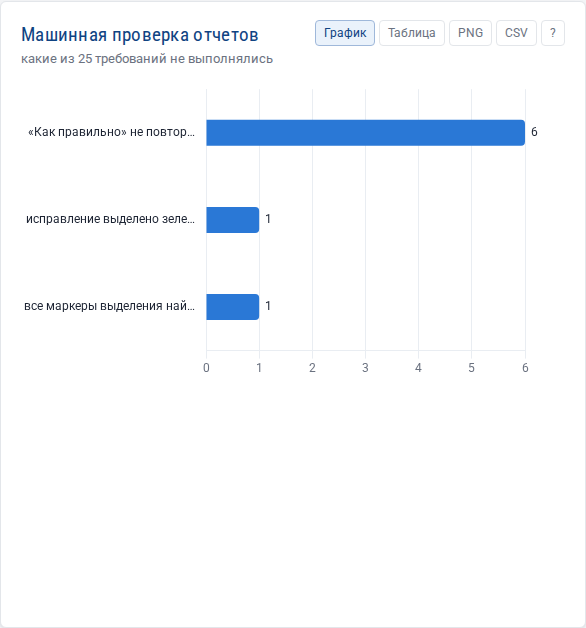

Какие из 25 требований к оформлению отчета не выполнялись. В норме график пуст и показывает «✓ Все отчеты прошли 25 из 25 проверок». Чаще всего нарушение появляется после ручной правки замечания (✎): исправленный фрагмент должен дословно входить в «Как правильно».

### 4.11. Страницы с наибольшим числом замечаний

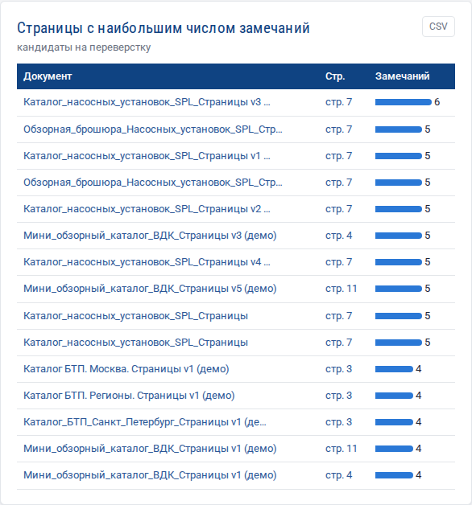

15 страниц, где замечаний больше всего. Нажатие на «стр. N» открывает изображение страницы. Это кандидаты на переверстку.

## 5. Таблицы для действий

### 5.1. Точность правил

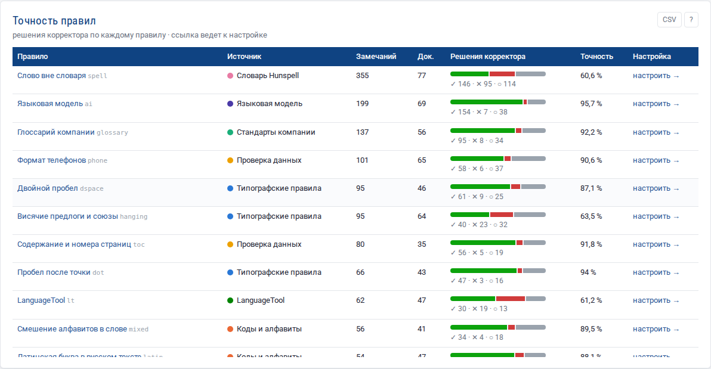

Для каждого правила: сколько замечаний, в скольких документах, решения корректора полосой (зеленый ✓, красный ✕, серый ○) и точность. Если точность ниже 50 % при 10 и более решениях, она выделяется красной пометкой ⚠: правило чаще ошибается, чем помогает. Ссылка **«настроить →»** открывает нужную настройку (она подсвечивается и раскрывается), где правило можно смягчить или отключить. Нажатие на название правила фильтрует страницу.

### 5.2. Повторяющиеся ошибки

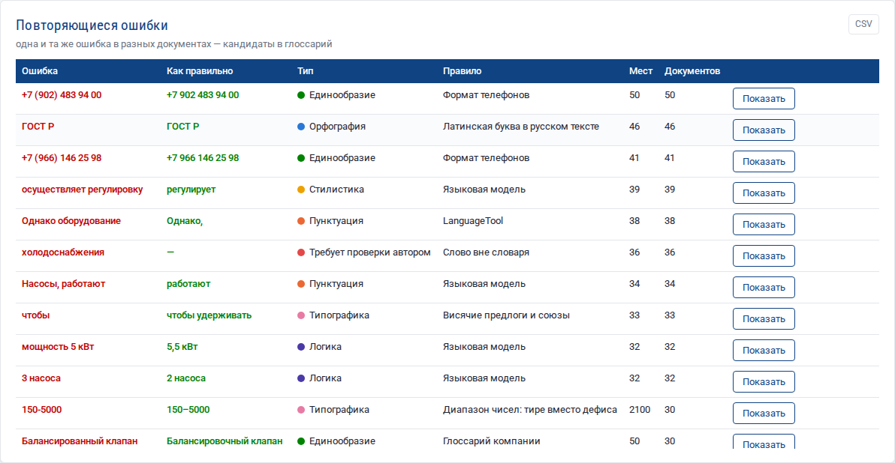

Одна и та же пара «ошибка → исправление», встретившаяся в разных документах. Это лучший материал для глоссария и памятки авторам.

- **Показать** — открыть все такие замечания в обозревателе.
- **В глоссарий** — добавить пару в глоссарий компании (Настройки → Стандарты компании). После этого неверное написание будет находиться при каждой проверке, даже без языковой модели. Кнопка появляется только для пар терминов: одинаковое число слов, без знаков препинания, не логика и не типографика.

### 5.3. Слова вне словаря

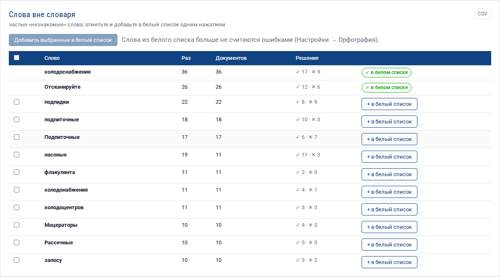

Слова, которых нет в словаре Hunspell, по убыванию числа документов. Чаще всего это термины и марки, написанные правильно. Отметьте их флажками и нажмите **«Добавить выбранные в белый список»** или **«+ в белый список»** в строке. Слова из белого списка больше не становятся замечаниями. Колонка «Решения» подсказывает: если слово корректор чаще отклонял (✕), его точно стоит добавить.

!!! warning "Проверьте слово перед добавлением"
    В списке встречаются и настоящие опечатки («насоные», «флакулянта»). Их добавлять нельзя — иначе сервис перестанет их находить.

## 6. Обозреватель замечаний

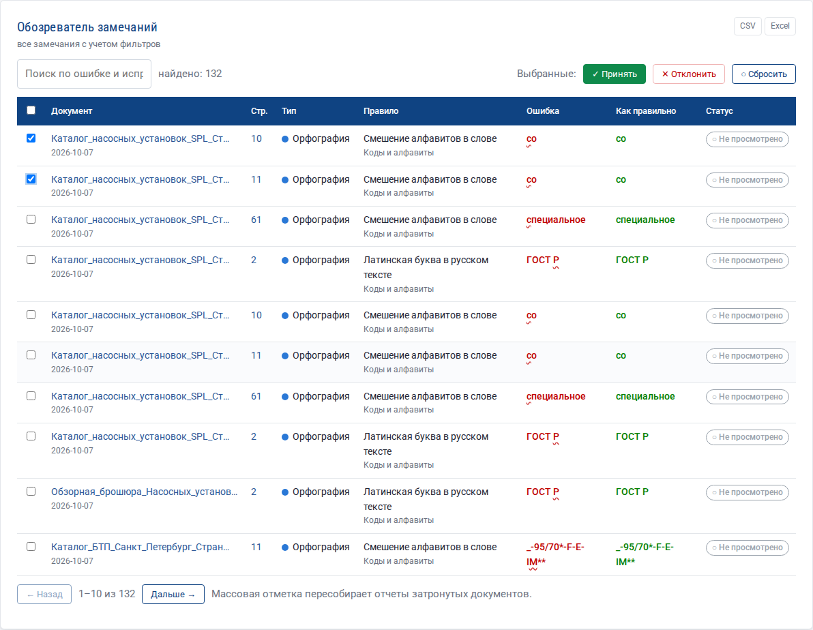

Внизу страницы — все замечания из всех документов с учетом фильтров, по 50 на странице, сначала новые документы.

- **Поиск** — по тексту ошибки и исправления.
- В замечаниях о смешении алфавитов «чужие» буквы подчеркнуты волнистой линией: латинская «c» в русском «cо» иначе не видна глазом.
- Нажатие на название документа открывает задание, на номер страницы — изображение страницы.
- **Массовая отметка:** выберите замечания флажками (флажок в шапке выбирает всю страницу) и нажмите **✓ Принять**, **✕ Отклонить** или **○ Сбросить**. Отчеты затронутых документов сразу пересобираются и проходят машинную проверку заново.
- **CSV / Excel** — выгрузить найденные замечания полностью, а не только текущую страницу.

Пример: отклонить ложные «висячие предлоги» во всех каталогах за месяц — фильтр «Период: 30 дней», нажатие на правило «Висячие предлоги и союзы» в таблице точности, проверка строк, флажок в шапке, «✕ Отклонить», «Дальше →», повторить.

## 7. Выгрузка и печать

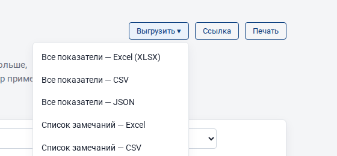

Кнопка **«Выгрузить»**:

| Пункт | Что получится |
|---|---|
| Все показатели — Excel | книга из 12 листов: показатели, типы, источники, правила с точностью, документы, документ × тип, положение, повторяющиеся ошибки, слова вне словаря, предпечатная проверка, машинная проверка, время обработки |
| Все показатели — CSV | те же таблицы одним файлом (разделитель «;», десятичная запятая — открывается в русском Excel без настройки) |
| Все показатели — JSON | все данные страницы для своих отчетов и BI-систем |
| Список замечаний — Excel / CSV | все замечания с учетом фильтров |

Выгрузка учитывает текущие фильтры. Тексты из PDF, начинающиеся с «=», «+», «−» или «@», выгружаются с апострофом, чтобы Excel не принял их за формулу.

Кнопка **«Печать»** печатает показатели и графики без панели фильтров и меню; в окне печати можно выбрать «Сохранить как PDF».

## 8. Типовые вопросы, на которые отвечает аналитика

| Вопрос | Где смотреть |
|---|---|
| Какие ошибки делают чаще всего? | «Замечания по типам», «Топ-15 правил», «Повторяющиеся ошибки» |
| Какой документ самый «грязный»? | «Плотность ошибок по документам» |
| Что добавить в глоссарий и белый список? | «Повторяющиеся ошибки», «Слова вне словаря» |
| Какое правило мешает? | «Точность правил» (⚠ и точность ниже 50 %) |
| Окупится ли языковая модель? | «Кто нашел ошибку», доля «автору» |
| Почему отчет не скачивается? | «Машинная проверка отчетов» |
| Что передать верстальщику? | «Предпечатная проверка», «Страницы с наибольшим числом замечаний» |
| Стало ли лучше? | раздел [Тренды](trends.md) |
