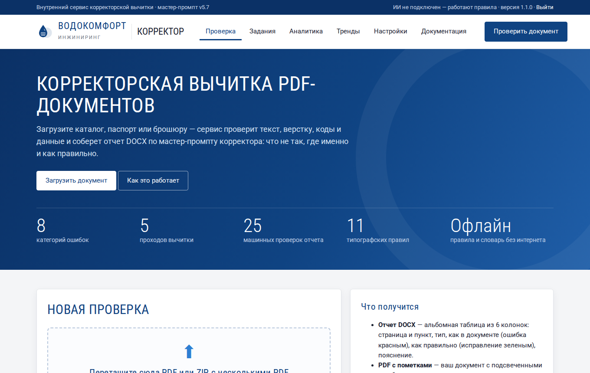
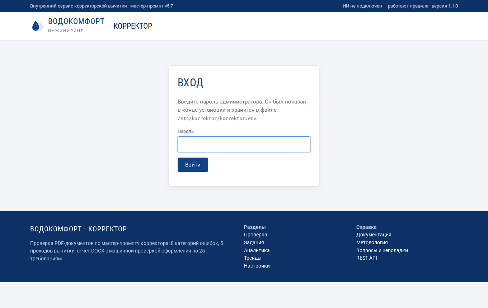
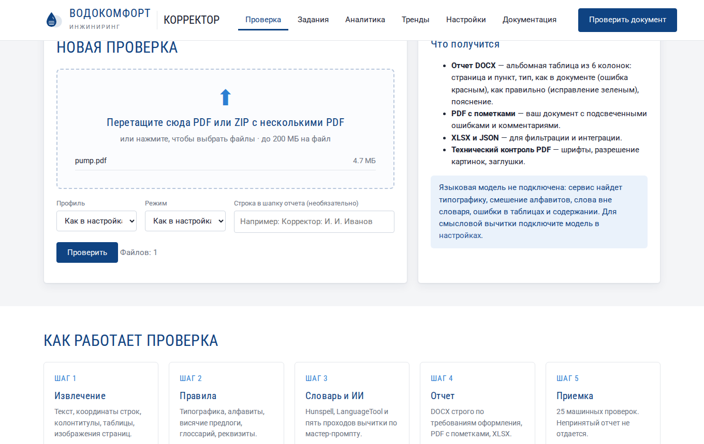
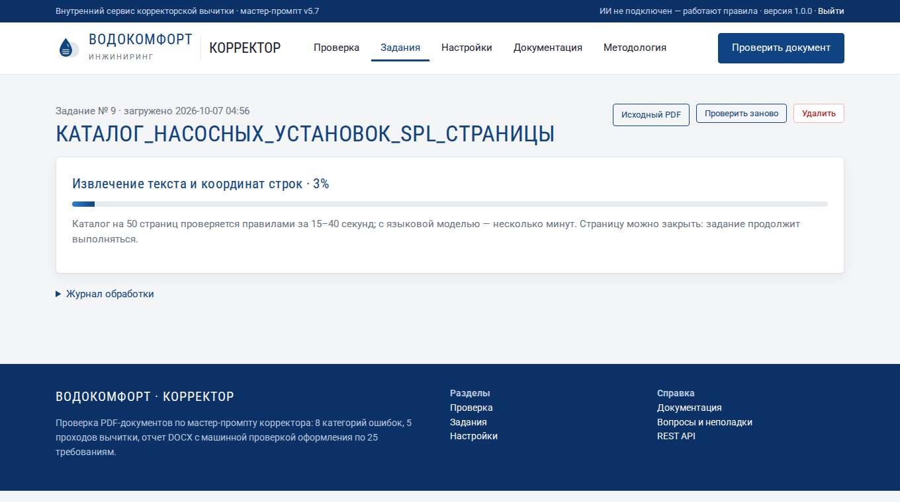
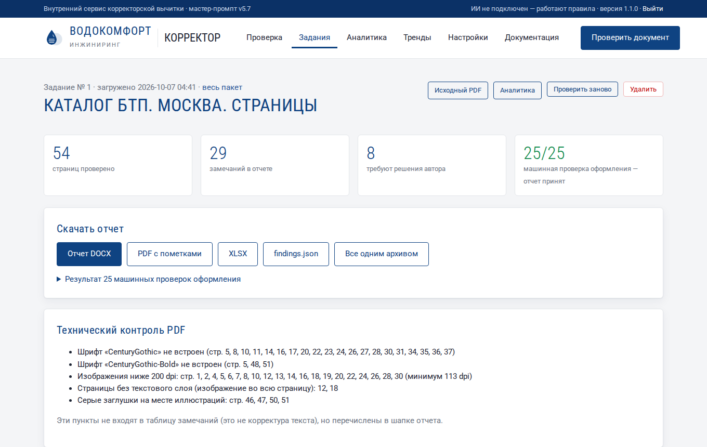
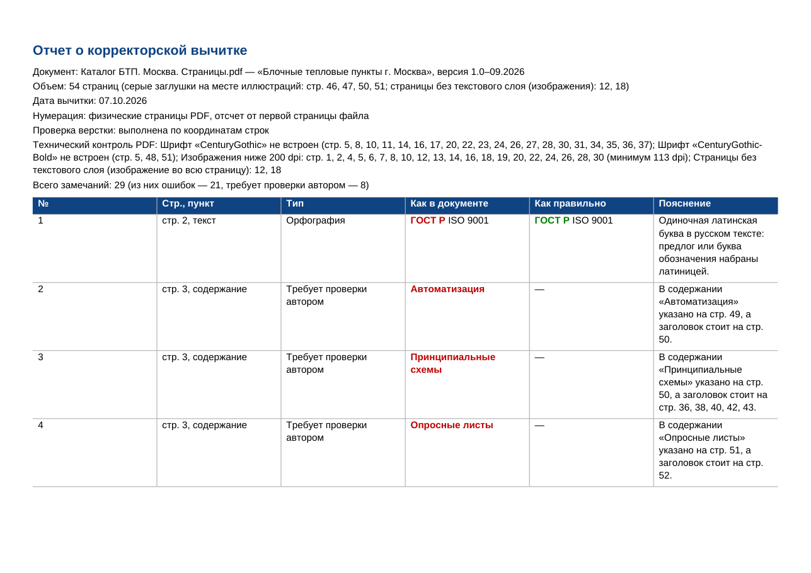
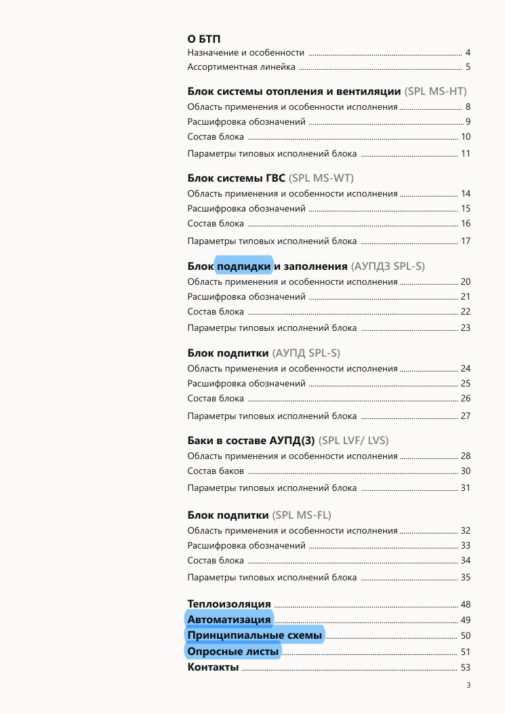
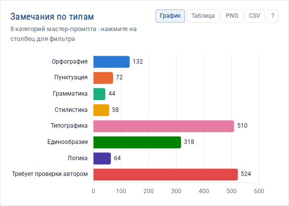

# Корректор: обзор и быстрый старт

**Корректор** — внутренний веб-сервис компании «ВОДОКОМФОРТ» для корректорской вычитки PDF-документов: каталогов, паспортов изделий, брошюр, инструкций. Вы загружаете PDF, а через несколько секунд или минут получаете отчет — таблицу замечаний «что не так, где именно и как правильно», оформленную строго по мастер-промпту корректора v5.7.

## Для кого этот сервис

- **Маркетологи и авторы каталогов** — проверить документ перед отправкой в типографию или на сайт.
- **Верстальщики** — получить список правок прямо на страницах PDF (PDF с пометками).
- **Корректоры и редакторы** — быстро пройти машинную часть вычитки и сосредоточиться на смысле.
- **Инженеры по продукту** — найти расхождения в таблицах, артикулах и характеристиках.

Специальных знаний не нужно: достаточно уметь открыть сайт в браузере и выбрать файл.

## Быстрый старт за три шага

### Шаг 1. Откройте сервис и войдите

Адрес сервиса и пароль выдает администратор (их показывает программа установки). Откройте адрес в браузере (Chrome, Firefox, Edge, Яндекс Браузер) и введите пароль.

### Шаг 2. Загрузите документ

На главной странице перетащите PDF в рамку «Новая проверка» или нажмите на рамку и выберите файл. Можно выбрать сразу несколько PDF или ZIP-архив — тогда сервис проверит их пакетом и дополнительно сравнит между собой. Нажмите **«Проверить»**.

### Шаг 3. Дождитесь результата и скачайте отчет

Откроется страница задания с ходом проверки. Каталог на 50 страниц проверяется правилами за 15–40 секунд, с языковой моделью — за несколько минут. Страницу можно закрыть: проверка продолжится, а задание останется в разделе «Задания».

Когда проверка закончится, появятся итоговые цифры и кнопки скачивания. Главный результат — **отчет DOCX**.

!!! note "Зеленая цифра 25/25"
    Справа в верхнем ряду — результат машинной проверки оформления отчета по 25 требованиям мастер-промпта. Если все требования выполнены, цифра зеленая и отчет можно скачивать. Если нет — отчет не выдается, пока нарушения не исправлены (так требует мастер-промпт, п. 0.9).

## Что внутри отчета

Отчет DOCX — альбомная страница A4 с шапкой и таблицей из шести колонок:

| Колонка | Что в ней |
|---|---|
| № | сквозной номер замечания |
| Стр., пункт | физическая страница PDF (первая страница файла — стр. 1) и место на странице |
| Тип | одна из 8 категорий: Орфография, Пунктуация, Грамматика, Стилистика, Типографика, Единообразие, Логика, Требует проверки автором |
| Как в документе | дословная цитата, ошибка выделена **красным** |
| Как правильно | готовый текст для вставки, исправление выделено **зеленым** |
| Пояснение | правило или суть расхождения |

Кроме DOCX сервис готовит:

- **PDF с пометками** — ваш документ, где каждая ошибка подсвечена, а при щелчке на подсветку открывается комментарий с правильным вариантом. Желтая подсветка — ошибка, голубая — вопрос автору.
- **XLSX** — таблица замечаний для фильтрации и распределения правок между сотрудниками.
- **JSON** — машиночитаемые данные для интеграции.

## Аналитика и тренды

Каждый проверенный документ попадает в общую статистику. Раздел **«Аналитика»** показывает, какие ошибки встречаются чаще, в каких документах их больше, насколько точны правила; там же можно одним нажатием пополнить белый список и глоссарий и массово отметить замечания. Раздел **«Тренды»** сравнивает текущий период с предыдущим и показывает, становятся ли документы чище от версии к версии.

## Что сервис находит, а что нет

| Сервис находит сам (без интернета) | Нужна языковая модель | Не проверяется |
|---|---|---|
| Дефисы вместо тире, лишние пробелы, неверные знаки градуса, дюйма, умножения | Смысловые и грамматические ошибки в предложениях | Достоверность технических данных по внешним стандартам (п. 0.1: интернет запрещен) |
| Латинские буквы в русских словах и наоборот («cо», «ГОСТ P», «IМ») | Неверные термины, противоречия между разделами | Качество фотографий и дизайн |
| Висячие предлоги в конце строки | Разные названия одного объекта | Цвета печати (CMYK) |
| Слова вне словаря (опечатки) | Ошибки в ссылках «см. п. N» по смыслу | |
| Разрывы и повторы диапазонов в таблицах, ошибки в содержании | Перекрестная логика таблиц | |
| Термины из глоссария компании, эталонные реквизиты | | |
| Технический контроль PDF: шрифты, разрешение картинок, заглушки | | |

Подробно — в разделе [Методология вычитки](methodology.md).

## Словарь терминов

| Термин | Значение |
|---|---|
| **Задание** | одна проверка одного PDF-файла |
| **Пакет** | несколько документов, загруженных вместе; сервис дополнительно сравнивает их между собой |
| **Замечание** | одна строка отчета: одно место в документе и его исправление |
| **Системная ошибка** | одинаковая ошибка в 5 и более местах; выносится одной строкой с перечнем страниц |
| **Требует проверки автором** | сервис видит подозрительное место, но правильный вариант должен решить автор |
| **Мастер-промпт** | методика вычитки (файл MASTER-PROMPT_CORRECTOR_v5.7.md): правила, категории, требования к отчету |
| **Висячий предлог** | предлог или союз в конце строки, оторванный от следующего слова |
| **Неразрывный пробел** | пробел, который не дает разорвать слова между строками (Ctrl+Shift+Пробел в Word) |
| **Языковая модель (ИИ)** | нейросеть, которая читает текст по мастер-промпту и находит смысловые ошибки |
| **Профиль** | готовый набор настроек: Стандартный, Строгий, Мягкий, Только типографика |

## Куда дальше

- [Методология вычитки](methodology.md) — как именно проверяется документ.
- [Работа с сервисом](usage.md) — подробно о каждой странице и кнопке.
- [Аналитика отчетов](analytics.md) — показатели и графики по всем проверенным документам.
- [Тренды](trends.md) — как меняется качество документов во времени, сравнение периодов и прогноз.
- [Справочник настроек](settings.md) — все параметры с рекомендациями и примерами.
- [Установка, обновление, удаление](installation.md) — для администратора.
- [Вопросы и неполадки](faq.md) — если что-то пошло не так.
