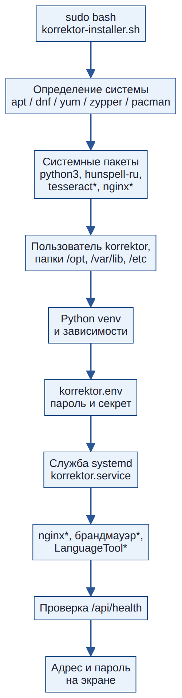
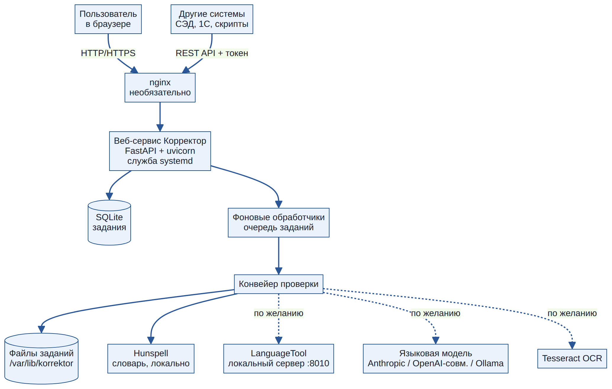
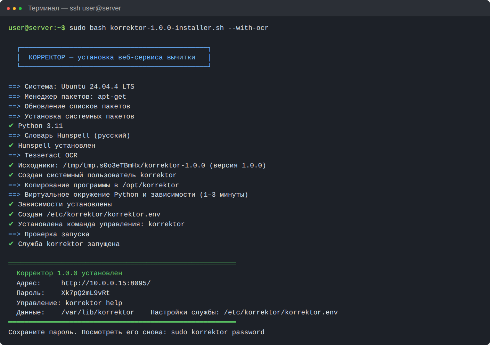
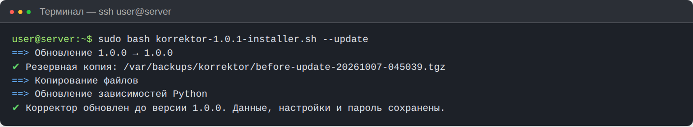
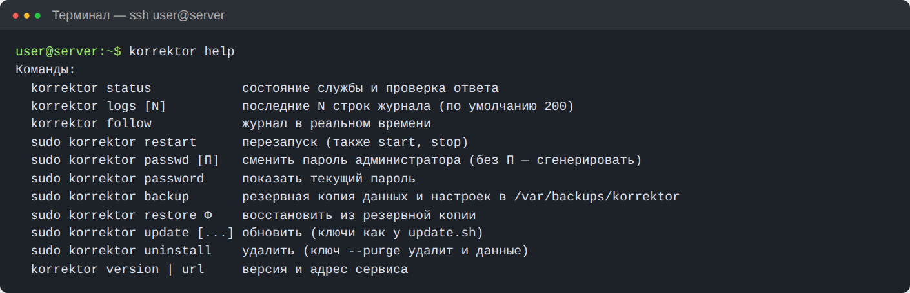

# Установка, обновление, удаление

Раздел для администратора. Написан так, чтобы установку мог выполнить и человек, который раньше не работал с Linux: каждое действие — отдельная команда, которую нужно скопировать и вставить.



## 1. Что понадобится

### Сервер

| Параметр | Минимум | Рекомендуется |
|---|---|---|
| Процессор | 2 ядра | 4 ядра |
| Память | 2 ГБ | 4 ГБ (8 ГБ с LanguageTool) |
| Диск | 5 ГБ | 20 ГБ и больше: каждое задание с изображениями страниц занимает 5–40 МБ |
| Система | любой современный Linux с Python 3.9+ | Ubuntu 22.04/24.04 LTS, Debian 12, Astra Linux, РЕД ОС, Rocky Linux 9 |
| Сеть | доступ к репозиториям пакетов и PyPI на время установки | постоянный доступ не нужен: сервис работает без интернета |

Подойдет виртуальная машина, физический сервер или облачный сервер. Docker не нужен.

### Доступ

- Учетная запись на сервере с правом `sudo` (администратор).
- Программа для подключения по SSH: в Windows 10/11 — встроенная «Командная строка» или PowerShell (команда `ssh`), PuTTY или MobaXterm; в macOS и Linux — «Терминал».
- Программа для копирования файлов на сервер: WinSCP (Windows), Cyberduck (macOS) или команда `scp`.



## 2. Установка одной командой

### Шаг 1. Скопируйте установщик на сервер

Установщик — один файл `korrektor-1.4.0-installer.sh` (в нем упакована вся программа). Скопируйте его в домашнюю папку на сервере.

**Windows (PowerShell):**

```powershell
scp .\korrektor-1.4.0-installer.sh user@10.0.0.15:~/
```

**macOS / Linux:**

```bash
scp korrektor-1.4.0-installer.sh user@10.0.0.15:~/
```

Здесь `user` — ваше имя на сервере, `10.0.0.15` — адрес сервера. В WinSCP просто перетащите файл в окно сервера.

### Шаг 2. Подключитесь к серверу

```bash
ssh user@10.0.0.15
```

### Шаг 3. Запустите установку

```bash
sudo bash korrektor-1.4.0-installer.sh
```

Программа сама определит систему, поставит нужные пакеты, создаст службу и запустит ее. Через 2–5 минут на экране появятся адрес и пароль:



!!! warning "Сохраните пароль"
    Пароль показывается один раз. Если забыли — `sudo korrektor password` покажет его снова.

### Шаг 4. Откройте сервис

Откройте в браузере адрес из сообщения (например, `http://10.0.0.15:8080/`) и войдите с паролем. Если страница не открывается — см. раздел [«Брандмауэр»](#7-брандмауэр) и [Вопросы и неполадки](faq.md).

### Установка из распакованной папки

Если у вас архив `korrektor-1.4.0.tar.gz` или папка с исходниками:

```bash
tar xzf korrektor-1.4.0.tar.gz
cd korrektor-1.4.0
sudo bash scripts/install.sh
```

## 3. Ключи установки

Ключи пишутся после имени файла, например: `sudo bash korrektor-1.4.0-installer.sh --port 9000 --with-nginx`.

| Ключ | Что делает | Пример |
|---|---|---|
| `--port N` | порт веб-сервиса (по умолчанию 8080) | `--port 9000` |
| `--listen ADDR` | адрес прослушивания: `0.0.0.0` — все сетевые интерфейсы, `127.0.0.1` — только сам сервер | `--listen 127.0.0.1` |
| `--password П` | задать пароль администратора вместо случайного | `--password 'Сложный-Пароль-2026'` |
| `--with-nginx` | поставить nginx на порт 80 перед сервисом (адрес без номера порта) | `--with-nginx` |
| `--domain ИМЯ` | имя сайта для nginx | `--domain korrektor.vodokomfort.local` |
| `--with-ocr` | поставить Tesseract для распознавания сканов | `--with-ocr` |
| `--with-languagetool` | поставить локальный сервер грамматики LanguageTool (≈250 МБ, Java) | `--with-languagetool` |
| `--with-office` | поставить LibreOffice Writer: прием документов DOC, DOCX, ODT, RTF (≈300 МБ) | `--with-office` |
| `--full` | все дополнения сразу: OCR, LanguageTool, LibreOffice | `--full` |
| `--open-firewall` | открыть порт в firewalld или ufw | `--open-firewall` |
| `--source ИСТОЧНИК` | взять программу из архива, git-репозитория или папки | `--source https://git.local/korrektor.git` |
| `--yes` | не задавать вопросов | `--yes` |

**Рекомендуемая установка для офисной сети:**

```bash
sudo bash korrektor-1.4.0-installer.sh --with-nginx --domain korrektor.local --with-ocr --with-office --open-firewall
```

## 4. Что и куда устанавливается

| Путь | Содержимое |
|---|---|
| `/opt/korrektor` | программа: `app/` (сервис), `docs/` (документация), `scripts/` (установка, обновление, удаление), `venv/` (Python-окружение) |
| `/var/lib/korrektor` | данные: `jobs/` (задания и отчеты), `batches/` (сводки пакетов), `settings.json` (настройки), `korrektor.db` (список заданий) |
| `/etc/korrektor/korrektor.env` | пароль администратора, секрет, порт, адрес, уровень журнала |
| `/etc/systemd/system/korrektor.service` | служба, запускается автоматически при включении сервера |
| `/usr/local/bin/korrektor` | команда управления |
| `/var/log/korrektor-install.log` | журнал установки |
| `/var/backups/korrektor` | резервные копии (создаются при обновлении, удалении и по команде) |

Служба работает от отдельного системного пользователя `korrektor` без права входа и без доступа к домашним папкам.

## 5. Подключение языковой модели

Без модели сервис проверяет правилами и словарем. Для полной вычитки по мастер-промпту:

1. Откройте **Настройки → Искусственный интеллект**.
2. Выберите провайдера и заполните поля:

| Провайдер | Адрес API | Модель (пример) | Ключ |
|---|---|---|---|
| Anthropic (Claude) | пусто | `claude-sonnet-4-5` | ключ из консоли Anthropic |
| OpenAI-совместимый | `https://api.openai.com/v1` или адрес вашего шлюза | `gpt-4.1` | ключ сервиса |
| Ollama (локально) | `http://127.0.0.1:11434` | `qwen2.5:32b` | не нужен |

3. Нажмите **«Сохранить настройки»**, затем **«Проверить связь с моделью»**.


!!! warning "Конфиденциальность"
    При облачном провайдере текст документа передается во внешний сервис. Если документы нельзя передавать наружу, используйте Ollama на собственном сервере.

**Ollama на том же сервере** (нужна видеокарта с 24+ ГБ памяти для моделей 30B; на процессоре работает медленно):

```bash
curl -fsSL https://ollama.com/install.sh | sh
ollama pull qwen2.5:32b
```

## 6. Nginx и HTTPS

С ключом `--with-nginx` сервис открывается по адресу без номера порта (`http://korrektor.local/`). Для HTTPS с бесплатным сертификатом Let's Encrypt (сервер должен быть доступен из интернета по имени):

```bash
sudo apt install -y certbot python3-certbot-nginx     # Debian/Ubuntu
sudo certbot --nginx -d korrektor.example.ru
```

Для внутренней сети используйте сертификат вашего удостоверяющего центра: пропишите пути `ssl_certificate` и `ssl_certificate_key` в `/etc/nginx/sites-available/korrektor` (или `/etc/nginx/conf.d/korrektor.conf`) и выполните `sudo systemctl reload nginx`.

## 7. Брандмауэр

Если сервис работает, а браузер не открывает страницу, скорее всего закрыт порт.

```bash
# Ubuntu / Debian (ufw)
sudo ufw allow 8080/tcp
# RHEL / Rocky / РЕД ОС (firewalld)
sudo firewall-cmd --permanent --add-port=8080/tcp && sudo firewall-cmd --reload
```

С nginx открывайте порт 80 (и 443 для HTTPS). Ключ `--open-firewall` делает это автоматически.

## 8. Установка без интернета

1. На компьютере с интернетом и той же версией Linux скачайте зависимости:

```bash
mkdir wheels && pip download -d wheels -r requirements.txt
```

2. Скопируйте папку `wheels` и установщик на сервер.
3. Установите системные пакеты из локального зеркала (python3, python3-venv, hunspell, hunspell-ru), затем:

```bash
export PIP_NO_INDEX=1 PIP_FIND_LINKS=$HOME/wheels
sudo -E bash korrektor-1.4.0-installer.sh
```

## 9. Обновление

Обновление сохраняет задания, настройки, пароль и загруженный мастер-промпт. Порядок действий:

1. Резервная копия данных, настроек и программы в `/var/backups/korrektor/before-update-*.tgz` (хранятся 5 последних; изображения страниц и venv в копию не входят). Если копию создать не удалось (например, нет места), обновление останавливается до каких-либо изменений.
2. Установка новых зависимостей Python — **пока работает старая версия**. Если PyPI недоступен, обновление останавливается, служба продолжает работать.
3. Остановка службы, замена файлов программы, запуск.
4. Проверка ответа `/api/health` в течение 30 секунд.

При ошибке на шагах 3–4 программа сама возвращает предыдущую версию и запускает службу.

При обновлении с версий 1.0–1.1 база заданий дополняется полями «начало обработки», «загрузил», «автор», «отдел», создаются таблицы пользователей и журнала. Старые задания остаются и попадают в аналитику (без автора и разбивки времени по этапам). Вход после обновления: логин `admin` и прежний пароль; учетные записи сотрудников заведите на странице «Пользователи» или включите вход через LDAP (см. [Пользователи, роли и журнал](users.md)). Для приема документов Word доустановите LibreOffice: `sudo apt install libreoffice-writer-nogui` (или повторно запустите установщик с ключом `--with-office`).

При обновлении до 1.4 в таблицу пользователей добавляются поля второго фактора; настройки, пароли и открытые сеансы сохраняются. Новые возможности (стандарт оформления, справочник продукции, двухфакторный вход, разделение по отделам, напоминания, отчет для руководства) выключены или не заданы, пока их не настроить; только профиль оформления документа собирается сразу. Шрифт для PDF-отчета входит в программу — дополнительных пакетов не нужно.

```bash
sudo bash korrektor-1.4.0-installer.sh --update
```

Или из архива, папки, git:

```bash
sudo korrektor update --source korrektor-1.4.0.tar.gz
sudo korrektor update --source https://git.local/korrektor.git
```



Повторный запуск установщика (не `--update`) безопасен: адрес и порт меняются, только если явно указаны `--listen` и `--port`; пароль и ключ сеансов сохраняются. Запускать установщик из самой папки `/opt/korrektor` нельзя — он откажется и подскажет, что делать.

## 10. Запуск в Docker

Если на сервере принят Docker, вместо установщика можно собрать образ из распакованного архива:

```bash
tar xzf korrektor-1.4.0.tar.gz && cd korrektor-1.4.0
echo 'KORREKTOR_ADMIN_PASSWORD=Сложный-Пароль-2026' > .env     # без пароля запуск отменяется
docker compose up -d --build
# адрес: http://сервер:8080, логин admin
```

| Что | Где |
|---|---|
| Данные (задания, настройки, база, ключ сеансов, свой мастер-промпт) | том `korrektor-data` → `/data` в контейнере |
| Обратный прокси на другом контейнере | добавьте его адрес в `KORREKTOR_TRUSTED_PROXIES`, иначе в журнале будет адрес прокси, а блокировка перебора паролей будет общей |
| Документы Word | LibreOffice включен в образ (аргумент сборки `WITH_OFFICE=1`) |
| Распознавание сканов | аргумент сборки `WITH_OCR=1` |
| LanguageTool | раскомментируйте сервис `languagetool` в `docker-compose.yml`, в настройках укажите `http://languagetool:8010` |
| Проверка состояния | встроенный HEALTHCHECK по `/api/health` |
| Обновление | распакуйте новую версию, `docker compose up -d --build` — том с данными сохраняется |

Перед контейнером поставьте обратный прокси с HTTPS (nginx, Traefik, Caddy).

## 11. Удаление

```bash
sudo korrektor uninstall            # удалить программу, задания и настройки сохранить
sudo korrektor uninstall --purge    # удалить все (перед этим делается резервная копия)
```

Системные пакеты (python3, hunspell, nginx) не удаляются — ими могут пользоваться другие программы. LanguageTool удаляется, только если его устанавливал Корректор (ключ `--with-languagetool`).

## 12. Резервное копирование и перенос

```bash
sudo korrektor backup                                   # копия в /var/backups/korrektor/
sudo korrektor verify /var/backups/korrektor/korrektor-auto-20261007-120000.tgz
sudo korrektor restore /var/backups/korrektor/korrektor-auto-20261007-120000.tgz
```

Копии по расписанию, проверку целостности и восстановление одной кнопкой удобнее делать в интерфейсе — см. [Администрирование, п. 9](administration.md#9-резервное-копирование-и-восстановление).

**Перенос на другой сервер:** сделайте копию, установите Корректор на новом сервере, войдите администратором, загрузите архив в Настройки → «Система и безопасность» → «Загрузить копию с компьютера» и нажмите «Восстановить…» (или скопируйте файл и выполните `sudo korrektor restore файл --with-env`).

## 13. Команда управления



| Команда | Действие |
|---|---|
| `korrektor status` | состояние службы и ответ сервиса |
| `korrektor logs 300` | последние 300 строк журнала |
| `korrektor follow` | журнал в реальном времени (выход — Ctrl+C) |
| `sudo korrektor restart` | перезапуск (также `start`, `stop`) |
| `sudo korrektor passwd` | новый случайный пароль; `sudo korrektor passwd МойПароль` — заданный (без пробелов и кавычек). Все открытые сеансы завершаются |
| `sudo korrektor password` | показать текущий пароль |
| `sudo korrektor backup` / `verify Ф` / `restore Ф` | резервная копия, проверка целостности, восстановление (`--with-env` — и файл настроек службы) |
| `sudo korrektor 2fa-off ЛОГИН` | отключить двухфакторный вход сотрудника (потерян телефон) |
| `sudo korrektor update …` | обновление |
| `sudo korrektor uninstall [--purge]` | удаление |
| `korrektor version` / `korrektor url` | версия и адрес |

## 14. Проверка после установки

```bash
korrektor status                          # active (running) и {"status":"ok"}
curl -s http://127.0.0.1:8080/api/health  # {"status":"ok","version":"1.4.0"}
```

Затем загрузите любой PDF через браузер: через минуту должен появиться отчет с результатом 25/25.
