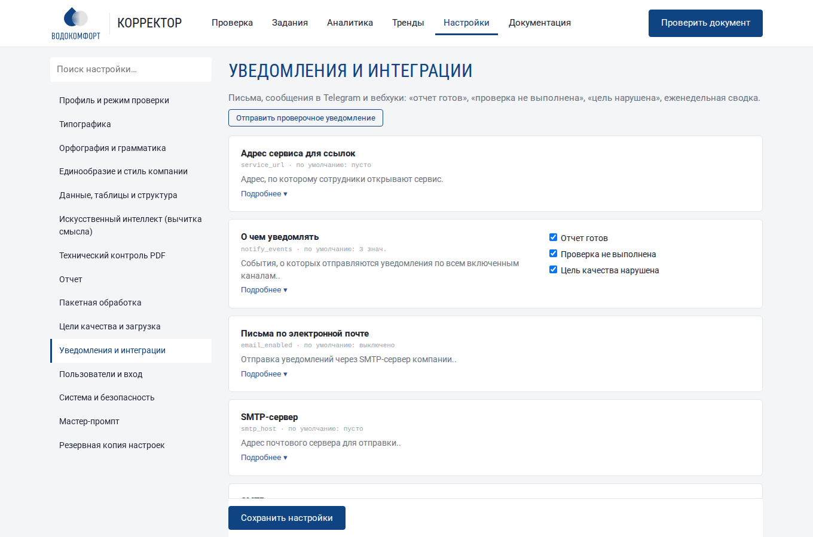
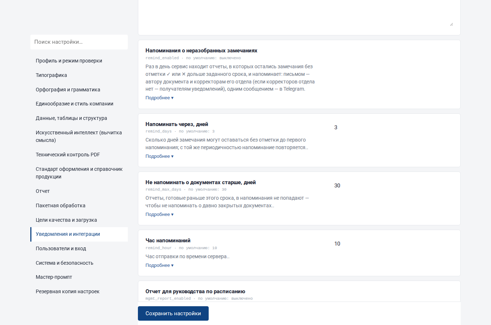
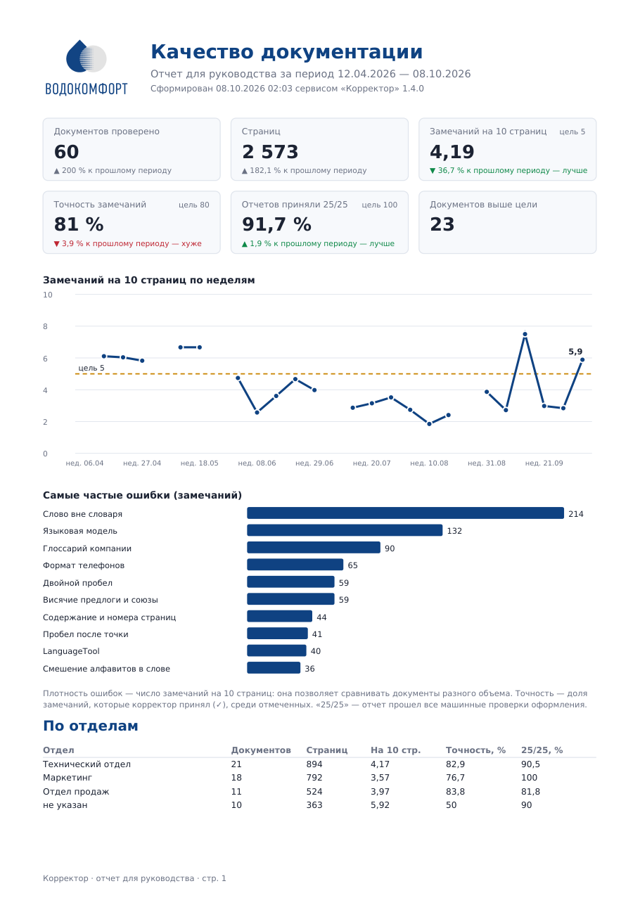
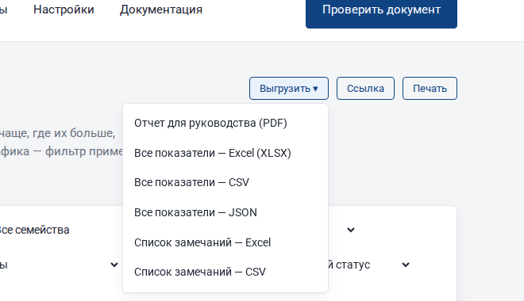
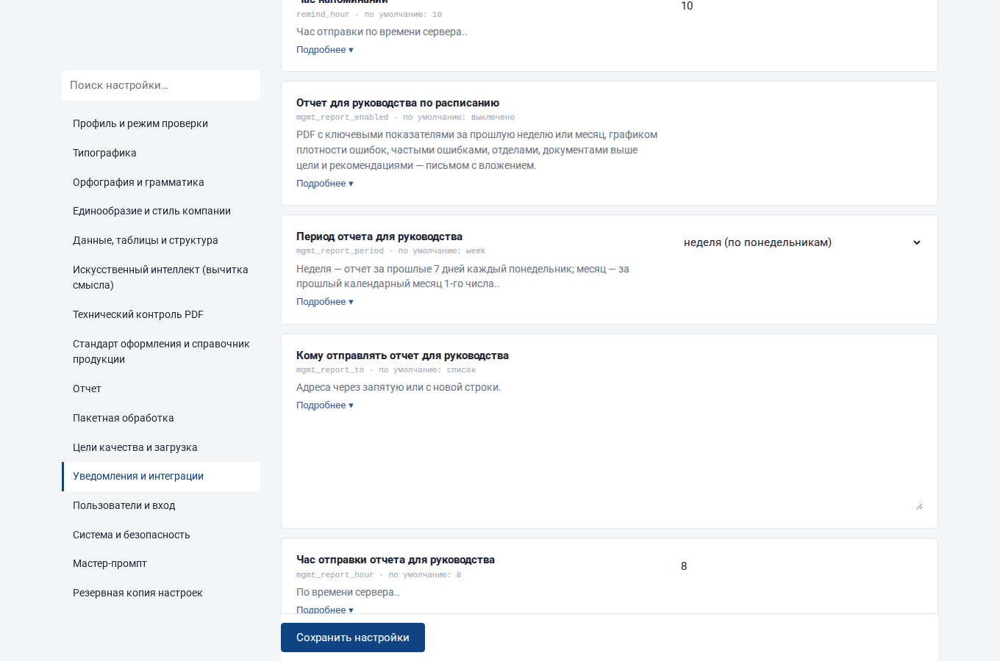

# Уведомления и интеграции

Корректор сам сообщает о готовых отчетах, ошибках и нарушенных целях качества — письмом, в Telegram или вебхуком в вашу систему; раз в неделю присылает сводку. Состояние сервиса снимается системой мониторинга (Prometheus). Все настраивается в разделе **Настройки → «Уведомления и интеграции»**.



## 1. События

| Событие | Когда | Кому |
|---|---|---|
| **Отчет готов** | проверка закончилась | получателям из настройки + автору документа (если у его учетной записи указана почта) |
| **Проверка не выполнена** | задание завершилось с ошибкой | получателям + автору |
| **Цель качества нарушена** | плотность ошибок документа выше цели (см. [Цели качества](analytics.md#9-цели-качества)) | получателям |
| **Еженедельная сводка** | раз в неделю в заданный день и час | получателям |

Какие события отправлять, выбирается флажками «О чем уведомлять». После настройки нажмите **«Отправить проверочное уведомление»** — придет тестовое сообщение по всем включенным каналам, а рядом с кнопкой появится результат по каждому каналу.

Чтобы ссылки в письмах открывали задания, заполните **«Адрес сервиса для ссылок»** — адрес, который сотрудники набирают в браузере.

## 2. Электронная почта

| Почтовый сервер | SMTP-сервер | Порт | Шифрование |
|---|---|---|---|
| Exchange / Microsoft 365 | адрес сервера / `smtp.office365.com` | 587 | STARTTLS |
| Яндекс 360 | `smtp.yandex.ru` | 465 | SSL/TLS |
| Mail.ru для бизнеса | `smtp.mail.ru` | 465 | SSL/TLS |
| Google Workspace | `smtp.gmail.com` | 587 | STARTTLS |
| Внутренний релей без авторизации | адрес релея | 25 | без шифрования |

Для отправки заведите отдельный ящик, например `korrektor@компания`. Если почта требует «пароль приложения» (Яндекс, Google), используйте его вместо обычного пароля. Пароль хранится в настройках с правами доступа 600 и в интерфейсе не показывается.

Письмо «отчет готов» содержит название документа, число страниц и замечаний, плотность ошибок, результат 25 проверок, предупреждение о нарушенной цели и кнопку «Открыть отчет».

## 3. Telegram

1. В Telegram откройте **@BotFather**, команда `/newbot`, задайте имя — получите токен вида `123456789:AA…`.
2. Добавьте бота в группу корректоров (или напишите ему лично).
3. Узнайте номер чата: например, перешлите сообщение из группы боту **@userinfobot**; номер группы начинается с минуса.
4. В настройках включите «Сообщения в Telegram», вставьте токен и номер чата, сохраните и отправьте проверочное уведомление.

Серверу нужен доступ к `api.telegram.org` (HTTPS).

## 4. Вебхук — для СЭД, 1С, Битрикс24, n8n

При каждом событии Корректор отправляет POST-запрос с JSON на указанный адрес:

```json
{
  "event": "done", "job": 128, "name": "Каталог_SPL_v3", "file": "Каталог_SPL_v3.pdf",
  "status": "done", "pages": 70, "findings": 31, "density": 4.43,
  "verify": "25/25", "verify_ok": true, "error": "",
  "author": "Смирнова Е.", "department": "Маркетинг", "owner": "smirnova",
  "url": "https://korrektor.local/job/128",
  "goal_density": 5.0, "goal_exceeded": false,
  "reports": {"docx": "https://korrektor.local/api/jobs/128/report?format=docx",
              "xlsx": "https://korrektor.local/api/jobs/128/report?format=xlsx"}
}
```

Значения `event`: `done`, `failed`, `goal`, `digest`, `remind`, `test`. Заголовок `X-Korrektor-Event` дублирует событие.

**Подпись.** Если задан «Секрет подписи», тело запроса подписывается HMAC-SHA256, подпись — в заголовке `X-Korrektor-Signature: sha256=<hex>`. Приемник должен проверить подпись:

```python
import hashlib, hmac
def valid(body: bytes, header: str, secret: str) -> bool:
    good = "sha256=" + hmac.new(secret.encode(), body, hashlib.sha256).hexdigest()
    return hmac.compare_digest(good, header or "")
```

Чтобы скачать отчет по ссылке из `reports`, приемнику нужен токен REST API (см. [REST API](api.md)).

Примеры использования: приложить отчет к карточке документа в СЭД; поставить задачу автору в Битрикс24, если `verify_ok` = false или `goal_exceeded` = true; записать показатели в свою таблицу.

## 5. Еженедельная сводка

Включите «Еженедельная сводка», выберите день и час. Сводка за 7 дней содержит: документы и страницы (к прошлой неделе), плотность ошибок и ее изменение, точность замечаний, долю отчетов 25/25, пять самых частых ошибок и документы с превышением цели. Ссылка ведет в раздел «Тренды».

## 6. Напоминания о неразобранных замечаниях

Если замечания разбирают не сразу, отчеты «зависают»: автор ждет решения, корректор забыл. Включите **«Напоминания о неразобранных замечаниях»**.



- Раз в день в заданный час сервис находит готовые отчеты, в которых остались замечания без отметки ✓ или ✕ дольше срока **«Напоминать через, дней»** (по умолчанию 3).
- **Письма**: автору документа — о его документах; корректорам отдела документа (роль «Корректор», тот же отдел, указана почта) — о документах отдела; если у отдела нет корректоров — получателям уведомлений. Каждому — одно письмо со списком документов, числом неразобранных замечаний и ссылками.
- **Telegram** — одно сводное сообщение; **вебхук** — событие `remind` со списком документов.
- По одному документу напоминание повторяется не чаще срока; о документах старше «Не напоминать о документах старше, дней» напоминаний нет.
- Кнопка **«Разослать напоминания сейчас»** — немедленная рассылка (для проверки).

## 7. Свой текст письма автору

Настройка **«Текст письма «отчет готов»»** заменяет стандартное письмо автору своим текстом. Подстановки:

| Подстановка | Значение |
|---|---|
| `{name}` | название документа |
| `{pages}`, `{findings}`, `{density}` | страниц, замечаний, замечаний на 10 страниц |
| `{verify}` | результат 25 машинных проверок, например `25/25` |
| `{author}`, `{department}`, `{doc_type}` | автор, отдел, тип документа |
| `{url}` | ссылка на отчет |

Пример: «Здравствуйте! Отчет по документу «{name}» готов: {findings} замечаний ({density} на 10 страниц). Откройте его по ссылке {url}, примите правки в файле «Правки в Word» и загрузите исправленную версию — сервис покажет, что исправлено». Получатели уведомлений по-прежнему получают стандартное письмо с показателями.

## 8. Отчет для руководства (PDF)

Двухстраничный PDF для руководителей: ключевые показатели с изменением к прошлому периоду и целями, график плотности ошибок, самые частые ошибки, таблицы по отделам и авторам, документы выше цели, предпечатная проверка и стандарты, рекомендации.



- **По кнопке**: Аналитика → «Выгрузить» → **«Отчет для руководства (PDF)»** — за выбранный на странице период и с текущими фильтрами (отдел, тип документа, автор).



- **По расписанию**: включите **«Отчет для руководства по расписанию»**, выберите период (неделя — каждый понедельник за прошлые 7 дней; месяц — 1-го числа за прошлый календарный месяц), адреса и час. Отчет приходит письмом с вложением. Кнопка **«Отправить отчет для руководства сейчас»** — проверка.



## 9. Мониторинг: метрики Prometheus

Адрес `/metrics` отдает показатели в формате Prometheus:

| Метрика | Что показывает |
|---|---|
| `korrektor_info{version}` | версия |
| `korrektor_jobs{status}` | задания по состояниям: в очереди, выполняются, готовы, с ошибкой |
| `korrektor_pages_total`, `korrektor_findings_total`, `korrektor_reports_verified_total` | всего страниц, замечаний, принятых отчетов |
| `korrektor_week_documents`, `korrektor_week_density`, `korrektor_week_verify_ratio` | за 7 дней: документы, плотность ошибок, доля 25/25 |
| `korrektor_processing_seconds_avg` | среднее время обработки (последние 200 заданий) |
| `korrektor_data_bytes` | размер папки данных |
| `korrektor_users_active` | активные пользователи |

Доступ: запросы с самого сервера (127.0.0.1) — без пароля; с других компьютеров и через nginx — с заголовком `Authorization: Bearer <токен API>`.

```yaml
# prometheus.yml
scrape_configs:
  - job_name: korrektor
    metrics_path: /metrics
    authorization: {type: Bearer, credentials: "<токен API>"}
    static_configs: [{targets: ["korrektor.local:80"]}]
```

Полезные оповещения: очередь `korrektor_jobs{status="queued"} > 5` дольше 30 минут; `korrektor_week_verify_ratio < 1`; рост `korrektor_data_bytes` до порога диска.

Простая проверка доступности без Prometheus — адрес `/api/health` (см. [Администрирование](administration.md#7-мониторинг)).
