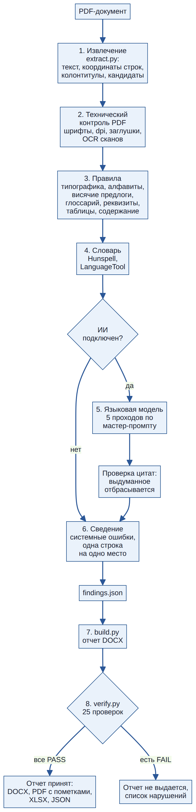
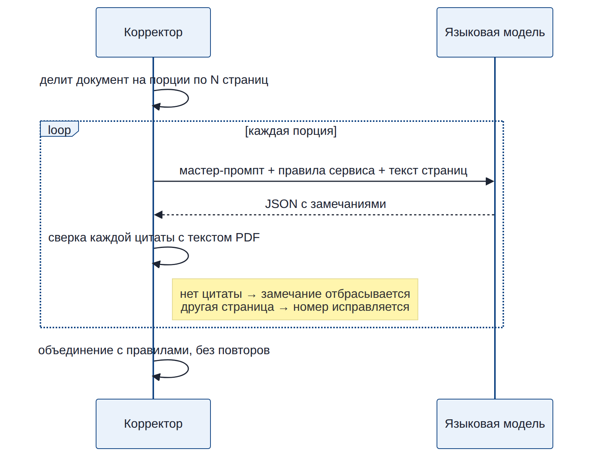
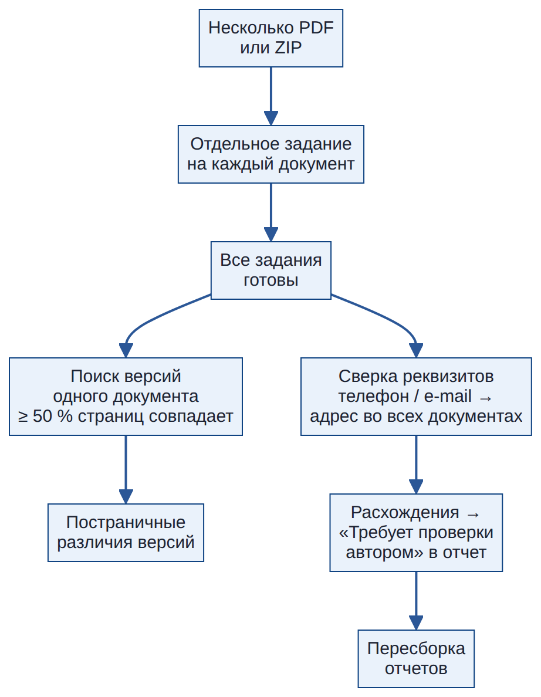
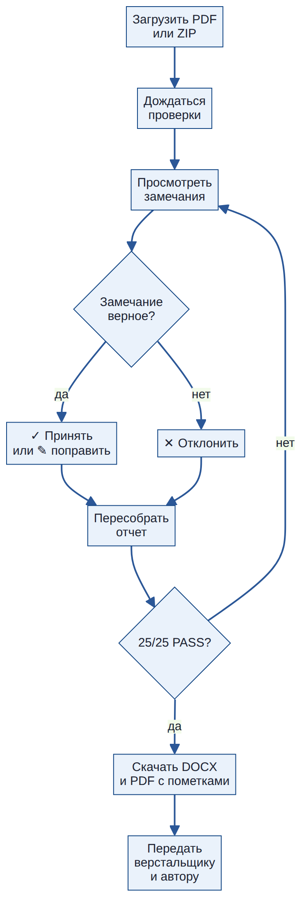

# Методология вычитки

Этот раздел объясняет, **как** сервис проверяет документ, откуда берутся правила и почему отчету можно доверять. Методика целиком основана на мастер-промпте корректора v5.7 (файл `MASTER-PROMPT_CORRECTOR_v5.7.md`, встроен в сервис) и дополнена приемами профессиональных корректорских и допечатных программ.

## 1. Принципы

1. **Корректор, а не редактор.** Исправляются ошибки, а не стиль «по вкусу» (п. 0.3 мастер-промпта). Каждая правка — минимальная.
2. **Только то, что есть в документе.** Каждое замечание дословно цитирует PDF. Цитата, которой нет на указанной странице, автоматически отбрасывается (п. 0.4, 0.13).
3. **Без интернета.** Данные не сверяются с внешними сайтами и базами стандартов: сравнивается только документ сам с собой (п. 0.1). Исключение — сверка реквизитов между документами одного пакета (п. 5.15).
4. **Сомнение — автору.** Если правильный вариант нельзя установить по документу, замечание получает тип «Требует проверки автором» с вопросом в пояснении (п. 0.15).
5. **Одна строка — одно место.** Два дефекта в одной фразе — одна строка с двумя исправлениями; одинаковая ошибка в 5+ местах — одна системная строка (п. 0.7, 5.4).
6. **Отчет собирает код и проверяет код.** Оформление DOCX задано программой `build.py`, а 25 требований проверяет `verify.py`. Непринятый отчет не выдается (п. 0.8, 0.9).

## 2. Как проходит проверка

| Этап | Что делается | Инструмент |
|---|---|---|
| 1. Извлечение | текст постранично, координаты каждой строки, колонтитулы, списки кандидатов: смешение алфавитов, числа без пробела, висячие предлоги, типографика по 11 категориям, таблицы, содержание, ссылки | `extract.py` из мастер-промпта (PyMuPDF) |
| 2. Технический контроль | встроены ли шрифты, разрешение изображений, размеры страниц, страницы без текста, серые заглушки; по желанию — распознавание сканов | PyMuPDF, Tesseract |
| 3. Правила | превращают кандидатов в готовые замечания с исправлением | модуль правил сервиса |
| 4. Словарь | слова вне словаря русского языка; по желанию — грамматика LanguageTool | Hunspell, LanguageTool |
| 5. Языковая модель | пять проходов вычитки по мастер-промпту: смысл, грамматика, термины, логика, данные | Anthropic Claude, OpenAI-совместимые модели, Ollama |
| 6. Сведение | системные ошибки, объединение одного места, проверка покрытия кандидатов | модуль правил |
| 7. Сборка | отчет DOCX строго по оформлению п. 4.0 | `build.py` из мастер-промпта |
| 8. Приемка | 25 машинных проверок оформления и полноты | `verify.py` из мастер-промпта |

## 3. Восемь категорий ошибок

| Тип | Что относится | Пример из реальных каталогов |
|---|---|---|
| Орфография | опечатки, слитно/раздельно, латиница в русском слове | «Происводитель» → «Производитель»; «cо шкафом» (латинская c) |
| Пунктуация | лишние и пропущенные запятые, тире, двоеточия | «вентиляции, и горячего водоснабжения» → «вентиляции и горячего…» |
| Грамматика | согласование, управление, падежи | «колесо насоса выполнены» → «выполнено» |
| Стилистика | повторы, канцеляризмы, двусмысленность | «снижает затраты… и снижает нагрузку» |
| Типографика | тире, пробелы, кавычки, знаки, висячие предлоги | «150-5000» → «150–5000»; «V=8л» → «V = 8 л» |
| Единообразие | один объект назван по-разному | «WRP-A ECO» и «WRP-A Eco»; «+7 (902)…» среди номеров без скобок |
| Логика | противоречия внутри документа | заголовок «Москва» над адресом петербургского офиса |
| Требует проверки автором | подозрительно, но правильный вариант решает автор | ряды таблицы 11 и 12 с одинаковым диапазоном 2500–3500 |

## 4. Пять проходов вычитки

Мастер-промпт (п. 3.5) требует пройти документ пять раз с разным фокусом. В сервисе проходы выполняются так:

| Проход | Фокус | Правила сервиса | Языковая модель |
|---|---|---|---|
| 1. Текст построчно | орфография, пунктуация, базовая типографика | 11 типографских правил, Hunspell, LanguageTool | смысловые ошибки, пунктуация |
| 2. Коды и алфавиты | артикулы, обозначения, номера | посимвольный разбор по Юникоду, одиночные латинские буквы | расшифровка кодов против артикулов |
| 3. Верстка | висячие предлоги, висячие строки, отрывы | по координатам строк | — |
| 4. Термины | один объект — одно название | глоссарий, эталон брендов | словарь «объект → варианты» по всему документу |
| 5. Данные и ссылки | таблицы, арифметика, ссылки, реквизиты | разрывы диапазонов, повтор параметров, содержание, ссылки «стр. N», эталонные реквизиты, формат телефонов | сверка одинаковых параметров между разделами |

## 5. Правила, которые работают без интернета

| Правило | Что ищет | Тип | Исправление |
|---|---|---|---|
| Дефис в диапазоне | «60-80» (кроме номеров стандартов и кодов) | Типографика | «60–80» |
| Пробел после точки | «насосами.Оборудование» | Типографика | «насосами. Оборудование» |
| Цифра слитно со словом | «EVR 1для» | Типографика | «EVR 1 для» |
| Двойной пробел | два пробела подряд | Типографика | один пробел |
| Знак градуса | ˚ или º вместо ° | Типографика | «+120 °С» |
| Прямые кавычки | "…" | Типографика | «…» |
| Дюйм | '' вместо ″ | Типографика | «G 1 ½″» |
| Знак «=» | без пробелов | Типографика | «V = 8 л» |
| Единица слитно | «220В», «70°С» | Типографика | «220 В», «70 °С» |
| Знак умножения | кириллическая «х», «x», «×» без пробелов | Типографика | «1765 × 780» |
| «м вод. ст.» | «м. вод.ст» | Типографика | «м вод. ст.» |
| Разряды | «1 200» при норме «1200» | Единообразие | «1200» |
| Десятичный разделитель | «1.5 мм» | Типографика | «1,5 мм» |
| Обозначения стандартов | «СП10», «СП-41» | Типографика | «СП 10» |
| Знак % | разнобой «50%» и «90 %» | Единообразие | по большинству |
| Висячие предлоги | предлог, союз, частица в конце строки | Типографика | неразрывный пробел |
| Смешение алфавитов | «IМ» (кириллическая М), «PE-Xа» | Орфография | все буквы одного алфавита |
| Латинская буква | «c блоками», «ГОСТ P» | Орфография | кириллица |
| Глоссарий | неправильные варианты терминов | Единообразие | эталонное написание |
| Бренды | «AQUASTRONG» / «Aquastrong» | Единообразие | эталон |
| Запрещенные слова | жаргон из списка | Стилистика | замена из списка |
| Формат телефонов | «+7 (902)…» среди «+7 495…» | Единообразие | формат большинства |
| Эталонные реквизиты | телефон рядом с чужим адресом | Требует проверки автором | — |
| Таблицы | повтор параметра; разрыв диапазонов рядов | Требует проверки автором | — |
| Содержание | номер страницы не совпадает с заголовком | Требует проверки автором | — |
| Ссылки | «см. стр. 44» на несуществующую страницу | Логика | — |
| Словарь | слово вне словаря | Требует проверки автором (по настройке — Орфография) | варианты в пояснении |

## 6. Системные ошибки

Если одна и та же ошибка встречается в N местах (по умолчанию 5, настройка «Порог системной ошибки»), отчет не раздувается десятками одинаковых строк: выносится одна строка с пометкой «системно», перечнем страниц и числом мест. Пример: «стр. 8, системно: стр. 8, 14, 20, 21, 23… (70 раз)» для дефиса в диапазонах.

Остальные вхождения записываются в служебный список «учтено системной строкой» — так машинная проверка подтверждает, что ни один кандидат не потерян.

## 7. Языковая модель и защита от выдумок

1. Документ делится на порции по N страниц (настройка «Страниц в одном запросе»).
2. Модель получает мастер-промпт целиком, правила работы в сервисе, сокращения и глоссарий компании, текст страниц.
3. Модель возвращает замечания в формате `findings.json`.
4. **Каждая цитата сверяется с текстом PDF.** Не найдена — замечание отбрасывается. Найдена на другой странице — номер исправляется (п. 0.13). Исправление совпадает с оригиналом — замечание становится вопросом автору.
5. Замечания модели объединяются с правилами без повторов: если место уже нашло правило, остается строка правила.

Температура модели по умолчанию 0: корректору творчество вредно.

**Честность о покрытии.** Если модель не проверила часть страниц (сервер недоступен, тайм-аут, исчерпан лимит времени), отчет об этом не умалчивает: в шапке появляется строка «Вычитка языковой моделью выполнена не полностью, не проверены: стр. …» с видом причины, а на странице задания — предупреждение. Так же отмечаются проверки, пропущенные из-за ошибки. Отчет никогда не выдает частичную проверку за полную.

**Сколько текста видит модель.** Мастер-промпт — около 30 тысяч токенов, и он отправляется с каждой порцией страниц. Для локальной модели (Ollama) размер контекста подбирается так, чтобы промпт, текст страниц и ответ помещались целиком; если модель прочитала почти столько токенов, сколько вмещает контекст, журнал предупреждает о вероятной обрезке промпта.

## 8. Пакет документов

Если загрузить несколько PDF сразу, сервис после проверки всех документов:

- находит **версии одного документа** (одинаковое число страниц, совпадает не менее половины страниц) и показывает постраничные различия — так региональные версии каталога вычитываются быстрее (п. 3.8);
- **сверяет реквизиты**: один телефон или e-mail должен стоять рядом с одним адресом во всех документах. Например, в шести каталогах у казанского офиса «пр-т Победы, д. 220Д», а в одном — «пр-т Ямашева, д. 33Б». Расхождение добавляется в отчет того документа, где адрес отличается (п. 5.15).

## 9. Приемка отчета: 25 машинных проверок

| № | Требование | № | Требование |
|---|---|---|---|
| 1 | ориентация альбомная | 14 | пояснение заполнено |
| 2 | формат A4 29,7 × 21,0 см | 15 | нет дублей одного места (по адресу и по цитате) |
| 3 | поля 1,2 см | 16 | ровно 6 колонок с названиями из п. 4.2 |
| 4 | шрифт Arial 10 | 17 | тип — одно из 8 названий |
| 5 | заголовки Arial 14 полужирный #0F4382 | 18 | «Как правильно» — только текст для вставки |
| 6 | заливка шапки таблицы #0F4382 | 19 | «Как правильно» не повторяет оригинал |
| 7 | текст шапки белый полужирный | 20 | маркеры выделения найдены в цитатах |
| 8 | шапка повторяется на каждой странице | 21 | итог без рекомендаций |
| 9 | только внутренние границы #B2B2B2 | 22 | цитаты лежат на указанных страницах PDF |
| 10 | число строк = число замечаний | 23 | все кандидаты и категории разобраны |
| 11 | в каждой строке страница и пункт | 24 | эталонные дефекты найдены (если задан эталон) |
| 12 | ошибка выделена красным #C00000 | 25 | в отчете нет буквы «ё» |
| 13 | исправление выделено зеленым #008000 | | |

## 10. Что взято из мирового опыта

| Источник | Прием | Как реализовано в Корректоре |
|---|---|---|
| PerfectIt (Intelligent Editing) | проверка единообразия по стиль-листу компании: термины, сокращения, регистр | глоссарий «правильно: неправильно», справочник сокращений, эталон брендов |
| Acrolinx | корпоративный словарь и запрещенная лексика | «Запрещенные слова и обороты», белый список |
| LanguageTool | открытые грамматические правила, собственный сервер | подключение локального LanguageTool, отключаемые правила |
| Hunspell (LibreOffice, Firefox) | словарная проверка, частотная фильтрация терминов | «Частота неизвестного слова», белый список с основами слов |
| Enfocus PitStop, Acrobat Preflight | технический контроль PDF по профилям, отчет с переходами к месту ошибки | «Технический контроль PDF», профили проверки, PDF с пометками |
| Аннотации Acrobat | правка прямо на странице | PDF с подсветкой и всплывающими комментариями |
| Типографские справочники Мильчина и Гиленсона, ГОСТ 8.417 | нормы набора и записи величин | 11 типографских правил и п. 5.1–5.10 мастер-промпта |
| Рецензирование в Word | принять / отклонить правку | кнопки ✓ и ✕ у каждого замечания и пересборка отчета |

## 11. Ограничения и честные оговорки

- **Без языковой модели** сервис не понимает смысл: не найдет неверное слово, которое есть в словаре («в соответствии с требованиям»), противоречие между двумя абзацами или неверный термин, если его нет в глоссарии.
- **Словарь Hunspell** не знает многих технических терминов. Первые проверки дадут ложные срабатывания — пополняйте белый список; через 3–4 документа шума почти не останется.
- **Висячие предлоги** в строках с выключкой иногда оказываются артефактом извлечения текста; сервис распознает такие случаи и не выносит их.
- **Таблицы** анализируются по строкам с одинаковой вертикальной координатой; сложные таблицы с объединенными ячейками проверяются частично.
- **Страницы-изображения** (сканы, фотографии с текстом) вычитываются только при включенном OCR, и точность ниже.

## 12. Как оценить качество на своих документах

1. Возьмите документ, уже вычитанный корректором вручную.
2. Составьте эталон `reference_findings.json` (п. 7.6 мастер-промпта): по одной записи на каждый известный дефект.
3. Проверьте документ в сервисе с профилем «Строгий» и сравните: проверка 24 в `verify.py` покажет, какие эталонные дефекты не найдены.
4. Пропущенное добавьте в глоссарий, белый список или дополнительные указания модели и повторите.

## 13. Рекомендуемый порядок работы

1. Автор загружает документ.
2. Корректор просматривает замечания, отклоняет ошибочные (✕), правит спорные (✎), пересобирает отчет.
3. Верстальщик вносит правки по PDF с пометками.
4. Автор отвечает на вопросы «Требует проверки автором».
5. Исправленный PDF проверяется повторно: число замечаний должно стремиться к нулю.
