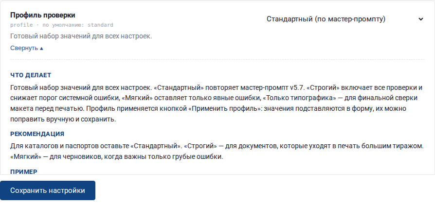
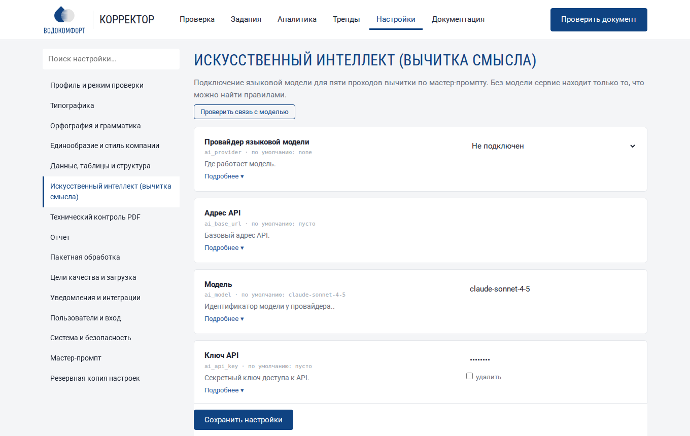

# Справочник настроек

Все настройки открываются в разделе **«Настройки»** (верхнее меню). Справочник ниже создан автоматически из программы и полностью совпадает с тем, что вы видите в интерфейсе.


## Как устроена страница настроек

- **Слева** — разделы и поиск. Начните вводить слово (например, «висяч» или «ключ») — останутся только подходящие настройки.
- **У каждой настройки** — название, служебное имя и значение по умолчанию, короткое описание и кнопка **«Подробнее»**: что делает, рекомендация и пример.
- **Измененная настройка** подсвечивается рамкой; внизу появляется «Есть несохраненные изменения». Не забудьте нажать **«Сохранить настройки»**.
- **Профиль** подставляет согласованный набор значений: выберите профиль, нажмите «Применить профиль», проверьте и сохраните.
- Внизу страницы — **мастер-промпт** (скачать, загрузить свой, вернуть встроенный) и **резервная копия настроек** (выгрузка, загрузка, сброс).




!!! note "Когда действуют изменения"
    Настройки применяются к новым заданиям. Уже выполненное задание можно перепроверить кнопкой «Проверить заново». Профиль, выбранный при загрузке файла, действует только на эту проверку. Настройка «Одновременных заданий» вступает в силу после перезапуска службы.

## Профили

| Настройка | Стандартный | Строгий | Мягкий | Только типографика |
|---|---|---|---|---|
| Страниц в одном запросе | 6 | 4 | 6 | 6 |
| Сомнительное — «Требует проверки автором» | да | да | нет | да |
| Формат телефонов | да | да | нет | да |
| Ссылки «см. стр. N» | да | да | да | нет |
| Обозначения стандартов | да | да | да | нет |
| Таблицы: повторы и разрывы диапазонов | да | да | да | нет |
| Содержание | да | да | да | нет |
| Словарная проверка (Hunspell) | да | да | да | нет |
| Частота неизвестного слова | 2 | 3 | 1 | 2 |
| LanguageTool | нет | нет | нет | нет |
| LanguageTool: придирчивый режим | нет | да | нет | нет |
| Режим вычитки | auto | auto | auto | rules |
| Проходы вычитки | text, codes, layout, terms, data | text, codes, layout, terms, data | text, codes, layout, terms, data | text, layout |
| Минимальное разрешение картинок, dpi | 200 | 300 | 200 | 200 |
| Форматы отчета | docx, xlsx, pdf_annot, json, docx_review | docx, xlsx, pdf_annot, json | docx, xlsx, pdf_annot, json, docx_review | docx, xlsx, pdf_annot, json, docx_review |
| Порог системной ошибки | 5 | 3 | 8 | 5 |
| Двойные пробелы | да | да | нет | да |
| Дюйм апострофами | да | да | нет | да |
| Запись «м вод. ст.» | да | да | нет | да |
| Прямые кавычки | да | да | нет | да |
| Неразобранные кандидаты | author | author | reject | author |

Остальные настройки во всех профилях одинаковые (значения по умолчанию).

## Профиль и режим проверки

Что проверять и насколько строго. Начните с выбора профиля: он задает разумные значения для всех остальных разделов.

### Профиль проверки

*Имя:* `profile` · *вид:* выбор из списка · *по умолчанию:* Стандартный (по мастер-промпту)

Готовый набор значений для всех настроек. «Стандартный» повторяет мастер-промпт v5.7. «Строгий» включает все проверки и снижает порог системной ошибки, «Мягкий» оставляет только явные ошибки, «Только типографика» — для финальной сверки макета перед печатью. Профиль применяется кнопкой «Применить профиль»: значения подставляются в форму, их можно поправить вручную и сохранить.

Варианты: «Стандартный (по мастер-промпту)»; «Строгий»; «Мягкий»; «Только типографика».

**Рекомендация.** Для каталогов и паспортов оставьте «Стандартный». «Строгий» — для документов, которые уходят в печать большим тиражом. «Мягкий» — для черновиков, когда важны только грубые ошибки.

**Пример.** Перед отправкой каталога в типографию: профиль «Строгий», затем «Применить профиль» и «Сохранить».

### Режим вычитки

*Имя:* `mode` · *вид:* выбор из списка · *по умолчанию:* Авто

«Правила» — только машинные проверки: типографика, смешение алфавитов, словарь, таблицы, содержание. Работает без интернета и бесплатно. «Правила + ИИ» — дополнительно языковая модель выполняет пять проходов вычитки по мастер-промпту (смысл, грамматика, термины, логика). «Авто» — ИИ включается, только если в разделе «Искусственный интеллект» указан провайдер и ключ.

Варианты: «Авто»; «Только правила»; «Правила + ИИ».

**Рекомендация.** Оставьте «Авто». Если модель не подключена, отчет все равно будет собран по правилам.

**Пример.** Модель подключена → «Авто» ведет себя как «Правила + ИИ»; ключ удален → как «Правила».

### Проходы вычитки

*Имя:* `passes` · *вид:* несколько значений · *по умолчанию:* 1. Текст построчно, 2. Коды, артикулы, алфавиты, 3. Верстка по координатам, 4. Термины и единообразие, 5. Данные, таблицы, ссылки

Пять проходов из п. 3.5 мастер-промпта: 1 — текст построчно; 2 — коды и алфавиты; 3 — верстка по координатам; 4 — термины и единообразие; 5 — данные и ссылки. Отключенный проход не выполняется ни правилами, ни моделью.

Варианты: «1. Текст построчно»; «2. Коды, артикулы, алфавиты»; «3. Верстка по координатам»; «4. Термины и единообразие»; «5. Данные, таблицы, ссылки».

**Рекомендация.** Отключать проходы не рекомендуется: мастер-промпт считает пропуск прохода браком (п. 0.6). Исключение — профиль «Только типографика».

**Пример.** Быстрая проверка верстки: оставить только «Верстка» и «Текст».

### Порог системной ошибки

*Имя:* `systemic_threshold` · *вид:* целое число · *по умолчанию:* 5

Если одна и та же ошибка встречается в N и более местах, она выносится одной строкой с пометкой «системно» и перечнем страниц (п. 5.4). Ошибки, которых меньше порога, расписываются построчно.

**Рекомендация.** 5 — по мастер-промпту. Для очень больших документов (200+ страниц) можно поставить 3, чтобы таблица была короче.

**Пример.** «Дефис вместо тире в диапазоне» встретился 66 раз → одна строка «стр. 8, 14, 20… (системно)».

### Обучение: скрывать замечания, которые корректор отклонял

*Имя:* `learn_reject_threshold` · *вид:* целое число · *по умолчанию:* 0

Если такое же замечание (то же правило и тот же фрагмент) корректор отклонил в N разных документах и ни разу не принял, в новых отчетах оно сразу помечается отклоненным с пометкой «скрыто по опыту». Его видно на странице задания, вернуть можно кнопкой ✓. 0 — не скрывать.

**Рекомендация.** По умолчанию выключено (0). Рекомендуется 3, когда корректоры регулярно отмечают замечания ✓ и ✕.

**Пример.** Слово «гидромодуль» трижды отклонено как «вне словаря» — в следующих каталогах оно уже не мешает.

### Сомнительное — «Требует проверки автором»

*Имя:* `author_review_on_doubt` · *вид:* переключатель · *по умолчанию:* включено

Если правило или модель не уверены, замечание получает тип «Требует проверки автором», а не «ошибка» (п. 0.4 и 0.15). Если выключить, сомнительные находки отбрасываются.

**Рекомендация.** Оставьте включенным: автор документа лучше знает, что верно.

**Пример.** Значение таблицы выпадает из закономерности → «Требует проверки автором» с вопросом в пояснении.

### Неразобранные кандидаты

*Имя:* `unresolved_candidates` · *вид:* выбор из списка · *по умолчанию:* Требует проверки автором

Что делать с кандидатами `extract.py`, которые не превратились в замечание автоматически (например, висячий предлог в строке с выключкой). «Требует проверки автором» — вынести строкой отчета; «Отклонить с пометкой» — записать в список отклоненных с причиной «не подтверждено автоматически».

Варианты: «Требует проверки автором»; «Отклонить с пометкой».

**Рекомендация.** «Требует проверки автором» — так ничего не потеряется. Второй вариант — если отчет должен быть коротким и его потом вычитывает человек.

**Пример.** Кандидат «Номинальное напряжение, В» (вольт, а не предлог) → при первом варианте попадет в отчет.

## Типографика

Правила набора: пробелы, тире, кавычки, знаки и единицы измерения. Основа — п. 5.1–5.10 мастер-промпта, справочники Мильчина и Гиленсона, ГОСТ 8.417.

### Дефис в диапазоне чисел

*Имя:* `typo_range_dash` · *вид:* переключатель · *по умолчанию:* включено

Диапазон чисел пишется с коротким тире без пробелов: «60–80 °C» (п. 5.2). Дефис «60-80» — ошибка. Номера стандартов (ГОСТ 31839-2012), годы и коды изделий автоматически исключаются.

**Рекомендация.** Включено во всех профилях, кроме «Мягкого». Отключайте, только если правило конфликтует со стилем компании (например, в фирменном стиле принят дефис в диапазонах).

**Пример.** «3,14-200» → «3,14–200»

### Нет пробела после точки

*Имя:* `typo_space_after_dot` · *вид:* переключатель · *по умолчанию:* включено

Пропущенный пробел между предложениями или после сокращения: «насосами.Оборудование», «нерж.сталь».

**Рекомендация.** Включено во всех профилях, кроме «Мягкого». Отключайте, только если правило конфликтует со стилем компании (например, в фирменном стиле принят дефис в диапазонах).

**Пример.** «рег.клапан» → «рег. клапан»

### Цифра слитно со словом

*Имя:* `typo_digit_word` · *вид:* переключатель · *по умолчанию:* включено

Число без пробела перед словом — частая ошибка колонтитулов: «EVR 1для установок».

**Рекомендация.** Включено во всех профилях, кроме «Мягкого». Отключайте, только если правило конфликтует со стилем компании (например, в фирменном стиле принят дефис в диапазонах).

**Пример.** «EVR 1для» → «EVR 1 для»

### Двойные пробелы

*Имя:* `typo_double_space` · *вид:* переключатель · *по умолчанию:* включено

Два и более пробела подряд внутри строки. Пробелы после «=» в бланках с пустыми полями не учитываются.

**Рекомендация.** Включено во всех профилях, кроме «Мягкого». Отключайте, только если правило конфликтует со стилем компании (например, в фирменном стиле принят дефис в диапазонах).

**Пример.** «совмещенного  водопровода» → «совмещенного водопровода»

### Неверный знак градуса

*Имя:* `typo_degree` · *вид:* переключатель · *по умолчанию:* включено

Вместо знака градуса ° (U+00B0) стоит кольцо ˚ (U+02DA) или порядковый индикатор º (U+00BA). На экране почти не отличается, но при поиске и в шрифтах ломается.

**Рекомендация.** Включено во всех профилях, кроме «Мягкого». Отключайте, только если правило конфликтует со стилем компании (например, в фирменном стиле принят дефис в диапазонах).

**Пример.** «+120˚С» → «+120 °С»

### Прямые кавычки

*Имя:* `typo_quotes` · *вид:* переключатель · *по умолчанию:* включено

В русском тексте основные кавычки — «елочки», внутренние — „лапки“. Прямые "…" — ошибка набора.

**Рекомендация.** Включено во всех профилях, кроме «Мягкого». Отключайте, только если правило конфликтует со стилем компании (например, в фирменном стиле принят дефис в диапазонах).

**Пример.** «"после себя"» → «„после себя“» или «после себя» в елочках

### Дюйм апострофами

*Имя:* `typo_inch` · *вид:* переключатель · *по умолчанию:* включено

Знак дюйма — двойной штрих ″ (U+2033). Два апострофа '' или кавычка " вместо него — ошибка.

**Рекомендация.** Включено во всех профилях, кроме «Мягкого». Отключайте, только если правило конфликтует со стилем компании (например, в фирменном стиле принят дефис в диапазонах).

**Пример.** «G 1 ½''» → «G 1 ½″»

### Знак «=» без отбивки

*Имя:* `typo_equals` · *вид:* переключатель · *по умолчанию:* включено

Знаки математических действий отбиваются пробелами с обеих сторон (п. 5.7).

**Рекомендация.** Включено во всех профилях, кроме «Мягкого». Отключайте, только если правило конфликтует со стилем компании (например, в фирменном стиле принят дефис в диапазонах).

**Пример.** «V=8л» → «V = 8 л»

### Единица слитно с числом

*Имя:* `typo_unit` · *вид:* переключатель · *по умолчанию:* включено

Между числом и единицей измерения нужен (неразрывный) пробел (п. 5.3, ГОСТ 8.417). Исключение — угловые градусы, минуты и секунды: 90°, 5′.

**Рекомендация.** Включено во всех профилях, кроме «Мягкого». Отключайте, только если правило конфликтует со стилем компании (например, в фирменном стиле принят дефис в диапазонах).

**Пример.** «220В» → «220 В», «8л» → «8 л»

### Знак умножения

*Имя:* `typo_times` · *вид:* переключатель · *по умолчанию:* включено

Знак умножения × отбивается пробелами; кириллическая «х», латинская «x» и звездочка вместо него — ошибка (п. 5.7, 5.8).

**Рекомендация.** Включено во всех профилях, кроме «Мягкого». Отключайте, только если правило конфликтует со стилем компании (например, в фирменном стиле принят дефис в диапазонах).

**Пример.** «1765 х 780» → «1765 × 780», «3×380» → «3 × 380»

### Запись «м вод. ст.»

*Имя:* `typo_mwc` · *вид:* переключатель · *по умолчанию:* включено

Единица «метр водяного столба» пишется «м вод. ст.»: после «м» точки нет.

**Рекомендация.** Включено во всех профилях, кроме «Мягкого». Отключайте, только если правило конфликтует со стилем компании (например, в фирменном стиле принят дефис в диапазонах).

**Пример.** «0–180* м. вод.ст» → «0–180* м вод. ст.»

### Висячие предлоги и союзы

*Имя:* `hanging_check` · *вид:* переключатель · *по умолчанию:* включено

Строка не должна заканчиваться предлогом, союзом или частицей (п. 5.9). Проверка идет по координатам строк: учитываются только строки, которые не последние в абзаце или ячейке. Исправление — неразрывный пробел (Ctrl+Shift+Пробел в Word, Shift+Пробел в InDesign) между коротким словом и следующим.

**Рекомендация.** Оставьте включенным для всех документов, которые идут в печать. В веб-текстах можно отключить: переносы строк там зависят от ширины экрана.

**Пример.** Конец строки «…обеспечить ее безопасность при» → «при⍽транспортировке» (⍽ — неразрывный пробел).

### Список висячих слов

*Имя:* `hanging_words` · *вид:* многострочный текст · *по умолчанию:* см. ниже

Слова, которые нельзя оставлять в конце строки. Список из п. 5.9 мастер-промпта: предлоги, союзы, частицы. Слова пишутся через пробел, строчными буквами.

Значение по умолчанию:

```
в во на за к ко с со о об обо от ото по до из изо без безо для при про над надо под подо перед передо через чрез между меж около кроме вместо сверх вдоль внутрь вроде вслед мимо ради среди сквозь согласно благодаря вопреки насчет и а но да или либо что чтобы как если чем то тоже также причем притом зато однако когда пока хотя будто словно точно не ни же ли бы б ведь вот вон лишь только именно даже уж уже
```

**Рекомендация.** Список по умолчанию полный. Добавляйте слова, характерные для ваших текстов, например «см.» или «т.».

**Пример.** Добавить «см.» → строка «…подробнее см.» будет отмечена.

### Исключения: сокращения, совпадающие с предлогами

*Имя:* `hanging_exclude_abbr` · *вид:* многострочный текст · *по умолчанию:* см. ниже

Сокращения, которые совпадают с предлогами или союзами, но ими не являются: «В» (вольт), «НО» (нормально открытый), «СО» (система отопления). Сравнение — с учетом регистра.

Значение по умолчанию:

```
В НО НЗ СО СВ ГВС ХВС Вт А
```

**Рекомендация.** Внесите сюда все отраслевые сокращения из ваших таблиц: так висячие «предлоги» в шапках таблиц не будут отмечаться.

**Пример.** «Номинальное напряжение, В» → не считается висячим предлогом.

### Кавычки

*Имя:* `quote_style` · *вид:* выбор из списка · *по умолчанию:* Елочки и лапки «„…“»

Какие кавычки считать правильными. Русская норма — «елочки», внутри — „лапки“.

Варианты: «Елочки и лапки «„…“»»; «Английские “…” ‘…’».

**Рекомендация.** Оставьте «Елочки и лапки». «Английские» — только для документов на английском.

**Пример.** «Регулятор давления „после себя“»

### Десятичный разделитель

*Имя:* `decimal_separator` · *вид:* выбор из списка · *по умолчанию:* Запятая

В русском тексте десятичный разделитель — запятая (3,14). Разнобой точки и запятой в одном документе — «Единообразие».

Варианты: «Запятая»; «Точка».

**Рекомендация.** Запятая. Точку выбирайте только для документов на английском.

**Пример.** «1.5 мм» в русском каталоге → «1,5 мм».

### Разряды в числах

*Имя:* `thousands` · *вид:* выбор из списка · *по умолчанию:* Пробел с пяти знаков (12 000, но 1200)

Как разбивать многозначные числа на группы. По норме четырехзначные числа пишутся слитно (1200), начиная с пяти знаков — с неразрывным пробелом (12 000). Главное — единообразие внутри документа.

Варианты: «Пробел с пяти знаков (12 000, но 1200)»; «Пробел с четырех знаков (1 200)»; «Не проверять».

**Рекомендация.** «С пяти знаков» — по справочнику Мильчина. Выберите «Всегда пробел», если так принято в фирменном стиле.

**Пример.** «1 200 м³/ч» и «1200» в одном каталоге → замечание «Единообразие».

### Знак процента

*Имя:* `percent_space` · *вид:* выбор из списка · *по умолчанию:* Единообразно (любой вариант)

Знак % допустим и слитно (50%), и через пробел (50 %). Ошибка — только разнобой в одном документе (п. 5.3).

Варианты: «Единообразно (любой вариант)»; «Всегда слитно»; «Всегда через пробел».

**Рекомендация.** «Единообразно» — сервис отметит, если встречаются оба варианта.

**Пример.** «до 50%» на стр. 4 и «90 %» на стр. 60 → «Единообразие».

### Буква «ё»

*Имя:* `yo_policy` · *вид:* выбор из списка · *по умолчанию:* Не отмечать, писать «е» (по промпту)

Мастер-промпт v5.6–5.7: в проекте используется обычная «е» везде; «ё» в документе дефектом не считается, в цитатах отчета она заменяется на «е» (п. 5.14). Можно включить старое правило: отмечать «ё».

Варианты: «Не отмечать, писать «е» (по промпту)»; «Отмечать как разнобой».

**Рекомендация.** «Не отмечать» — по действующему промпту.

**Пример.** «оснащён» в PDF → в отчете цитата «оснащен», замечания нет.

## Орфография и грамматика

Словарная проверка (Hunspell) и, по желанию, грамматическая проверка LanguageTool — открытого сервиса, который используют миллионы людей.

### Словарная проверка (Hunspell)

*Имя:* `hunspell_enabled` · *вид:* переключатель · *по умолчанию:* включено

Каждое слово сверяется со словарем русского языка Hunspell — тем же, что в LibreOffice и Firefox. Неизвестные слова становятся кандидатами с вариантами исправления. Работает без интернета.

**Рекомендация.** Включите и заполните «Белый список»: в технических текстах много терминов и марок, которых нет в словаре.

**Пример.** «холодонабжения» → кандидат, вариант «холодоснабжения».

### Словарь Hunspell

*Имя:* `hunspell_dict` · *вид:* строка · *по умолчанию:* ru_RU

Имя словаря Hunspell. Можно указать несколько через запятую, например «ru_RU,en_US», чтобы английские слова не считались ошибками.

**Рекомендация.** «ru_RU,en_US» для каталогов с английскими названиями моделей.

**Пример.** ru_RU,en_US

### Частота неизвестного слова

*Имя:* `hunspell_max_freq` · *вид:* целое число · *по умолчанию:* 2

Неизвестное словарю слово, которое встречается в документе чаще N раз, считается термином и не отмечается. Так отсеиваются марки, названия и отраслевые слова. Прием частотной фильтрации используют профессиональные корректорские программы.

**Рекомендация.** 2 — опечатку редко повторяют трижды. Для коротких документов (до 10 страниц) поставьте 1.

**Пример.** «гидромодуль» встречается 6 раз → термин, не отмечается; «насоные» 6 раз → тоже пропустится, поэтому частые опечатки ловит ИИ-проход или глоссарий.

### Что делать с неизвестным словом

*Имя:* `hunspell_action` · *вид:* выбор из списка · *по умолчанию:* Требует проверки автором

«Требует проверки автором» — строка отчета с вариантами исправления в пояснении. «Исправлять первым вариантом» — тип «Орфография», в колонку «Как правильно» подставляется первый вариант словаря (быстрее, но иногда неверно).

Варианты: «Требует проверки автором»; «Исправлять первым вариантом».

**Рекомендация.** «Требует проверки автором»: словарь не знает контекста.

**Пример.** «Происводитель» → вариант «Производитель».

### Белый список слов

*Имя:* `whitelist` · *вид:* многострочный текст · *по умолчанию:* см. ниже

Слова, которые всегда считаются правильными: марки, бренды, термины, сокращения. Пишутся через пробел или с новой строки. Регистр не важен.

Значение по умолчанию:

```
SPL ВОДОКОМФОРТ Водокомфорт AQUASTRONG Aquastrong POLAT БТП ИТП ЦТП ГВС ХВС ШАУ ППУ АУПД АУПДЗ ПЧ гидромодуль теплообменник фанкойл чиллер декантер декантерный пусконаладка пусконаладочный кек флокулянт EVR EVS EVP Ду DN PN SDR Гкал Мкал инжиниринговый инжиниринговой теплопотребления водоподогреватель водоподогревателей этиленгликоль этиленгликоля пропиленгликоль пропиленгликоля деаэрация деаэрацию повысительный повысительным повысительного минераловатный минераловатных теплопотери теплопотерь кашированные шильдик проушина воздухоотводчик погодозависимое электропривод электроприводом тепловычислитель расключения расключений моторесурса типоразмер типоразмеры спринклерной дренчерной технополимер технополимера резинометаллический стеклопластиковый гидроудар гидроударов энергоэффективный энергоэффективную энергоэффективной погружной погружными холодоснабж холодоцентр кислородозащит внутрипольн надвижн мацератор сгустител теплоноситель водоотведени коллекторн пресс-фитинг
```

**Рекомендация.** Пополняйте список после каждого отчета: всё, что словарь отметил зря, — сюда. Через 3–4 документа ложных срабатываний почти не останется.

**Пример.** Добавить «Тепловычислитель» → больше не отмечается.

### LanguageTool

*Имя:* `lt_enabled` · *вид:* переключатель · *по умолчанию:* выключено

Грамматическая и стилистическая проверка LanguageTool (открытый проект, есть русские правила: согласование, пунктуация, повторы). Нужен сервер LanguageTool: собственный (рекомендуется, данные не уходят наружу) или публичный api.languagetool.org (бесплатно с ограничениями).

**Рекомендация.** Разверните свой сервер: `docker run -d -p 8010:8010 erikvl87/languagetool` и укажите адрес http://127.0.0.1:8010. Скрипт установки умеет это делать с ключом --with-languagetool.

**Пример.** «в соответствии с требованиям» → «требованиями».

### Адрес LanguageTool

*Имя:* `lt_url` · *вид:* строка · *по умолчанию:* http://127.0.0.1:8010

Адрес сервера LanguageTool без /v2/check.

**Рекомендация.** http://127.0.0.1:8010 для локального сервера.

**Пример.** https://api.languagetool.org — публичный, не более 20 запросов в минуту и 20 КБ текста за запрос.

### Отключенные правила LanguageTool

*Имя:* `lt_disabled_rules` · *вид:* многострочный текст · *по умолчанию:* см. ниже

Идентификаторы правил LanguageTool, которые не нужно применять. В технических таблицах правила про пробелы и заглавную букву в начале «предложения» дают много ложных срабатываний.

Значение по умолчанию:

```
WHITESPACE_RULE UPPERCASE_SENTENCE_START
```

**Рекомендация.** Оставьте по умолчанию; добавляйте ID правил, которые часто ошибаются на ваших документах (ID виден в пояснении замечания).

**Пример.** WHITESPACE_RULE UPPERCASE_SENTENCE_START

### LanguageTool: придирчивый режим

*Имя:* `lt_picky` · *вид:* переключатель · *по умолчанию:* выключено

Включает дополнительные стилистические правила LanguageTool (level=picky).

**Рекомендация.** Выключено: в технических документах придирчивый режим дает много шума.

**Пример.** Отмечает канцеляризмы вроде «осуществляет проведение».

## Единообразие и стиль компании

Собственный стиль компании: глоссарий терминов, сокращения, написание брендов и эталонные реквизиты. Подход взят из инструментов класса PerfectIt и Acrolinx.

### Глоссарий: правильно — неправильные варианты

*Имя:* `glossary` · *вид:* многострочный текст · *по умолчанию:* см. ниже

Главный инструмент единообразия (как стиль-лист в PerfectIt). Каждая строка: правильное написание, двоеточие, неправильные варианты через запятую. Поиск без учета регистра. Каждое найденное неправильное написание становится замечанием «Единообразие» с готовым исправлением.

Значение по умолчанию:

```
жокей-насос: жакей-насос
рым-болт: рым болт
двухходовой: 2х ходовой, 2-х ходовой
балансировочный клапан: балансированный клапан
отдельно стоящий: отдельно-стоящий
мультичастотное: мульти-частотное
```

**Рекомендация.** Ведите один глоссарий на всю компанию. Добавляйте сюда каждую ошибку в термине, найденную в отчетах: она больше никогда не пройдет незамеченной.

**Пример.** Строка «жокей-насос: жакей-насос» → «Жакей-насос: нет» → «Жокей-насос: нет».

### Справочник сокращений

*Имя:* `abbreviations` · *вид:* многострочный текст · *по умолчанию:* см. ниже

Сокращения и их расшифровки. Используется ИИ-проходом и для проверки, что каждое сокращение пишется одинаково. Формат: «СОКРАЩЕНИЕ — расшифровка», по одному на строку.

Значение по умолчанию:

```
АУПД — автоматическая установка поддержания давления
АУПДЗ — автоматическая установка поддержания давления и заполнения
БТП — блочный тепловой пункт
ШАУ — шкаф автоматического управления
ПЧ — преобразователь частоты
```

**Рекомендация.** Перенесите сюда список сокращений из ваших паспортов изделий.

**Пример.** «ШАУ-П» и «ШАУ П» в одном документе → «Единообразие».

### Эталонное написание брендов и серий

*Имя:* `brand_case` · *вид:* многострочный текст · *по умолчанию:* см. ниже

Названия, регистр которых должен быть одинаковым во всем документе. Если в тексте встретится то же слово в другом регистре (AQUASTRONG / Aquastrong, BASIC / Basic), будет замечание «Единообразие».

Значение по умолчанию:

```
SPL AQUASTRONG POLAT ВОДОКОМФОРТ Basic Eco SMART
```

**Рекомендация.** Укажите все бренды и названия серий в том виде, как они должны печататься.

**Пример.** Эталон «Basic» → «WRP-A BASIC» отмечается.

### Эталонные реквизиты

*Имя:* `requisites` · *вид:* многострочный текст · *по умолчанию:* см. ниже

Адреса, телефоны и e-mail компании, как они должны печататься. Формат строки: «название: адрес | телефон | e-mail». Если в документе телефон или e-mail стоит рядом с другим адресом, будет замечание «Требует проверки автором» (п. 5.12, 5.15).

Значение по умолчанию:

```
Москва, главный офис: ул. Кожевническая, д. 16, стр. 4 | +7 495 959 55 45 | info@vodokomfort.ru
Санкт-Петербург, офис: ул. Барочная, д. 10, корп. 1, оф. 406 | +7 812 612 21 11 | spb@vodokomfort.ru
Казань, офис: пр-т Победы, д. 220Д, оф. 404 | +7 843 254 54 70 | kzn@vodokomfort.ru
```

**Рекомендация.** Скопируйте сюда страницу «Контакты» из утвержденного документа и поддерживайте актуальной.

**Пример.** В мини-каталоге у телефона +7 843 254 54 70 указан «пр-т Ямашева» → замечание.

### Запрещенные слова и обороты

*Имя:* `forbidden_words` · *вид:* многострочный текст · *по умолчанию:* пусто

Слова и обороты, которых не должно быть в документах компании (устаревшие названия, жаргон, слова конкурентов). По одному на строку; можно добавить замену через двоеточие: «частотник: частотный преобразователь».

**Рекомендация.** Начните с жаргона из ваших отчетов: «частотник», «нерж.», «эл. двигатель».

**Пример.** частотник: преобразователь частоты

## Данные, таблицы и структура

Машинные проверки логики документа: таблицы, содержание, ссылки «см. стр.», колонтитулы, коды изделий.

### Таблицы: повторы и разрывы диапазонов

*Имя:* `check_tables` · *вид:* переключатель · *по умолчанию:* включено

Ищет в таблицах параметр, повторенный с другими значениями, и разрывы или повторы диапазонов в таблицах «N ряд» (конец одного ряда должен совпадать с началом следующего).

**Рекомендация.** Включено. Именно в таблицах прячутся самые дорогие ошибки каталогов.

**Пример.** «ряд 11: 2500–3500 → ряд 12: 2500–3500» → «Требует проверки автором».

### Содержание

*Имя:* `check_toc` · *вид:* переключатель · *по умолчанию:* включено

Сверяет номера страниц в содержании со страницами, где реально стоят заголовки.

**Рекомендация.** Включено для всех документов с содержанием.

**Пример.** «Автоматизация … 49», а заголовок на стр. 50 → замечание.

### Ссылки «см. стр. N»

*Имя:* `check_refs` · *вид:* переключатель · *по умолчанию:* включено

Находит ссылки на страницы и проверяет, что такая страница есть. Соответствие содержания страницы проверяет ИИ-проход или человек.

**Рекомендация.** Включено.

**Пример.** «представлены на стр. 44», а на стр. 44 — таблица обозначений.

### Колонтитулы

*Имя:* `check_running` · *вид:* переключатель · *по умолчанию:* включено

Собирает все варианты колонтитулов с диапазонами страниц и показывает их в отчете веб-интерфейса — чужой колонтитул сразу виден. Колонтитулы с пропущенными пробелами ловит типографика.

**Рекомендация.** Включено.

**Пример.** Колонтитул «Коллекторные группы…» на страницах каталога насосов.

### Коды и артикулы: смешение алфавитов

*Имя:* `check_codes` · *вид:* переключатель · *по умолчанию:* включено

Посимвольный разбор по Юникоду: кириллические буквы в латинских кодах и наоборот (п. 5.11), латинская «c» вместо предлога «с», «ГОСТ P» с латинской P.

**Рекомендация.** Включено всегда — такие ошибки не видны глазом.

**Пример.** «IМ» с кириллической М в 14 артикулах → одна системная строка.

### Разрешенные смешанные токены

*Имя:* `code_whitelist` · *вид:* многострочный текст · *по умолчанию:* см. ниже

Токены, в которых смешение алфавитов допустимо: аббревиатуры с русским окончанием, обозначения с русскими индексами. Через пробел.

Значение по умолчанию:

```
QR BIM Gсет Gмест
```

**Рекомендация.** Добавьте свои обозначения вида «Gсет», «Pраб».

**Пример.** QR BIM Gсет Gмест

### Обозначения стандартов

*Имя:* `check_standards` · *вид:* переключатель · *по умолчанию:* включено

Единообразие записи стандартов: «СП30» и «СП 30», «ГОСТ» и «ГОСТ Р», разные годы одного стандарта (СП 60.13330.2012 и .2020).

**Рекомендация.** Включено. Проверка не обращается к внешним базам: сравнивается только внутри документа (п. 0.1).

**Пример.** «СП10, СП 30» в одной ячейке → «Типографика».

### Формат телефонов

*Имя:* `check_phone_format` · *вид:* переключатель · *по умолчанию:* включено

Единообразие записи телефонов: «+7 495 959 55 45» и «+7 (495) 959 55 45» в одном документе.

**Рекомендация.** Включено.

**Пример.** Два номера со скобками среди двадцати без скобок → замечание.

## Искусственный интеллект (вычитка смысла)

Подключение языковой модели для пяти проходов вычитки по мастер-промпту. Без модели сервис находит только то, что можно найти правилами.



### Провайдер языковой модели

*Имя:* `ai_provider` · *вид:* выбор из списка · *по умолчанию:* Не подключен

Где работает модель. «Anthropic (Claude)» — облачный API Anthropic. «OpenAI-совместимый» — любой сервис с API в формате OpenAI (OpenAI, YandexGPT через совместимый шлюз, GigaChat через прокси, OpenRouter, vLLM, LM Studio). «Ollama» — модель на собственном сервере, документы не покидают сеть.

Варианты: «Не подключен»; «Anthropic (Claude)»; «OpenAI-совместимый API»; «Ollama (локально)».

**Рекомендация.** Для лучшего качества — Anthropic Claude. Если документы нельзя передавать во внешние сервисы — Ollama с моделью 30B+ на сервере с видеокартой (качество ниже, но приемлемое для первого прохода).

**Пример.** Anthropic, модель claude-sonnet-4-5, ключ sk-ant-… → полноценная вычитка по мастер-промпту.

### Адрес API

*Имя:* `ai_base_url` · *вид:* строка · *по умолчанию:* 

Базовый адрес API. Для Anthropic можно оставить пустым (https://api.anthropic.com). Для OpenAI — https://api.openai.com/v1. Для Ollama — http://127.0.0.1:11434. Для других совместимых сервисов — адрес из их документации.

**Рекомендация.** Оставьте пустым для Anthropic и OpenAI.

**Пример.** http://10.0.0.5:11434 — Ollama на соседнем сервере.

### Модель

*Имя:* `ai_model` · *вид:* строка · *по умолчанию:* claude-sonnet-4-5

Идентификатор модели у провайдера.

**Рекомендация.** Берите самую сильную модель, доступную по бюджету: вычитка требует внимания к деталям. Для Ollama — модели с поддержкой русского (например, qwen2.5:32b).

**Пример.** claude-sonnet-4-5, gpt-4.1, qwen2.5:32b

### Ключ API

*Имя:* `ai_api_key` · *вид:* секрет (скрыт звездочками) · *по умолчанию:* не задан

Секретный ключ доступа к API. Хранится на сервере в файле настроек с правами 600 и в интерфейсе показывается звездочками. Для Ollama не нужен.

**Рекомендация.** Создайте отдельный ключ для сервиса и установите на нем лимит расходов у провайдера.

**Пример.** sk-ant-api03-…

### Температура

*Имя:* `ai_temperature` · *вид:* число · *по умолчанию:* 0.0

Степень случайности ответов модели: 0 — максимально предсказуемо, 1 — творчески. Корректору творчество вредно: модель начинает «улучшать» текст и выдумывать ошибки (нарушение п. 0.3–0.4).

**Рекомендация.** 0 или 0,1.

**Пример.** 0

### Страниц в одном запросе

*Имя:* `ai_pages_per_request` · *вид:* целое число · *по умолчанию:* 6

Сколько страниц текста отправлять модели за один раз. Мастер-промпт отправляется с каждым запросом (у Anthropic он кэшируется). Меньше страниц — внимательнее вычитка, но больше запросов и дороже.

**Рекомендация.** 4–8. Для плотных текстовых документов — 4, для каталогов с таблицами — 8.

**Пример.** Каталог 54 страницы при значении 6 → 9 запросов.

### Максимум токенов ответа

*Имя:* `ai_max_tokens` · *вид:* целое число · *по умолчанию:* 8000

Ограничение длины ответа модели на один запрос. Если замечаний много, а лимит мал, ответ обрежется.

**Рекомендация.** 8000 хватает на 40–60 замечаний.

**Пример.** 8000

### Тайм-аут запроса, с

*Имя:* `ai_timeout` · *вид:* целое число · *по умолчанию:* 240

Сколько секунд ждать ответа модели.

**Рекомендация.** 240 для облачных API, 600 для локальной модели на слабом сервере.

**Пример.** 240

### Повторы при ошибке

*Имя:* `ai_retries` · *вид:* целое число · *по умолчанию:* 2

Сколько раз повторить запрос при сетевой ошибке или перегрузке API.

**Рекомендация.** 2.

**Пример.** 2

### Параллельных запросов

*Имя:* `ai_parallel` · *вид:* целое число · *по умолчанию:* 2

Сколько запросов к модели выполнять одновременно. Ускоряет большие документы, но упирается в лимиты API.

**Рекомендация.** 2 для облачных API, 1 для Ollama.

**Пример.** 2

### Проверка цитат модели

*Имя:* `ai_quote_check` · *вид:* выбор из списка · *по умолчанию:* Отбросить

Модель иногда «цитирует» текст, которого нет в документе. Каждая цитата сверяется с текстом указанной страницы (и соседних). «Отбросить» — несуществующие цитаты удаляются; «Исправить страницу» — если цитата найдена на другой странице, номер исправляется, иначе удаляется; «Оставить с пометкой» — замечание переводится в «Требует проверки автором».

Варианты: «Исправить страницу или отбросить»; «Отбросить»; «Оставить с пометкой».

**Рекомендация.** «Исправить страницу» — лучший баланс; это прямое требование п. 0.13 мастер-промпта.

**Пример.** Модель указала стр. 1 для пункта со стр. 2 → номер исправлен на 2.

### Дополнительные указания модели

*Имя:* `ai_extra_instructions` · *вид:* многострочный текст · *по умолчанию:* пусто

Текст, который добавляется к мастер-промпту в каждом запросе: особенности ваших документов, что проверять особенно тщательно, чего не трогать.

**Рекомендация.** Пишите коротко и конкретно, по одному указанию на строку. Не противоречьте мастер-промпту.

**Пример.** Названия жилых комплексов не проверять. Обращать особое внимание на единицы в шапках таблиц.

### Лимит страниц для ИИ

*Имя:* `ai_max_pages` · *вид:* целое число · *по умолчанию:* 300

Документы длиннее лимита проверяются моделью только частично (первые N страниц) — защита от случайных больших расходов.

**Рекомендация.** 300. Увеличьте, если регулярно проверяете большие каталоги.

**Пример.** 300

## Технический контроль PDF

Проверки самого файла, как в программах допечатной подготовки (preflight): шрифты, разрешение картинок, размеры страниц, страницы-сканы.

### Технический контроль PDF

*Имя:* `preflight_enabled` · *вид:* переключатель · *по умолчанию:* включено

Проверки файла перед печатью по образцу preflight-программ: встроены ли шрифты, разрешение картинок, одинаковы ли размеры страниц, есть ли страницы без текста (сканы), пустые страницы и серые заглушки вместо иллюстраций. Результат — отдельный блок на странице отчета и строки в шапке DOCX.

**Рекомендация.** Включено. Это не корректура текста, но такие дефекты дороже всего обнаружить в напечатанном тираже.

**Пример.** «Шрифт MyriadPro не встроен», «картинка на стр. 12 — 96 dpi».

### Минимальное разрешение картинок, dpi

*Имя:* `preflight_min_dpi` · *вид:* целое число · *по умолчанию:* 200

Картинки с эффективным разрешением ниже порога отмечаются. Для офсетной печати норма — 300 dpi, для цифровой — 200, для экрана — 96–150.

**Рекомендация.** 300 для типографии, 200 для цифровой печати, 0 — не проверять.

**Пример.** Фото 800 пикселей растянуто на 10 см → 203 dpi.

### Невстроенные шрифты

*Имя:* `preflight_fonts` · *вид:* переключатель · *по умолчанию:* включено

Шрифт, не встроенный в PDF, на другом компьютере или в типографии заменится другим — съедет верстка.

**Рекомендация.** Включено.

**Пример.** «Arial (не встроен)»

### Распознавание страниц-сканов (OCR)

*Имя:* `ocr_enabled` · *вид:* переключатель · *по умолчанию:* выключено

Страницы без текстового слоя распознаются Tesseract, чтобы их тоже можно было вычитать. Точность OCR ниже, координаты строк приблизительные; такие страницы помечаются в шапке отчета.

**Рекомендация.** Включайте, если в документах бывают вставленные сканы (сертификаты, письма). Нужен пакет tesseract-ocr-rus (скрипт установки ставит его с ключом --with-ocr).

**Пример.** Скан сертификата на стр. 30 → распознан и вычитан.

### Разрешение изображений страниц

*Имя:* `page_images_dpi` · *вид:* целое число · *по умолчанию:* 72

Изображения страниц для просмотра в веб-интерфейсе и для визуальной проверки.

**Рекомендация.** 72 — быстро и экономно; 110 — если нужно рассматривать мелкие таблицы.

**Пример.** 72

## Стандарт оформления и справочник продукции

Сверка с корпоративными требованиями: шрифты, кегли, цвета и поля страницы по самому PDF, а также сверка артикулов и технических характеристик с выгрузкой справочника продукции из 1С или ERP.

### Проверять оформление по стандарту

*Имя:* `style_enabled` · *вид:* переключатель · *по умолчанию:* включено

Для каждого документа собирается профиль оформления (гарнитуры, кегли, цвета текста с долей в тексте) и, если ниже задан стандарт, — нарушения: шрифт вне списка, кегль меньше минимума или вне шкалы, цвет вне палитры, текст на полях. Результат — блок «Стандарт оформления» в задании и лист в выгрузке XLSX; на 25 проверок отчета не влияет.

**Рекомендация.** Включено. Чтобы задать стандарт, посмотрите профиль эталонного документа и перенесите значения.

**Пример.** —

### Разрешенные гарнитуры

*Имя:* `style_fonts` · *вид:* строка · *по умолчанию:* 

Через запятую. Сравнение по семейству: «Arial» разрешает Arial, Arial Bold, Arial Narrow; «PT Sans» — PTSans-Regular, PTSans-Bold. Пусто — шрифты не проверяются.

**Рекомендация.** Гарнитуры из брендбука плюс шрифт таблиц и формул.

**Пример.** Arial, PT Sans, Symbol

### Не больше гарнитур в документе

*Имя:* `style_max_fonts` · *вид:* целое число · *по умолчанию:* 0

Если в документе больше разных гарнитур, это отмечается: пестрота шрифтов — частая ошибка верстки. 0 — не проверять.

**Рекомендация.** 3–4.

**Пример.** 4

### Минимальный кегль, пт

*Имя:* `style_min_size` · *вид:* число · *по умолчанию:* 0.0

Текст мельче отмечается: в печати он плохо читается. 0 — не проверять.

**Рекомендация.** 6 пт для сносок и подписей в каталогах, 8 пт для инструкций.

**Пример.** 6

### Шкала кеглей, пт

*Имя:* `style_sizes` · *вид:* строка · *по умолчанию:* 

Разрешенные кегли через запятую (допуск ±0,3 пт). Пусто — шкала не проверяется.

**Рекомендация.** Шкала из брендбука: например, 7, 8, 9, 10, 12, 14, 18, 24, 36.

**Пример.** 8, 9, 10, 12, 14, 18, 24

### Фирменная палитра текста

*Имя:* `style_colors` · *вид:* строка · *по умолчанию:* 

Разрешенные цвета текста в формате #RRGGBB через запятую. Пусто — цвета не проверяются.

**Рекомендация.** Черный, белый и фирменные цвета.

**Пример.** #000000, #ffffff, #0f4382, #e30613

### Допуск по цвету

*Имя:* `style_color_tolerance` · *вид:* целое число · *по умолчанию:* 40

Насколько цвет может отличаться от палитры (расстояние в RGB, 0–441). Учитывает погрешности перевода CMYK → RGB.

**Рекомендация.** 30–50.

**Пример.** 40

### Минимальные поля, мм

*Имя:* `style_margin_mm` · *вид:* число · *по умолчанию:* 0.0

Текст ближе к краю страницы отмечается: при обрезке и печати он может пострадать. 0 — не проверять.

**Рекомендация.** 5 мм для каталогов под обрез, 10–15 мм для документов А4.

**Пример.** 5

### Сверять со справочником продукции

*Имя:* `products_enabled` · *вид:* переключатель · *по умолчанию:* включено

Если загружен справочник (кнопка ниже), в каждом документе ищутся артикулы: опечатки (артикул отличается от справочного 1–2 знаками), неизвестные артикулы известных серий и расхождения характеристик — значение с единицей измерения в той же строке (строке таблицы), что и артикул, сравнивается со справочным.

**Рекомендация.** Включено; справочник обновляйте выгрузкой из 1С по расписанию через REST API.

**Пример.** —

### Допуск расхождения характеристик, %

*Имя:* `products_tolerance` · *вид:* число · *по умолчанию:* 0.5

Насколько значение в документе может отличаться от справочного (округление).

**Рекомендация.** 0,5–1 %.

**Пример.** 0.5

### Отмечать неизвестные артикулы

*Имя:* `products_unknown` · *вид:* переключатель · *по умолчанию:* включено

Артикул с префиксом серии из справочника (SPL-…, БТП-…), которого в справочнике нет. Выключите, если справочник неполный и таких замечаний слишком много.

**Рекомендация.** Включено, если справочник полный.

**Пример.** —

### Адрес выгрузки справочника (автообновление)

*Имя:* `products_sync_url` · *вид:* строка · *по умолчанию:* 

Если 1С, ERP или PIM публикует выгрузку номенклатуры по адресу (HTTP-сервис 1С, файл на внутреннем веб-сервере, ссылка на SharePoint/Nextcloud), Корректор сам забирает ее раз в день в заданный час. Формат — как у файла справочника (CSV или XLSX). Пусто — автообновления нет.

**Рекомендация.** HTTP-сервис 1С: https://1c.компания/ut/hs/catalog/products.csv

**Пример.** https://1c.vodokomfort.local/ut/hs/korrektor/products.csv

### Заголовок авторизации для выгрузки

*Имя:* `products_sync_auth` · *вид:* секрет (скрыт звездочками) · *по умолчанию:* не задан

Если адрес требует входа: целиком заголовок Authorization — «Basic …» (логин:пароль в base64) или «Bearer …».

**Рекомендация.** Отдельная учетная запись 1С только для чтения номенклатуры.

**Пример.** Basic a29ycmVrdG9yOnBhcm9sMTIz

### Час автообновления справочника

*Имя:* `products_sync_hour` · *вид:* целое число · *по умолчанию:* 6

По времени сервера.

**Рекомендация.** 6 — до начала работы.

**Пример.** 6

## Отчет

Форматы, состав и подача отчета. Оформление DOCX задано мастер-промптом и проверяется автоматически (25 проверок).

### Форматы отчета

*Имя:* `report_formats` · *вид:* несколько значений · *по умолчанию:* DOCX (по мастер-промпту), XLSX, PDF с пометками, JSON, Правки в исходном Word (для документов DOCX, DOC, ODT, RTF)

DOCX — основной отчет по мастер-промпту (альбомная A4, 6 колонок, 25 машинных проверок). XLSX — та же таблица для фильтрации и распределения правок. CSV — для импорта в трекеры задач. PDF с пометками — исходный документ с подсвеченными ошибками и комментариями прямо на страницах (как правка в Acrobat). JSON — машиночитаемые данные (findings.json). Правки в исходном Word — копия загруженного документа Word, где каждое замечание стоит примечанием, а ошибки с готовым исправлением внесены в режиме рецензирования: автор принимает их кнопкой «Принять».

Варианты: «DOCX (по мастер-промпту)»; «XLSX»; «CSV»; «PDF с пометками»; «JSON»; «Правки в исходном Word (для документов DOCX, DOC, ODT, RTF)».

**Рекомендация.** DOCX + PDF с пометками: верстальщику удобнее всего видеть ошибку на самой странице.

**Пример.** Верстальщик открывает PDF с пометками, щелкает по желтой подсветке — видит правильный вариант.

### Автор правок в Word

*Имя:* `review_author` · *вид:* строка · *по умолчанию:* Корректор

Имя, которое Word покажет у примечаний и исправлений в режиме рецензирования.

**Рекомендация.** Название службы или ФИО корректора.

**Пример.** Корректор (Водокомфорт)

### Шаблон имени файла отчета

*Имя:* `report_filename` · *вид:* строка · *по умолчанию:* {name}_корректура

Имя файла без расширения. Подстановки: {name} — имя исходного PDF, {date} — дата проверки, {job} — номер задания.

**Рекомендация.** {name}_корректура — по мастер-промпту (п. 4).

**Пример.** {name}_корректура_{date} → Каталог_БТП_корректура_2026-10-07.docx

### Включать «Требует проверки автором»

*Имя:* `report_include_author` · *вид:* переключатель · *по умолчанию:* включено

Выводить ли в отчет замечания с типом «Требует проверки автором». Мастер-промпт требует выводить (п. 0.15).

**Рекомендация.** Включено.

**Пример.** Выключите, если отчет уходит подрядчику, которому нужны только бесспорные правки.

### Только принятые вручную замечания

*Имя:* `report_reviewed_only` · *вид:* переключатель · *по умолчанию:* выключено

На странице задания каждое замечание можно принять или отклонить. Если включено, в отчет попадают только принятые; если выключено — все, кроме отклоненных.

**Рекомендация.** Выключено для быстрой работы; включите, если каждое замечание обязательно просматривает корректор.

**Пример.** Корректор отклонил 5 ложных замечаний и нажал «Пересобрать отчет».

### Разрешать скачивание непринятого отчета

*Имя:* `report_allow_unverified` · *вид:* переключатель · *по умолчанию:* выключено

Если машинная проверка (verify.py) нашла нарушения, отчет по мастер-промпту отдавать нельзя (п. 0.9). Включите, чтобы все равно разрешить скачивание с пометкой «не принят».

**Рекомендация.** Выключено.

**Пример.** Нужно срочно показать черновик отчета коллеге.

### Автоматический итог

*Имя:* `report_summary_auto` · *вид:* переключатель · *по умолчанию:* включено

Раздел «Итог» (2–4 предложения) составляется автоматически по найденным замечаниям: число, системные проблемы, самые важные находки. Рекомендации в итоге запрещены (п. 0.16) — проверяется автоматически.

**Рекомендация.** Включено. Итог можно отредактировать на странице задания перед пересборкой.

**Пример.** «Найдено 65 замечаний. Системные проблемы — дефис в диапазонах (66 мест)…»

### Дополнительные строки шапки

*Имя:* `report_extra_header` · *вид:* многострочный текст · *по умолчанию:* пусто

Строки, которые добавляются в шапку каждого отчета: заказчик, номер договора, корректор.

**Рекомендация.** Не добавляйте статистику по типам — это запрещено (п. 0.11).

**Пример.** Корректор: И. И. Иванов
Заказчик: отдел маркетинга

## Пакетная обработка

Работа с несколькими документами сразу: сравнение версий одного каталога и сверка реквизитов между документами.

### Сравнение версий одного документа

*Имя:* `batch_compare` · *вид:* переключатель · *по умолчанию:* включено

При загрузке нескольких PDF сервис находит версии одного документа (одинаковое число страниц, совпадает не менее заданной доли страниц) и показывает различия по страницам (п. 3.8).

**Рекомендация.** Включено.

**Пример.** Каталоги для Москвы, регионов и Петербурга → различаются стр. 1, 4, 8, 9…

### Порог сходства версий, %

*Имя:* `batch_similarity` · *вид:* целое число · *по умолчанию:* 50

Какая доля страниц должна совпадать дословно, чтобы документы считались версиями одного.

**Рекомендация.** 50 — подходит для региональных версий каталогов.

**Пример.** 50

### Сверка реквизитов между документами

*Имя:* `batch_requisites` · *вид:* переключатель · *по умолчанию:* включено

Один телефон или e-mail должен стоять рядом с одним адресом во всех документах пакета (п. 5.15). Расхождения выносятся в отчет того документа, где адрес отличается.

**Рекомендация.** Включено.

**Пример.** Казанский офис: «пр-т Победы» в шести документах и «пр-т Ямашева» в одном.

## Цели качества и загрузка

Целевые значения показателей: они рисуются на графиках аналитики и трендов, а при нарушении приходит уведомление. Здесь же — поля, которые заполняются при загрузке документа (автор, отдел).

### Цель: замечаний на 10 страниц, не больше

*Имя:* `goal_density` · *вид:* число · *по умолчанию:* 5.0

Плотность ошибок, которую компания считает приемлемой. На графиках аналитики и трендов рисуется линией цели; документ с большей плотностью отмечается, а при включенном уведомлении о целях приходит письмо или сообщение.

**Рекомендация.** Начните со среднего значения за последние 3 месяца (раздел «Тренды») и снижайте его каждый квартал на 10–20 %.

**Пример.** 5 — каталог на 50 страниц с 25 замечаниями еще в норме, с 30 — нет. 0 — цель не задана.

### Цель: доля «Требует проверки автором», %, не больше

*Имя:* `goal_author_share` · *вид:* число · *по умолчанию:* 35.0

Высокая доля вопросов автору означает, что словарь и глоссарий не знают ваших терминов.

**Рекомендация.** 30–40 %. Если выше — пополните белый список (Аналитика → «Слова вне словаря»).

**Пример.** 35. 0 — цель не задана.

### Цель: точность замечаний, %, не меньше

*Имя:* `goal_precision` · *вид:* число · *по умолчанию:* 80.0

Доля принятых замечаний среди просмотренных. Ниже цели — правила дают много ложных срабатываний.

**Рекомендация.** 80 %. Ниже 70 % — откройте «Точность правил» и смягчите правила с пометкой ⚠.

**Пример.** 80. 0 — цель не задана.

### Цель: отчеты, прошедшие 25/25, %, не меньше

*Имя:* `goal_verify_rate` · *вид:* число · *по умолчанию:* 100.0

Доля отчетов, принятых машинной проверкой оформления.

**Рекомендация.** 100 %.

**Пример.** 100. 0 — цель не задана.

### Уведомлять о нарушении цели

*Имя:* `goal_alert` · *вид:* переключатель · *по умолчанию:* включено

Если документ превысил цель по плотности ошибок, в уведомлении «отчет готов» появится предупреждение, а получатели уведомлений о целях получат отдельное сообщение.

**Рекомендация.** Включено, если настроены уведомления.

**Пример.** —

### Требовать автора документа при загрузке

*Имя:* `upload_author_required` · *вид:* переключатель · *по умолчанию:* выключено

При загрузке появляется поле «Автор документа»; включенная настройка делает его обязательным. Автор и отдел попадают в аналитику (разбивка по авторам и отделам) и в шапку отчета.

**Рекомендация.** Включите, если нужна статистика по авторам. Для внешних документов укажите поставщика.

**Пример.** —

### Типы документов

*Имя:* `doc_types` · *вид:* многострочный текст · *по умолчанию:* см. ниже

Типы для выбора при загрузке. Тип попадает в аналитику (разбивка и фильтр «Тип документа») и позволяет задать свою цель по плотности ошибок. Каждый тип — с новой строки.

Значение по умолчанию:

```
Каталог
Обзорный каталог
Брошюра
Паспорт изделия
Инструкция
Листовка
```

**Рекомендация.** Перечислите виды документов, которые проходят вычитку.

**Пример.** Каталог
Паспорт изделия

### Цели по типам документов

*Имя:* `goal_density_by_type` · *вид:* многострочный текст · *по умолчанию:* пусто

Своя цель «замечаний на 10 страниц» для типа документа: строка «Тип: число». Для типов без строки действует общая цель. Паспорт и инструкция обычно строже каталога: в них меньше маркетингового текста.

**Рекомендация.** Начните с общей цели и уточняйте по данным раздела «Аналитика» → «По типам документов».

**Пример.** Паспорт изделия: 3
Инструкция: 3
Каталог: 6

### Список отделов

*Имя:* `departments` · *вид:* многострочный текст · *по умолчанию:* см. ниже

Отделы для выбора при загрузке и для фильтра в аналитике. Каждый отдел — с новой строки.

Значение по умолчанию:

```
Маркетинг
Технический отдел
Отдел продаж
Сервис
Производство
```

**Рекомендация.** Перечислите подразделения, которые готовят документы.

**Пример.** Маркетинг
Технический отдел

## Уведомления и интеграции

Письма, сообщения в Telegram и вебхуки: «отчет готов», «проверка не выполнена», «цель нарушена», еженедельная сводка.

### Адрес сервиса для ссылок

*Имя:* `service_url` · *вид:* строка · *по умолчанию:* 

Адрес, по которому сотрудники открывают сервис. Подставляется в письма и сообщения как ссылка на задание.

**Рекомендация.** Тот же адрес, что в браузере.

**Пример.** https://korrektor.vodokomfort.local

### О чем уведомлять

*Имя:* `notify_events` · *вид:* несколько значений · *по умолчанию:* Отчет готов, Проверка не выполнена, Цель качества нарушена

События, о которых отправляются уведомления по всем включенным каналам.

Варианты: «Отчет готов»; «Проверка не выполнена»; «Цель качества нарушена».

**Рекомендация.** «Отчет готов» — авторам; «Проверка не выполнена» и «Цель нарушена» — администратору и руководителю.

**Пример.** —

### Письма по электронной почте

*Имя:* `email_enabled` · *вид:* переключатель · *по умолчанию:* выключено

Отправка уведомлений через SMTP-сервер компании.

**Рекомендация.** Включите после заполнения параметров SMTP и проверки кнопкой.

**Пример.** —

### SMTP-сервер

*Имя:* `smtp_host` · *вид:* строка · *по умолчанию:* 

Адрес почтового сервера для отправки.

**Рекомендация.** Exchange: адрес сервера; Яндекс 360: smtp.yandex.ru; Gmail Workspace: smtp.gmail.com.

**Пример.** mail.vodokomfort.local

### SMTP-порт

*Имя:* `smtp_port` · *вид:* целое число · *по умолчанию:* 587

587 — STARTTLS, 465 — SSL, 25 — без шифрования.

**Рекомендация.** 587.

**Пример.** 587

### Шифрование SMTP

*Имя:* `smtp_security` · *вид:* выбор из списка · *по умолчанию:* STARTTLS

Способ защиты соединения с почтовым сервером.

Варианты: «STARTTLS»; «SSL/TLS»; «Без шифрования».

**Рекомендация.** STARTTLS для порта 587, SSL для 465.

**Пример.** STARTTLS

### SMTP: пользователь

*Имя:* `smtp_user` · *вид:* строка · *по умолчанию:* 

Учетная запись для отправки. Пусто — без авторизации.

**Рекомендация.** Отдельный почтовый ящик сервиса, например korrektor@компания.

**Пример.** korrektor@vodokomfort.ru

### SMTP: пароль

*Имя:* `smtp_password` · *вид:* секрет (скрыт звездочками) · *по умолчанию:* не задан

Пароль почтового ящика (или пароль приложения).

**Рекомендация.** Хранится в settings.json с правами 600, в интерфейсе скрыт.

**Пример.** —

### Адрес отправителя

*Имя:* `smtp_from` · *вид:* строка · *по умолчанию:* 

Поле «От» в письмах.

**Рекомендация.** Корректор <korrektor@компания>.

**Пример.** Корректор <korrektor@vodokomfort.ru>

### Получатели уведомлений

*Имя:* `notify_to` · *вид:* многострочный текст · *по умолчанию:* пусто

Адреса для всех уведомлений, по одному в строке. Авторы документов дополнительно получают письмо о своем отчете, если у их учетной записи указана почта.

**Рекомендация.** Корректор и руководитель отдела маркетинга.

**Пример.** corrector@vodokomfort.ru
marketing@vodokomfort.ru

### Сообщения в Telegram

*Имя:* `telegram_enabled` · *вид:* переключатель · *по умолчанию:* выключено

Уведомления в чат или группу Telegram через бота.

**Рекомендация.** Создайте бота у @BotFather, добавьте его в группу, узнайте номер чата (например, через @userinfobot).

**Пример.** —

### Telegram: токен бота

*Имя:* `telegram_token` · *вид:* секрет (скрыт звездочками) · *по умолчанию:* не задан

Токен, выданный @BotFather.

**Рекомендация.** —

**Пример.** 123456789:AA…

### Telegram: номер чата

*Имя:* `telegram_chat` · *вид:* строка · *по умолчанию:* 

Числовой номер чата или группы (для группы — с минусом).

**Рекомендация.** —

**Пример.** -1001234567890

### Вебхук: адрес

*Имя:* `webhook_url` · *вид:* строка · *по умолчанию:* 

При каждом событии сервис отправляет POST с JSON (событие, задание, показатели, ссылки на отчет) — для СЭД, 1С, Битрикс24, n8n, Zapier и своих скриптов.

**Рекомендация.** Адрес приемника в вашей сети.

**Пример.** https://sed.local/hooks/korrektor

### Вебхук: секрет подписи

*Имя:* `webhook_secret` · *вид:* секрет (скрыт звездочками) · *по умолчанию:* не задан

Если задан, тело запроса подписывается HMAC-SHA256, подпись — в заголовке X-Korrektor-Signature. Приемник проверяет подпись и отбрасывает поддельные запросы.

**Рекомендация.** Длинная случайная строка.

**Пример.** openssl rand -hex 32

### Еженедельная сводка

*Имя:* `digest_enabled` · *вид:* переключатель · *по умолчанию:* выключено

Раз в неделю получатели уведомлений получают сводку: документы, плотность ошибок к прошлой неделе, частые ошибки, документы с нарушением целей.

**Рекомендация.** Включите для руководителя.

**Пример.** —

### День сводки

*Имя:* `digest_weekday` · *вид:* выбор из списка · *по умолчанию:* Понедельник

В какой день недели отправлять сводку.

Варианты: «Понедельник»; «Вторник»; «Среда»; «Четверг»; «Пятница»; «Суббота»; «Воскресенье».

**Рекомендация.** Понедельник.

**Пример.** Понедельник

### Час сводки

*Имя:* `digest_hour` · *вид:* целое число · *по умолчанию:* 9

Час отправки по времени сервера.

**Рекомендация.** 9.

**Пример.** 9

### Текст письма «отчет готов»

*Имя:* `mail_template_done` · *вид:* многострочный текст · *по умолчанию:* пусто

Свой текст письма автору вместо стандартного. Подстановки: {name} — документ, {pages}, {findings}, {density} — замечаний на 10 страниц, {verify} — результат 25 проверок, {author}, {department}, {doc_type}, {url} — ссылка на отчет. Пусто — стандартное письмо.

**Рекомендация.** Добавьте, что делать автору: «откройте отчет, примите правки в Word и пришлите исправленную версию».

**Пример.** Здравствуйте! Отчет по документу «{name}» готов: {findings} замечаний. Откройте: {url}

### Напоминания о неразобранных замечаниях

*Имя:* `remind_enabled` · *вид:* переключатель · *по умолчанию:* выключено

Раз в день сервис находит отчеты, в которых остались замечания без отметки ✓ или ✕ дольше заданного срока, и напоминает: письмом — автору документа и корректорам его отдела (если корректоров отдела нет — получателям уведомлений), одним сообщением — в Telegram. По одному документу напоминание повторяется не чаще срока.

**Рекомендация.** Включите, если замечания разбирают не сразу и отчеты «зависают».

**Пример.** —

### Напоминать через, дней

*Имя:* `remind_days` · *вид:* целое число · *по умолчанию:* 3

Сколько дней замечания могут оставаться без отметки до первого напоминания; с той же периодичностью напоминание повторяется.

**Рекомендация.** 3–5 дней.

**Пример.** 3

### Не напоминать о документах старше, дней

*Имя:* `remind_max_days` · *вид:* целое число · *по умолчанию:* 30

Отчеты, готовые раньше этого срока, в напоминания не попадают — чтобы не напоминать о давно закрытых документах.

**Рекомендация.** 30.

**Пример.** 30

### Час напоминаний

*Имя:* `remind_hour` · *вид:* целое число · *по умолчанию:* 10

Час отправки по времени сервера.

**Рекомендация.** 10.

**Пример.** 10

### Отчет для руководства по расписанию

*Имя:* `mgmt_report_enabled` · *вид:* переключатель · *по умолчанию:* выключено

PDF с ключевыми показателями за прошлую неделю или месяц, графиком плотности ошибок, частыми ошибками, отделами, документами выше цели и рекомендациями — письмом с вложением. Тот же отчет за любой период можно скачать в разделе «Аналитика» (Выгрузить → «Отчет для руководства (PDF)»).

**Рекомендация.** Включите и укажите адреса руководителей.

**Пример.** —

### Период отчета для руководства

*Имя:* `mgmt_report_period` · *вид:* выбор из списка · *по умолчанию:* неделя (по понедельникам)

Неделя — отчет за прошлые 7 дней каждый понедельник; месяц — за прошлый календарный месяц 1-го числа.

Варианты: «неделя (по понедельникам)»; «месяц (1-го числа)».

**Рекомендация.** Месяц — для руководителей, неделя — для руководителя отдела документации.

**Пример.** —

### Кому отправлять отчет для руководства

*Имя:* `mgmt_report_to` · *вид:* многострочный текст · *по умолчанию:* пусто

Адреса через запятую или с новой строки. Пусто — получателям уведомлений.

**Рекомендация.** Руководитель, директор по маркетингу.

**Пример.** director@vodokomfort.ru

### Час отправки отчета для руководства

*Имя:* `mgmt_report_hour` · *вид:* целое число · *по умолчанию:* 8

По времени сервера.

**Рекомендация.** 8.

**Пример.** 8

### Битрикс24: входящий вебхук

*Имя:* `bitrix_webhook` · *вид:* секрет (скрыт звездочками) · *по умолчанию:* не задан

Адрес входящего вебхука Битрикс24 с правами «Задачи» и «Пользователи» (Приложения → Разработчикам → Другое → Входящий вебхук). Корректор ставит автору документа задачу со ссылкой на отчет: автоматически по выбранным событиям и кнопкой «Задача в Битрикс24» на странице задания.

**Рекомендация.** Отдельный вебхук от имени служебного пользователя «Корректор».

**Пример.** https://vodokomfort.bitrix24.ru/rest/1/abc123def456/

### Битрикс24: когда ставить задачу автоматически

*Имя:* `bitrix_auto` · *вид:* несколько значений · *по умолчанию:* ничего

Задача ставится один раз на документ. Ответственный — сотрудник Битрикс24 с той же почтой, что у загрузившего документ в Корректоре, иначе — ответственный по умолчанию.

Варианты: «цель качества нарушена»; «отчет не принят машинной проверкой»; «каждый готовый отчет с замечаниями».

**Рекомендация.** «Цель качества нарушена» и «Отчет не принят» — чтобы автор исправил документ.

**Пример.** —

### Битрикс24: ответственный по умолчанию (ID)

*Имя:* `bitrix_default_responsible` · *вид:* целое число · *по умолчанию:* 0

Номер пользователя Битрикс24 (из адреса его профиля …/company/personal/user/ID/), если автора найти не удалось. 0 — задача не ставится.

**Рекомендация.** Руководитель отдела документации.

**Пример.** 15

### Битрикс24: срок задачи, дней

*Имя:* `bitrix_deadline_days` · *вид:* целое число · *по умолчанию:* 3

Крайний срок от момента создания.

**Рекомендация.** 3–5.

**Пример.** 3

### Битрикс24: группа (проект)

*Имя:* `bitrix_group_id` · *вид:* целое число · *по умолчанию:* 0

ID группы для задач; 0 — без группы.

**Рекомендация.** Группа «Документация».

**Пример.** 0

## Пользователи и вход

Вход по личным учетным записям, подключение к LDAP / Active Directory, журнал действий. Пользователей и роли администратор ведет на странице «Пользователи».

### Вход через LDAP / Active Directory

*Имя:* `ldap_enabled` · *вид:* переключатель · *по умолчанию:* выключено

Сотрудники входят своим доменным логином и паролем. При первом входе учетная запись создается с ролью по умолчанию; роль меняет администратор на странице «Пользователи». Встроенный «admin» работает всегда.

**Рекомендация.** Включите, если в компании есть Active Directory, FreeIPA или OpenLDAP. Проверьте кнопкой «Проверить вход LDAP».

**Пример.** —

### Адрес сервера LDAP

*Имя:* `ldap_url` · *вид:* строка · *по умолчанию:* 

ldap:// — порт 389, ldaps:// — защищенный, порт 636.

**Рекомендация.** ldaps:// или ldap:// со STARTTLS: пароли не должны идти открытым текстом.

**Пример.** ldaps://dc1.vodokomfort.local

### STARTTLS для ldap://

*Имя:* `ldap_starttls` · *вид:* переключатель · *по умолчанию:* включено

Шифровать соединение ldap:// командой STARTTLS.

**Рекомендация.** Включено.

**Пример.** —

### Шаблон имени для входа

*Имя:* `ldap_bind_template` · *вид:* строка · *по умолчанию:* {login}@vodokomfort.local

Как из логина сотрудника получить имя для подключения: {login} заменяется введенным логином.

**Рекомендация.** Active Directory: {login}@домен; OpenLDAP/FreeIPA: uid={login},cn=users,cn=accounts,dc=…

**Пример.** {login}@vodokomfort.local

### Проверять сертификат сервера LDAP

*Имя:* `ldap_tls_verify` · *вид:* переключатель · *по умолчанию:* включено

Без проверки сертификата злоумышленник в сети может выдать себя за контроллер домена и получить пароли.

**Рекомендация.** Включено. Если сертификат выдан внутренним центром сертификации, укажите его файл ниже.

**Пример.** —

### Файл корневого сертификата для LDAP

*Имя:* `ldap_ca_file` · *вид:* строка · *по умолчанию:* 

Путь к сертификату внутреннего центра сертификации (PEM), которым подписан сертификат контроллера домена. Пусто — системное хранилище сертификатов.

**Рекомендация.** Выгрузите корневой сертификат домена в /etc/korrektor/ca.pem.

**Пример.** /etc/korrektor/ca.pem

### Где искать сведения о сотруднике

*Имя:* `ldap_search_base` · *вид:* строка · *по умолчанию:* 

Если задано, после входа сервис читает ФИО, почту и отдел сотрудника (displayName, mail, department).

**Рекомендация.** Корень домена или подразделение с сотрудниками.

**Пример.** dc=vodokomfort,dc=local

### Фильтр поиска сотрудника

*Имя:* `ldap_search_filter` · *вид:* строка · *по умолчанию:* (sAMAccountName={login})

LDAP-фильтр, {login} заменяется логином.

**Рекомендация.** AD: (sAMAccountName={login}); OpenLDAP: (uid={login}).

**Пример.** (sAMAccountName={login})

### Роль новых пользователей LDAP

*Имя:* `ldap_default_role` · *вид:* выбор из списка · *по умолчанию:* Автор

Роль, с которой создается учетная запись при первом входе.

Варианты: «Автор»; «Корректор»; «Администратор».

**Рекомендация.** «Автор»: корректоров назначает администратор.

**Пример.** Автор

### Вход через Keycloak / ADFS / Entra ID (OpenID Connect)

*Имя:* `oidc_enabled` · *вид:* переключатель · *по умолчанию:* выключено

На странице входа появляется кнопка входа через корпоративный сервер учетных записей (единый вход). Роли можно назначать по группам: администраторов и корректоров сервер передает в токене, остальные получают роль по умолчанию.

**Рекомендация.** Включите, если в компании есть Keycloak, ADFS (Windows Server 2016+), Microsoft Entra ID или другой сервер OpenID Connect. Адрес возврата для регистрации клиента: <адрес сервиса>/login/oidc/callback.

**Пример.** —

### OIDC: адрес издателя (issuer)

*Имя:* `oidc_issuer` · *вид:* строка · *по умолчанию:* 

Адрес, по которому доступно описание сервера: <issuer>/.well-known/openid-configuration.

**Рекомендация.** Keycloak: https://sso.компания/realms/<realm>; ADFS: https://adfs.компания/adfs; Entra ID: https://login.microsoftonline.com/<tenant>/v2.0.

**Пример.** https://sso.vodokomfort.local/realms/office

### OIDC: идентификатор клиента

*Имя:* `oidc_client_id` · *вид:* строка · *по умолчанию:* korrektor

Client ID приложения на сервере учетных записей.

**Рекомендация.** Зарегистрируйте конфиденциального клиента «korrektor».

**Пример.** korrektor

### OIDC: секрет клиента

*Имя:* `oidc_client_secret` · *вид:* секрет (скрыт звездочками) · *по умолчанию:* не задан

Client secret, выданный сервером учетных записей.

**Рекомендация.** Хранится в настройках с правами 600.

**Пример.** —

### OIDC: области доступа (scope)

*Имя:* `oidc_scopes` · *вид:* строка · *по умолчанию:* openid profile email

Какие сведения запрашивать. Для групп в Keycloak добавьте область, которая передает groups.

**Рекомендация.** openid profile email (+ groups, roles — если так настроено на сервере).

**Пример.** openid profile email groups

### OIDC: поле с логином

*Имя:* `oidc_login_claim` · *вид:* строка · *по умолчанию:* preferred_username

Из какого поля токена брать логин пользователя Корректора.

**Рекомендация.** Keycloak — preferred_username; ADFS — upn или unique_name; Entra ID — preferred_username или email.

**Пример.** preferred_username

### OIDC: поле с группами или ролями

*Имя:* `oidc_role_claim` · *вид:* строка · *по умолчанию:* groups

Поле токена со списком групп или ролей; вложенные поля — через точку, несколько — через запятую.

**Рекомендация.** Keycloak: groups или realm_access.roles; ADFS: group или role; Entra ID: groups или roles.

**Пример.** groups, realm_access.roles

### OIDC: группы администраторов

*Имя:* `oidc_admin_values` · *вид:* строка · *по умолчанию:* korrektor-admins

Через запятую. Пользователь из такой группы входит администратором.

**Рекомендация.** Отдельная группа на сервере учетных записей.

**Пример.** korrektor-admins

### OIDC: группы корректоров

*Имя:* `oidc_corrector_values` · *вид:* строка · *по умолчанию:* korrektor-correctors

Через запятую. Пользователь из такой группы входит корректором.

**Рекомендация.** Отдельная группа на сервере учетных записей.

**Пример.** korrektor-correctors

### OIDC: роль остальных пользователей

*Имя:* `oidc_default_role` · *вид:* выбор из списка · *по умолчанию:* Автор

Роль пользователя, который не входит в группы администраторов и корректоров.

Варианты: «Автор»; «Корректор»; «Администратор».

**Рекомендация.** «Автор».

**Пример.** Автор

### OIDC: надпись на кнопке входа

*Имя:* `oidc_button` · *вид:* строка · *по умолчанию:* Войти через корпоративную учетную запись

Текст кнопки на странице входа.

**Рекомендация.** Название, привычное сотрудникам.

**Пример.** Войти через учетную запись Водокомфорт

### Авторы видят только свои документы

*Имя:* `authors_own_only` · *вид:* переключатель · *по умолчанию:* выключено

Пользователь с ролью «Автор» видит в заданиях, аналитике, трендах и сравнении только документы, которые загрузил сам. Корректоры и администраторы видят все.

**Рекомендация.** Включите, если документы разных отделов конфиденциальны друг для друга.

**Пример.** —

### Разделение по отделам

*Имя:* `department_scope` · *вид:* переключатель · *по умолчанию:* выключено

Авторы и корректоры видят и проверяют только документы своего отдела (поле «Отдел» в учетной записи) и загруженные ими самими. Без отдела в учетной записи — только свои. Отдел назначает администратор, сотрудник в профиле сменить его не может. Администраторы видят все. Перед включением проверьте отделы на странице «Пользователи»: до включения сотрудники могли указать отдел сами (каждое изменение — в журнале).

**Рекомендация.** Включите, если у каждого отдела свой корректор или документы отделов не должны смешиваться.

**Пример.** —

### Длительность сеанса, часов

*Имя:* `session_hours` · *вид:* целое число · *по умолчанию:* 336

Через сколько часов после входа нужно войти снова.

**Рекомендация.** 336 (2 недели) для офиса; 8–12 для общих компьютеров.

**Пример.** 336

### Двухфакторный вход обязателен для

*Имя:* `totp_required` · *вид:* выбор из списка · *по умолчанию:* никого (по желанию)

Кроме пароля, при входе нужен шестизначный код из приложения на телефоне (Яндекс Ключ, Google Authenticator и т. п.). Сотрудник, у которого второй фактор еще не подключен, подключает его сразу при следующем входе. Подключить по желанию может каждый — в профиле. При едином входе (OpenID Connect) второй фактор проверяет сервер учетных записей.

Варианты: «никого (по желанию)»; «администраторов»; «корректоров и администраторов»; «всех пользователей».

**Рекомендация.** Как минимум — администраторы: у них доступ к настройкам, пользователям и резервным копиям.

**Пример.** —

### Разрешенные сети

*Имя:* `allowed_networks` · *вид:* многострочный текст · *по умолчанию:* пусто

Адреса и подсети (по одной в строке или через запятую), с которых открывается Корректор: страницы, вход и REST API. С остальных адресов — отказ «Доступ запрещен». Пусто — без ограничений. Сам сервер (127.0.0.1) разрешен всегда, чтобы ошибку в списке можно было исправить. За nginx адрес берется из X-Real-IP.

**Рекомендация.** Подсети офисов и VPN компании.

**Пример.** 10.0.0.0/8
192.168.10.0/24
2a02:6b8::/32

### Сети для администрирования

*Имя:* `admin_networks` · *вид:* многострочный текст · *по умолчанию:* пусто

Настройки, пользователи, журнал и резервные копии открываются только с этих адресов (например, из сети ИТ-отдела). Пусто — с любого разрешенного адреса.

**Рекомендация.** Подсеть ИТ-отдела или VPN администраторов.

**Пример.** 10.10.5.0/24

### Хранить журнал действий, дней

*Имя:* `audit_days` · *вид:* целое число · *по умолчанию:* 365

Записи журнала старше срока удаляются.

**Рекомендация.** 365 — год истории для разборов.

**Пример.** 365

## Система и безопасность

Ограничения, хранение файлов, доступ и интеграция с другими системами.

### Максимальный размер файла, МБ

*Имя:* `max_upload_mb` · *вид:* целое число · *по умолчанию:* 200

Файлы больше лимита не принимаются.

**Рекомендация.** 200 — хватает для каталогов с фотографиями.

**Пример.** 200

### Максимум страниц в документе

*Имя:* `max_pages` · *вид:* целое число · *по умолчанию:* 1000

Документы длиннее не обрабатываются.

**Рекомендация.** 1000.

**Пример.** 1000

### Одновременных заданий

*Имя:* `workers` · *вид:* целое число · *по умолчанию:* 1

Сколько документов обрабатывать параллельно. Каждое задание занимает одно ядро процессора и до 1 ГБ памяти на больших каталогах.

**Рекомендация.** 1–2 для сервера с 2–4 ядрами. Изменение вступает в силу после перезапуска службы.

**Пример.** 1

### Хранить задания, дней

*Имя:* `retention_days` · *вид:* целое число · *по умолчанию:* 30

Задания старше N дней удаляются вместе с файлами. 0 — хранить бессрочно.

**Рекомендация.** 30. Если документы конфиденциальны — 1–7.

**Пример.** 30

### Требовать вход по паролю

*Имя:* `auth_required` · *вид:* переключатель · *по умолчанию:* включено

Доступ к сервису только после входа. Пароль администратора задается при установке и меняется командой `sudo korrektor-passwd` или в файле /etc/korrektor/korrektor.env.

**Рекомендация.** Включено всегда, если сервис доступен не только с вашего компьютера.

**Пример.** —

### Токен REST API

*Имя:* `api_token` · *вид:* секрет (скрыт звездочками) · *по умолчанию:* не задан

Токен для автоматической отправки документов из других систем (СЭД, 1С, скрипты). Передается в заголовке Authorization: Bearer <токен>. Пусто — API доступен только после входа в браузере.

**Рекомендация.** Сгенерируйте длинную случайную строку: `openssl rand -hex 32`.

**Пример.** curl -H 'Authorization: Bearer …' -F file=@cat.pdf http://сервер/api/jobs

### Подробность журнала

*Имя:* `log_level` · *вид:* выбор из списка · *по умолчанию:* INFO

Уровень журнала службы (journalctl -u korrektor).

Варианты: «INFO»; «DEBUG»; «WARNING».

**Рекомендация.** INFO; DEBUG — только для поиска неполадок.

**Пример.** INFO

### Резервное копирование по расписанию

*Имя:* `backup_enabled` · *вид:* переключатель · *по умолчанию:* выключено

Каждый день в заданный час сервис сохраняет архив данных (задания, отчеты, настройки, пользователи, журнал, свой мастер-промпт, файл korrektor.env) в папку копий. Восстановление: sudo korrektor restore <архив>.

**Рекомендация.** Включите и укажите папку на другом диске или на сетевом ресурсе (смонтированном в Linux).

**Пример.** —

### Папка резервных копий

*Имя:* `backup_dir` · *вид:* строка · *по умолчанию:* /var/backups/korrektor

Куда сохранять архивы. Служба должна иметь право записи в папку (пользователь korrektor).

**Рекомендация.** Сетевой диск: смонтируйте его, например, в /mnt/backup и укажите /mnt/backup/korrektor.

**Пример.** /mnt/backup/korrektor

### Час резервного копирования

*Имя:* `backup_hour` · *вид:* целое число · *по умолчанию:* 2

Час запуска по времени сервера.

**Рекомендация.** Ночью, когда сервисом не пользуются: 1–5.

**Пример.** 2

### Хранить копий

*Имя:* `backup_keep` · *вид:* целое число · *по умолчанию:* 14

Сколько последних архивов хранить; старые удаляются.

**Рекомендация.** 14 — две недели ежедневных копий.

**Пример.** 14

### Копировать изображения страниц

*Имя:* `backup_include_pages` · *вид:* переключатель · *по умолчанию:* выключено

Изображения страниц занимают большую часть места и создаются заново при проверке. Без них архив в 5–10 раз меньше.

**Рекомендация.** Выключено.

**Пример.** —

### Принимать Word, ODT, RTF

*Имя:* `office_convert` · *вид:* переключатель · *по умолчанию:* включено

Документы DOC, DOCX, ODT, RTF конвертируются в PDF через LibreOffice (если он установлен: ключ установщика --with-office) и проверяются как PDF. Нумерация страниц — по получившемуся PDF.

**Рекомендация.** Включено. Для макетов из InDesign загружайте PDF: верстка Word и InDesign различается.

**Пример.** —
