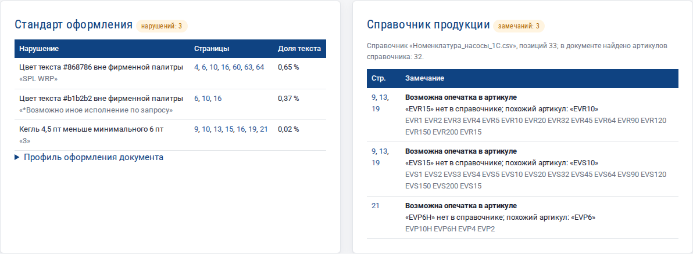
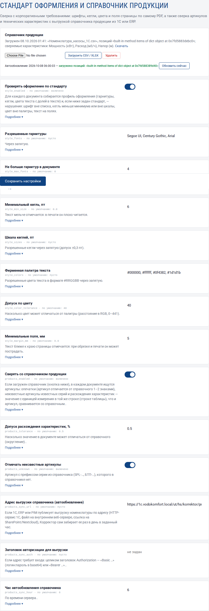
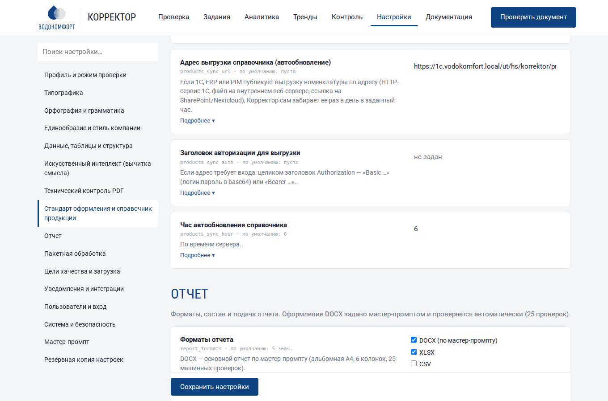

# Стандарт оформления и справочник продукции

Кроме корректуры текста, Корректор сверяет документ с двумя корпоративными эталонами:

- **стандартом оформления** — разрешенные гарнитуры, кегли, цвета текста и поля страницы;
- **справочником продукции** — выгрузкой артикулов и технических характеристик из 1С, ERP или PIM.

Результаты показываются отдельным блоком на странице задания и выгружаются в таблицу. На 25 машинных проверок отчета они не влияют: это не корректура, а контроль соответствия.



## 1. Стандарт оформления

Настройки → **«Стандарт оформления и справочник продукции»**.



| Настройка | Что проверяется | Пример |
|---|---|---|
| Разрешенные гарнитуры | шрифт каждого фрагмента текста; сравнение по семейству («Arial» разрешает Arial Bold и Arial Narrow) | `Arial, PT Sans, Symbol` |
| Не больше гарнитур в документе | пестрота шрифтов | `4` |
| Минимальный кегль, пт | слишком мелкий текст | `6` |
| Шкала кеглей, пт | кегли вне фирменной шкалы (допуск ±0,3 пт) | `8, 9, 10, 12, 14, 18, 24` |
| Фирменная палитра текста | цвет текста вне палитры (с допуском на перевод CMYK → RGB) | `#000000, #ffffff, #0f4382` |
| Минимальные поля, мм | текст ближе к краю страницы, чем допускает обрез | `5` |

Пустое значение — проверка выключена. Каждое нарушение показывается одной строкой: что нарушено, на каких страницах, какая доля текста затронута и пример фрагмента. Щелчок по номеру страницы открывает ее изображение.

### Как составить стандарт за 5 минут

1. Проверьте эталонный документ — например, последний каталог, сверстанный по брендбуку.
2. На странице задания откройте **«Профиль оформления документа»**: там перечислены гарнитуры, кегли и цвета текста с долей в тексте.
3. Перенесите в настройки то, что соответствует брендбуку, и сохраните. Следующие документы будут проверяться по этому стандарту.

!!! tip "Шрифты-«символы»"
    Значки (галочки, стрелки, «±») часто набраны отдельным шрифтом — Symbol, Wingdings, ZapfDingbats. Добавьте его в список разрешенных, чтобы он не попадал в нарушения.

## 2. Справочник продукции

### Формат файла

CSV (разделитель `;`, `,` или табуляция, кодировка UTF-8 или Windows-1251) или XLSX, первый лист:

| Артикул | Наименование | Мощность, кВт | Расход, м3/ч | Напор (м) |
|---|---|---|---|---|
| SPL-1010 | Установка повышения давления | 5,5 | 12 | 40 |
| SPL-1020 | Установка повышения давления | 7,5 | 14 | 45 |

- **Первая колонка — артикул**, вторая — наименование (необязательно).
- **Единица измерения — в заголовке колонки**: через запятую, в скобках или квадратных скобках. Колонки без единицы только хранятся и не сверяются.
- Число в ячейке — с запятой или точкой.

Загрузите файл кнопкой **«Загрузить CSV / XLSX»** в том же разделе настроек. Там же видно, когда и какой справочник загружен, сколько в нем позиций и какие характеристики сверяются; кнопка «Скачать» возвращает справочник в CSV.

### Что находит сверка

| Замечание | Когда | Пример |
|---|---|---|
| **Возможна опечатка в артикуле** | артикула нет в справочнике, но есть отличающийся на 1–2 знака | «SPL-1021» → «SPL-1020» |
| **Артикул не найден в справочнике** | артикул начинается с префикса серии из справочника (серия — от трех артикулов с общим префиксом), но такого артикула нет | «SPL-9999» |
| **Расхождение со справочником** | в строке текста ровно один артикул справочника, а значение с единицей характеристики отличается от справочного больше допуска | «SPL-1010 … 7,5 кВт» при 5,5 кВт в справочнике |
| **Расхождение в таблице со справочником** | в таблице характеристик значение в ячейке (без единицы — она в заголовке колонки или строки) отличается от справочного | колонка «Мощность, кВт», строка SPL-1020: 9 при 7,5 в справочнике |

### Таблицы характеристик

Значения в таблицах обычно стоят без единиц — единица указана в заголовке. Корректор находит такие таблицы по координатам слов на странице и сверяет ячейки по колонкам. Поддерживаются оба вида таблиц:

| «Строка — изделие» | «Колонка — изделие» |
|---|---|
| Шапка: `Модель · Мощность, кВт · Напор, м`; ниже — строки `SPL-1010 · 5,5 · 40` | Шапка: `Параметр · SPL-1010 · SPL-1020`; ниже — строки `Мощность, кВт · 5,5 · 7,5` |

Колонка характеристики узнается по ее названию из справочника («Мощность», «Напор номинальный») или по единице, если она у характеристики единственная («кВт»). Строки графиков и диаграмм (оси со значениями без названия характеристики) не сверяются. Если две характеристики имеют одну единицу («Высота, мм», «Ширина, мм»), колонка узнается только по названию.

Одно и то же замечание по разным страницам объединяется в одну строку со списком страниц. Допуск расхождения (по умолчанию 0,5 %) и поиск неизвестных артикулов настраиваются. Если справочник неполный, выключите «Отмечать неизвестные артикулы».

### Автоматическое обновление из 1С

**Способ 1 — Корректор сам забирает выгрузку.** Если 1С (HTTP-сервис), ERP или PIM публикует номенклатуру по адресу, укажите в настройках **«Адрес выгрузки справочника»**, при необходимости — **«Заголовок авторизации»** (`Basic …` или `Bearer …`) и час. Каждый день в этот час справочник обновляется; в блоке «Справочник продукции» видно время и итог последнего обновления, кнопка **«Обновить сейчас»** запускает его немедленно.



**Способ 2 — внешняя система отправляет файл.** Справочник можно обновлять из 1С, ERP или планировщика заданий запросом к REST API с токеном (Настройки → «Система и безопасность» → токен API):

```bash
curl -X POST "https://korrektor.local/api/products?name=nomenklatura.csv" \
     -H "Authorization: Bearer <токен API>" \
     --data-binary @nomenklatura.csv
# → {"ok": true, "items": 1250, "units": {"Мощность": "кВт", "Напор": "м"}}
```

В 1С это делается регламентным заданием: выгрузите номенклатуру с нужными реквизитами в CSV и отправьте ее HTTP-запросом (`HTTPСоединение`, метод `ОтправитьДляОбработки`). Каждая загрузка записывается в журнал действий.

## 3. Одинаковые изображения у разных изделий

Частая ошибка каталога — фото или чертеж одного изделия, по недосмотру поставленный к другому. Корректор сравнивает картинки документа по «отпечаткам» (перцептивный хеш из 64 бит: устойчив к пережатию, масштабу и небольшому перекадрированию) и находит одинаковые или почти одинаковые картинки рядом с разными обозначениями изделий.

| Настройка | Что задает | По умолчанию |
|---|---|---|
| Одинаковые изображения у разных изделий | включить проверку | включено |
| Похожесть изображений (0–12) | насколько картинки могут различаться: 0 — только идентичные, 4 — то же фото после перекадрирования или пережатия | 4 |
| Картинка встречается не чаще | картинка, повторенная чаще, считается элементом оформления (логотип, значок) и не проверяется | 3 |

Подпись картинки — ближайшая строка текста. Если загружен справочник продукции, учитываются его артикулы: картинки рядом с одним и тем же изделием не считаются ошибкой. Результат — блок «Изображения» на странице задания (миниатюры, страницы, подписи) и лист «Изображения» в выгрузке XLSX. В таблицу замечаний отчета изображения не попадают: решение принимает корректор по миниатюрам.

## 4. Нумерация рисунков и таблиц

Правило «Нумерация рисунков и таблиц» (раздел «Данные, таблицы и структура») проверяет подписи «Рисунок N», «Рис. N», «Таблица N», «Табл. N», в том числе по разделам («Рисунок 3.2»):

- повторы номеров («Таблица 4» дважды);
- пропуски («Рисунок 5» после «Рисунка 3»);
- нарушенный порядок;
- ссылки в тексте («см. рис. 7», «в таблице 3») на номера, которых нет.

Подписи «Продолжение таблицы» не считаются. Замечания попадают в отчет с типом «Требует проверки автором»: какой номер правильный, решает автор.

## 5. Выгрузка и аналитика

- **Выгрузка задания**: ссылка «Выгрузить стандарт оформления и сверку со справочником (XLSX)» под блоками. В файле четыре листа: нарушения оформления, профиль оформления, изображения, замечания по справочнику.
- **Аналитика**: на графике «Предпечатная проверка и стандарты» видно, сколько документов нарушают стандарт оформления и сколько расходятся со справочником.
- **Отчет для руководства** (PDF) содержит те же показатели в таблице «Предпечатная проверка и стандарты».
