# Тренды

Раздел **«Тренды»** показывает, как меняется качество документов и работа сервиса во времени. Здесь видно, стало ли ошибок меньше после внедрения глоссария, какие правила срабатывают все чаще, становится ли новая версия каталога чище предыдущей и когда сервис загружен больше всего.

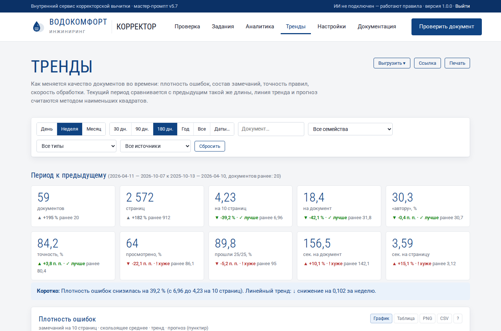

## 1. Шаг и период

Панель фильтров такая же, как в разделе [Аналитика](analytics.md#2-фильтры), с двумя отличиями:

- **Шаг: День / Неделя / Месяц** — как группировать документы по времени. Для периода до 30 дней удобен день, до полугода — неделя, для года и больше — месяц. Неделя начинается с понедельника и подписывается датой понедельника («нед. 06.04»).
- **Период** по умолчанию — 180 дней. «Все» начинается с первого проверенного документа.

Фильтры по документу, семейству, типу и источнику работают так же, как в аналитике: например, тип «Единообразие» покажет тренд только этой категории.

## 2. Период к предыдущему

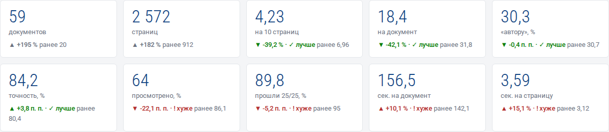

Каждая плитка сравнивает выбранный период с **предыдущим периодом такой же длины**. Например, для «180 дней» с 11.04 по 07.10 предыдущий период — с 13.10 прошлого года по 10.04. Даты обоих периодов указаны в заголовке.

Под значением:

- стрелка ▲ (рост) или ▼ (снижение) и величина изменения: в процентах — для количеств, в процентных пунктах (п. п.) — для долей;
- оценка **«✓ лучше»** (зеленая) или **«! хуже»** (красная). Для плотности ошибок, доли «автору» и времени обработки лучше — меньше; для точности, доли просмотренных и доли отчетов 25/25 лучше — больше. Для числа документов и страниц оценки нет: это объем работы;
- значение предыдущего периода («ранее …»).

Если в предыдущем периоде документов не было, вместо изменения стоит «ранее —».

Под плитками — строка **«Коротко»**: изменение плотности ошибок словами, направление тренда, правила, которые стали срабатывать заметно чаще (больше чем на 30 %), и правила, сработавшие впервые.

## 3. Плотность ошибок: тренд и прогноз

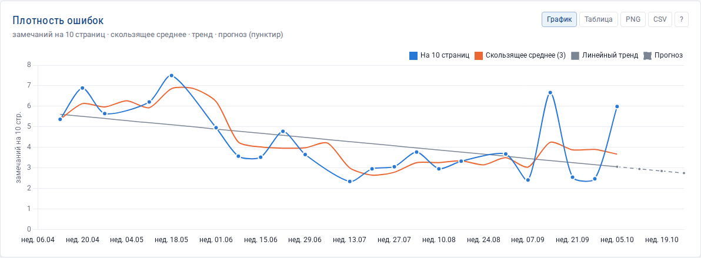

Главный график раздела. Четыре линии:

| Линия | Что показывает |
|---|---|
| **На 10 страниц** (синяя, с точками) | фактическая плотность ошибок в каждом периоде. Периоды без документов пропускаются |
| **Скользящее среднее (3)** (оранжевая) | среднее за текущий и два предыдущих периода: сглаживает случайные всплески — один «грязный» документ не меняет картину |
| **Линейный тренд** (серая) | прямая, лучше всего проходящая через точки (метод наименьших квадратов). Наклон вниз — качество растет |
| **Прогноз** (серый пунктир) | продолжение тренда на 3 периода вперед. Пунктиром рисуется только прогноз |

При наведении на график всплывает подсказка со всеми значениями периода. Прогноз — ориентир, а не обещание: при 5–10 точках он заметно колеблется от одного нового документа.

## 4. Объем работы

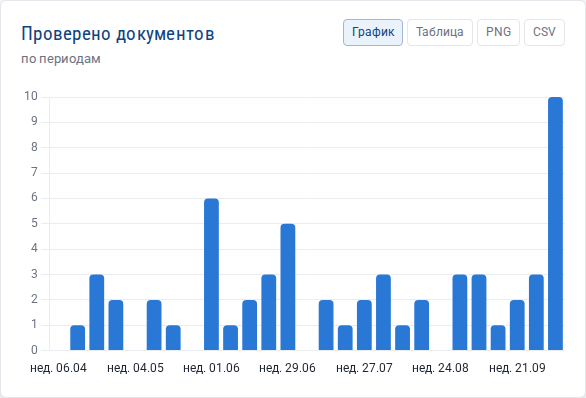

Два графика: **документов** и **страниц** по периодам. Отдельные графики, а не одна диаграмма с двумя шкалами, чтобы не возникало ложного впечатления о связи величин разного масштаба.

## 5. Состав замечаний

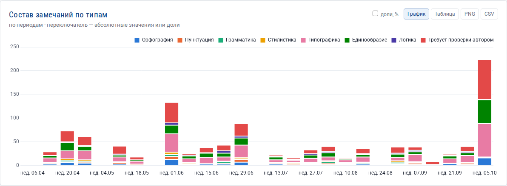

Столбцы по периодам, разделенные на 8 типов ошибок. Флажок **«доли, %»** переключает на проценты: каждый столбец становится 100 % и видно, как меняется **структура** ошибок независимо от объема.

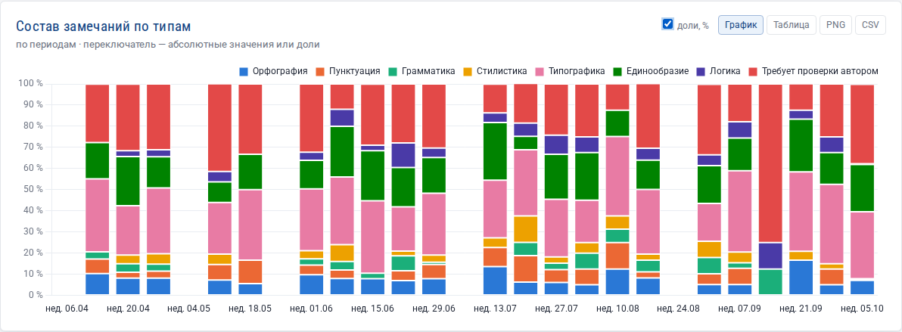

Пример: доля «Единообразия» снизилась после пополнения глоссария, а доля «Требует проверки автором» — после пополнения белого списка.

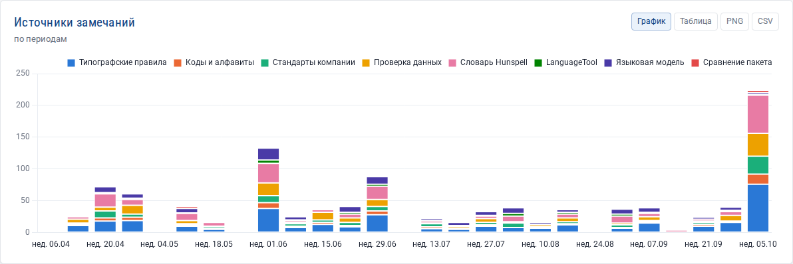

«Источники замечаний» — то же по механизмам проверки. После подключения языковой модели появится новый слой «Языковая модель».

## 6. Качество работы

Четыре отдельных графика по периодам:

| График | Норма | Если плохо |
|---|---|---|
| **Доля «Требует проверки автором»** | ниже 30 % | пополнить белый список и глоссарий, проверить «Действие для слов вне словаря» |
| **Точность замечаний** | выше 80 % | открыть «Точность правил» в аналитике и смягчить правила с ⚠ |
| **Отчеты, прошедшие 25/25** | 100 % | «Машинная проверка отчетов» в аналитике |
| **Время обработки** | стабильно | рост — больше страниц, ИИ или нехватка ресурсов сервера; см. «Этапы обработки» |

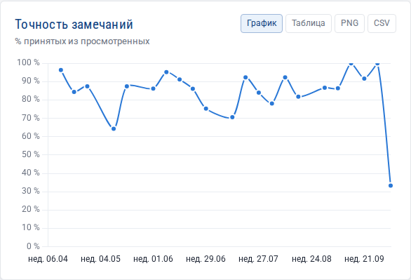

## 7. Динамика правил

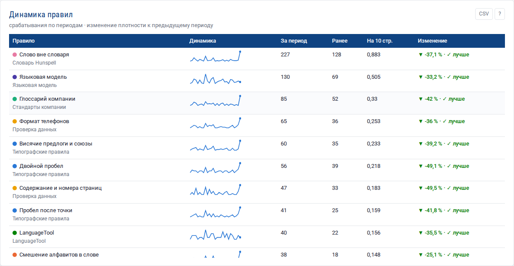

25 самых частых правил. Для каждого:

- **Динамика** — мини-график числа срабатываний по периодам;
- **За период / Ранее** — срабатывания в текущем и предыдущем периодах;
- **На 10 стр.** — срабатывания на 10 страниц;
- **Изменение** — как изменилась частота **на 10 страниц** по сравнению с предыдущим периодом. Поэтому рост числа проверенных документов сам по себе не дает «роста» ошибок. ▼ и «✓ лучше» — правило срабатывает реже, ошибок этого вида меньше.

В CSV-выгрузке этой таблицы есть значения по каждому периоду.

## 8. Новое в периоде

Три списка того, чего не было **до начала периода**:

- **Новые правила** — проверки, сработавшие впервые; ниже — правила, которые раньше срабатывали, а в этом периоде нет («Больше не срабатывают» — хороший знак);
- **Новые ошибки** — пары «ошибка → исправление», не встречавшиеся раньше;
- **Новые слова вне словаря** — кандидаты в белый список или новые опечатки.

Если до начала периода документов не было, сервис предупреждает: все будет «новым». Расширьте период или выберите более поздний.

## 9. Версии документов

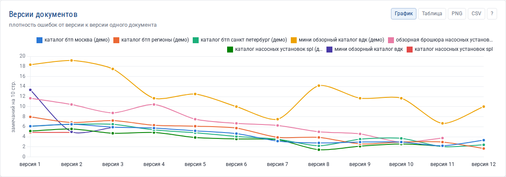

Сервис объединяет версии одного документа в **семейство** по названию без номеров версий, дат и служебных слов: «Каталог_SPL_v2», «Каталог SPL v3», «Каталог_SPL (1)», «Каталог_SPL_итог» — одно семейство «каталог spl». График показывает плотность ошибок от версии к версии (до 8 семейств с наибольшим числом версий). Линия вниз — правки вносятся, документ становится чище. Линия вверх — в новую версию добавили новый текст или старые ошибки вернулись.

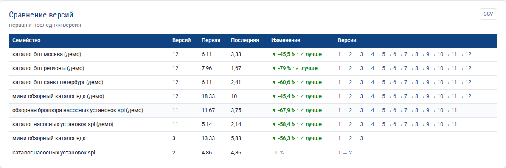

Таблица «Сравнение версий» показывает первую и последнюю версии и изменение в процентах. Номера версий — ссылки на задания.

!!! note "Чтобы семейства собирались правильно"
    Называйте файлы версий одинаково, меняя только номер: «Каталог_БТП_v1.pdf», «Каталог_БТП_v2.pdf». Для сравнения двух версий построчно загрузите их вместе пакетом (см. [Работа с сервисом](usage.md)).

## 10. Календарь и нагрузка

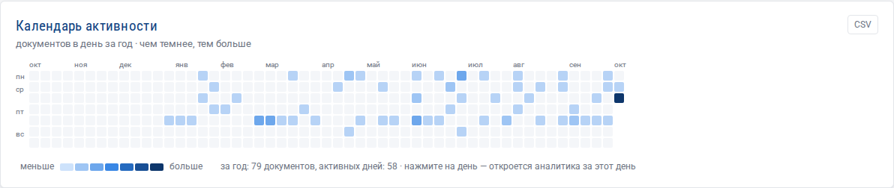

**Календарь активности** — квадрат на каждый день последнего года, строки — дни недели. Чем темнее, тем больше документов проверено в этот день. Нажатие на день открывает аналитику только за этот день.

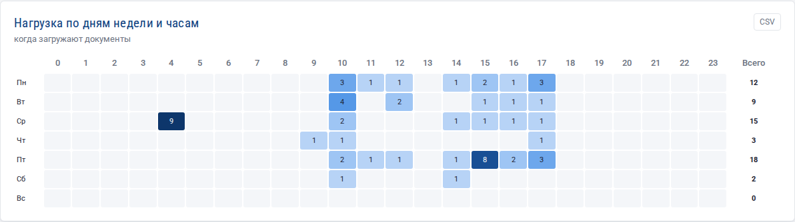

**Нагрузка по дням недели и часам** — когда загружают документы. Полезно администратору: плановые работы и обновления лучше проводить в самые «светлые» часы.

## 11. Выгрузка

Кнопка **«Выгрузить»**: Excel (листы «Динамика», «Типы по периодам», «Правила», «Версии документов», «Новое в периоде»), CSV и JSON. В листе «Динамика» есть плотность ошибок, скользящее среднее, тренд и строки прогноза — по ним можно построить свой график в Excel. У каждого графика также есть кнопки PNG и CSV.

## 12. Как пользоваться трендами: три сценария

**Ежемесячный отчет руководителю.** Шаг «Месяц», период «Год». Скопируйте ссылку, выгрузите Excel и PNG графика «Плотность ошибок». В письме: изменение плотности к предыдущему периоду, три правила с наибольшим ростом, доля отчетов 25/25.

**Оценка эффекта глоссария.** Запомните дату пополнения глоссария. Через месяц откройте тренды с шагом «Неделя», тип «Единообразие»: столбцы после даты должны стать ниже, а в «Динамике правил» у «Глоссарий компании» — сначала рост (сервис стал находить больше), затем снижение (авторы перестали ошибаться).

**Контроль подготовки каталога.** Фильтр «Семейство» — нужный каталог. График «Версии документов» показывает, как каждая итерация правок снижает число ошибок; в «Новом в периоде» видно, не добавила ли последняя версия новых ошибок.
