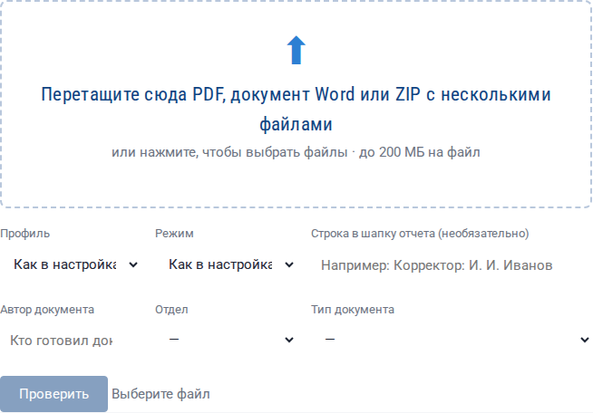
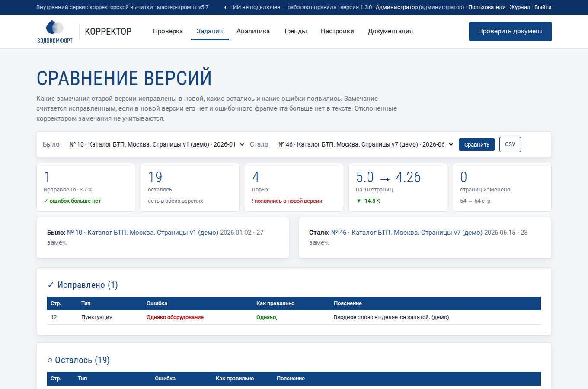
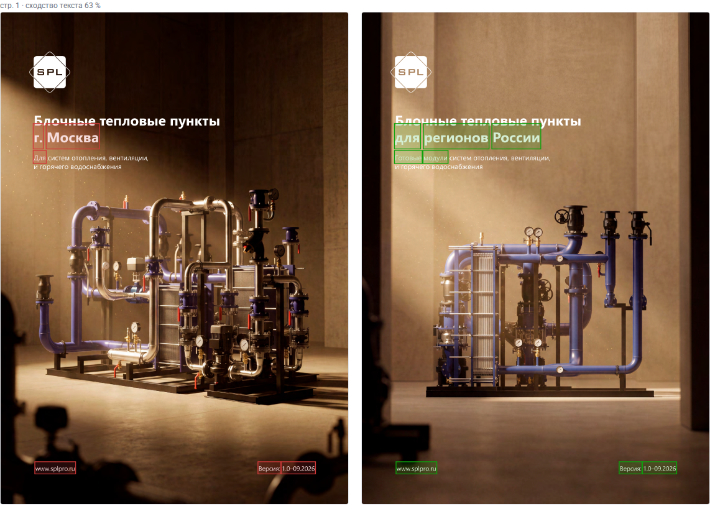
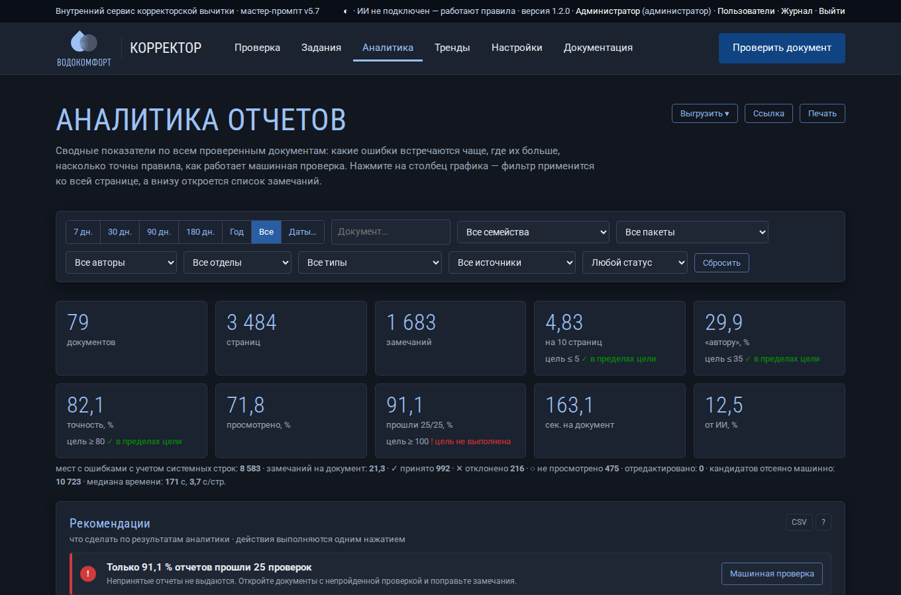
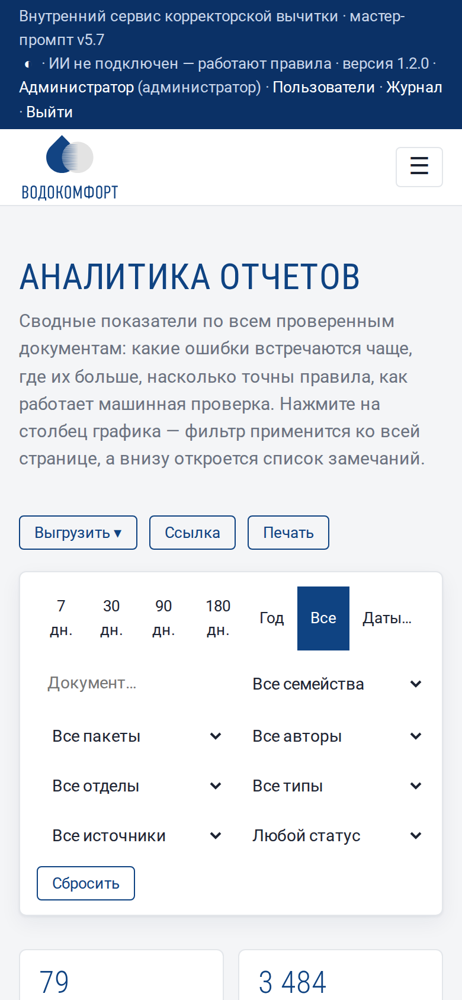
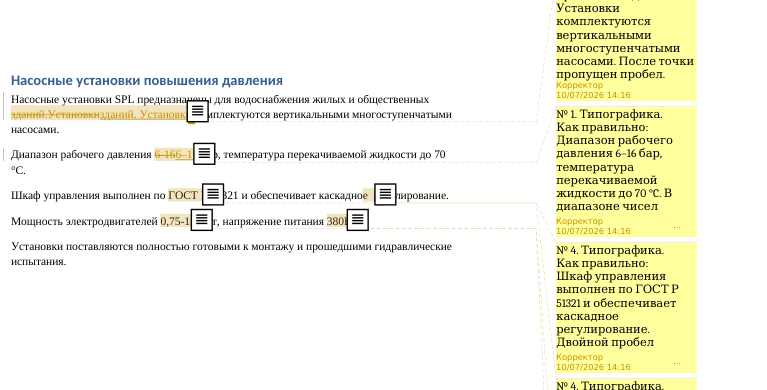

# Работа с сервисом

Пошаговое описание всех страниц и кнопок. Если вы впервые открываете сервис, начните с раздела [Обзор и быстрый старт](index.md).

## 1. Вход

Откройте адрес сервиса (например, `http://korrektor.local/` или `http://10.0.0.15:8080/`) и введите **логин и пароль**, выданные администратором (или доменные, если включен вход через LDAP). После входа браузер помнит вас 14 дней. В правом верхнем углу темной полосы — ваше имя (ссылка на [профиль](users.md#6-профиль)), роль и кнопка **«Выйти»**. Что разрешено каждой роли — в разделе [Пользователи, роли и журнал](users.md).

!!! note "Если пароль неизвестен"
    Логин и пароль выдает администратор. Пароль встроенного администратора `admin` показывается в конце установки; посмотреть — `sudo korrektor password`, сменить — `sudo korrektor passwd`.

## 2. Главная страница: новая проверка

Вверху — что умеет сервис, в темной полосе справа — подключена ли языковая модель («ИИ подключен» или «работают правила»).

### Загрузка файлов

1. Перетащите файлы в рамку или щелкните по ней и выберите файлы.
2. Принимаются **PDF**, документы **Word (DOCX, DOC), ODT, RTF** и **ZIP** с такими файлами внутри. Один файл — одно задание; несколько файлов — пакет. Документы Word сервис сам преобразует в PDF (нужен LibreOffice на сервере — ключ установщика `--with-office`); нумерация страниц в отчете — по получившемуся PDF.
3. Под рамкой можно выбрать:
   - **Профиль** — набор настроек именно для этой проверки (Стандартный, Строгий, Мягкий, Только типографика). «Как в настройках» — использовать сохраненные настройки.
   - **Режим** — только правила, правила + ИИ или автоматически.
   - **Строка в шапку отчета** — например, «Корректор: И. И. Иванов». Появится в шапке DOCX.
   - **Тип документа** — каталог, паспорт изделия, брошюра и т. д. (список задает администратор). У типа может быть своя цель по плотности ошибок; в аналитике есть разбивка и фильтр по типам.
   - **Автор документа** и **отдел** — кто готовил документ. Используются в аналитике («По авторам», «По отделам») и в уведомлениях. Автору подставляются его имя и отдел из профиля.
4. Нажмите **«Проверить»**. Полоса показывает загрузку файла; затем откроется страница задания или пакета.

!!! warning "Требования к PDF"
    Нужен PDF с текстовым слоем (такой получается при экспорте из InDesign, Word, CorelDRAW). Если PDF собран из картинок (скан), текст можно извлечь только распознаванием (OCR) — его включает администратор.

## 3. Страница задания

### Ход проверки

Пока задание выполняется, показывается текущий этап и процент: извлечение текста, изображения страниц, технический контроль, правила, словарь, ИИ, сборка отчета. Страница обновляется сама.

### Итоги и скачивание

Четыре цифры вверху:

| Цифра | Значение |
|---|---|
| страниц проверено | сколько страниц в PDF |
| замечаний в отчете | сколько строк будет в DOCX (без отклоненных) |
| требуют решения автора | замечания «Требует проверки автором» |
| машинная проверка оформления | например, 25/25 — отчет принят; зеленая — можно скачивать |

Кнопки скачивания:

- **Отчет DOCX** — основной результат по мастер-промпту.
- **PDF с пометками** — исходный документ с подсветкой ошибок.
- **XLSX**, **CSV**, **findings.json** — если включены в настройках «Отчет → Форматы отчета».
- **Все одним архивом** — ZIP со всеми файлами.

### Результат 25 машинных проверок

Раскройте «Результат 25 машинных проверок оформления». ✅ — требование выполнено, ❌ — нарушено, рядом причина.

### Технический контроль PDF

Отдельный блок с проблемами файла: невстроенные шрифты, картинки с низким разрешением, разные размеры страниц, страницы без текста, серые заглушки на месте иллюстраций. В таблицу замечаний эти пункты не входят, но перечислены в шапке отчета.

### Стандарт оформления и справочник продукции

Два блока рядом: нарушения корпоративного стандарта оформления (шрифты, кегли, цвета, поля) с профилем оформления документа и замечания сверки со справочником продукции (опечатки в артикулах, неизвестные артикулы, расхождения характеристик). Номера страниц открывают изображение страницы; ссылка под блоками выгружает все в XLSX. Подробнее — [Стандарт оформления и справочник](standards.md).

### Таблица замечаний

Колонки те же, что в DOCX: ошибка выделена красным, исправление — зеленым. Над таблицей фильтры:

- **тип** — одна из 8 категорий;
- **состояние** — не просмотрено, принято, отклонено;
- **источник** — правила, словарь, ИИ, данные и таблицы;
- **поиск по тексту**.

Кнопки справа у каждой строки:

| Кнопка | Действие |
|---|---|
| ✓ | принять замечание (зеленая метка слева) |
| ✕ | отклонить — строка зачеркивается и не попадет в отчет |
| ✎ | изменить тип, исправление и пояснение |

Повторный щелчок по ✓ или ✕ снимает отметку.

### Просмотр страницы

Щелкните по номеру страницы в колонке «Стр., пункт» — откроется изображение этой страницы документа. Закрыть — кнопкой «Закрыть» или щелчком мимо окна.

### Изменение замечания

- **Тип** — категория замечания. Если выбрать «Требует проверки автором», колонка «Как правильно» станет «—».
- **Как правильно** — готовый текст для вставки (без пояснений и вариантов на выбор — это запрещено мастер-промптом).
- **Исправленный фрагмент** — часть текста выше, которая будет выделена зеленым. Должна входить в «Как правильно» дословно.
- **Пояснение** — правило или суть расхождения.

После сохранения замечание автоматически отмечается как принятое.

### Итог и пересборка отчета

Итог (2–4 предложения) составляется автоматически. Его можно отредактировать — без рекомендаций и советов (п. 0.16 мастер-промпта; машинная проверка это контролирует). Нажмите **«Пересобрать отчет»**: сервис соберет DOCX заново с учетом ваших отметок и снова выполнит 25 проверок.

### Колонтитулы и шапка отчета

Внизу страницы — все варианты колонтитулов документа с диапазонами страниц (чужой колонтитул сразу заметен) и шапка будущего отчета. Если в документе есть ссылки «см. стр. N», они перечислены со статусом.

### Журнал, перезапуск, удаление

- **Журнал обработки** — подробности каждого этапа; пригодится администратору при неполадках.
- **Проверить заново** — выполнить проверку с текущими настройками (ручные отметки будут потеряны).
- **Удалить** — удалить задание и все его файлы.
- **Исходный PDF** — скачать загруженный документ.

## 4. Пакет документов

Если загружено несколько файлов, открывается страница пакета:

1. **Таблица заданий** — состояние каждого документа.
2. **Сводка по пакету** — страницы, замечания, результат проверки для каждого документа.
3. **Версии одного документа** — какие страницы различаются между версиями и что именно изменилось (раскройте строку).
4. **Расхождения реквизитов** — один телефон или e-mail рядом с разными адресами в разных документах. Каждое расхождение уже добавлено в отчет соответствующего документа.

## 5. Раздел «Задания»

Список всех проверок: номер, документ, автор и отдел (и кто загрузил), время загрузки, число страниц, состояние, число замечаний, результат проверки оформления. Активные задания обновляются сами. Старые задания удаляются автоматически через срок из настройки «Хранить задания, дней».

## 6. Аналитика и тренды

В верхнем меню — разделы **«Аналитика»** и **«Тренды»**. Аналитика собирает показатели и графики по всем проверенным документам, тренды — их изменение во времени. На странице готового задания кнопка **«Аналитика»** открывает графики только этого документа. Подробно — в разделах [Аналитика отчетов](analytics.md) и [Тренды](trends.md).

## 7. Сравнение версий

Когда автор прислал исправленную версию, загрузите ее как новое задание и нажмите на ее странице **«Сравнить версии»**: сервис сам подставит предыдущую версию того же документа (по названию без номеров версий и дат) и покажет:

| Блок | Что в нем |
|---|---|
| **✓ Исправлено** | замечания старой версии, которых нет в новой, и ошибочного фрагмента больше нет в тексте |
| **○ Осталось** | такое же замечание есть в новой версии — правку не внесли |
| **! Новые ошибки** | замечания новой версии, которых не было в старой — их добавили при правке |
| **Нет в отчете, но фрагмент остался** | замечания нет, а фрагмент в тексте есть: правило выключено или замечание отклонено — проверьте вручную |

Вверху — сколько исправлено (и процент), плотность ошибок «было → стало», какие страницы изменились. Блок **«Изменения на страницах»** показывает измененные страницы рядом: слева старая версия, удаленный текст обведен красным; справа новая, добавленный текст — зеленым. Нажатие на страницу открывает ее крупно.

 Любые два задания можно выбрать в списках «Было» и «Стало». **CSV** сохраняет сравнение для передачи автору. Отклоненные корректором замечания (✕) не учитываются.

## 8. Темная тема и телефон

Кнопка **◐** в левой части темной полосы переключает тему: как в системе → темная → светлая. Выбор запоминается в браузере.

На телефоне и планшете меню открывается кнопкой **☰**, таблицы прокручиваются вбок, графики и фильтры перестраиваются в одну колонку.

## 9. Как пользоваться отчетом DOCX

1. Откройте отчет в Word, LibreOffice или «Мой Офис».
2. Идите по таблице сверху вниз — замечания отсортированы по страницам.
3. Для каждой строки найдите цитату из колонки «Как в документе» в исходном файле верстки (Ctrl+F) и замените ее текстом из «Как правильно».
4. Строки «Требует проверки автором» передайте автору: в «Пояснении» сформулирован вопрос.
5. Для висячих предлогов исправление — неразрывный пробел: в Word — Ctrl+Shift+Пробел, в InDesign — Ctrl+Alt+X (Windows) или ⌥⌘X (macOS).
6. Системные строки («системно: стр. …») исправляются во всех перечисленных местах; удобно делать заменой по всему документу.

## 10. Правки прямо в документе Word

Если загружен документ Word (DOCX, а также DOC, ODT, RTF), на странице задания появляется кнопка **«Правки в Word»**. Это копия вашего документа, в которой:

- ошибки с готовым исправлением внесены **в режиме рецензирования** — зачеркнуто «как было», подчеркнуто «как правильно»;
- у каждого замечания — **примечание** с номером, типом, правильным вариантом и пояснением;
- «Требует проверки автором» — только примечание, без правки.

Автор открывает файл в Word, на вкладке **«Рецензирование»** проходит правки кнопками «Принять» / «Отклонить» и отвечает на примечания. Места, где ошибка задевает табуляцию, рисунок, сноску или поле, сервис не правит — такие замечания остаются в основном отчете DOCX. Формат включается в настройках «Отчет → Форматы отчета» («Правки в исходном Word»), имя автора правок — «Автор правок в Word».

## 11. Как пользоваться PDF с пометками

Откройте файл `…_пометки.pdf` в Acrobat Reader, браузере или другой программе просмотра PDF. Каждая ошибка подсвечена: желтым — ошибка, голубым — вопрос автору. Наведите указатель или щелкните по подсветке — появится комментарий с номером замечания, типом, правильным вариантом и пояснением. В Acrobat список всех комментариев открывается на панели «Комментарии».

## 12. Советы

- Загружайте **последнюю версию** PDF из программы верстки, а не печатную с метками реза.
- Для каталогов в нескольких региональных версиях загружайте **все версии одним пакетом** — получите различия и сверку реквизитов.
- После каждого отчета **пополняйте белый список и глоссарий** в настройках — следующая проверка будет точнее.
- Если нужен только контроль перед печатью, выберите профиль **«Только типографика»**.
