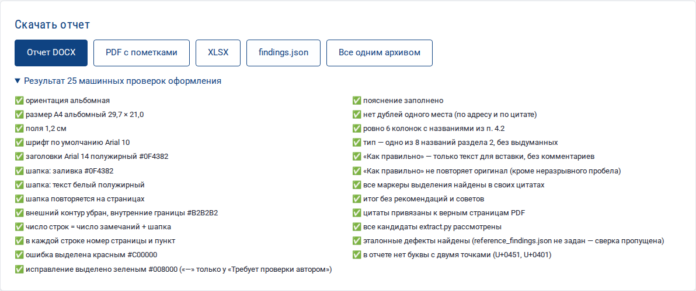
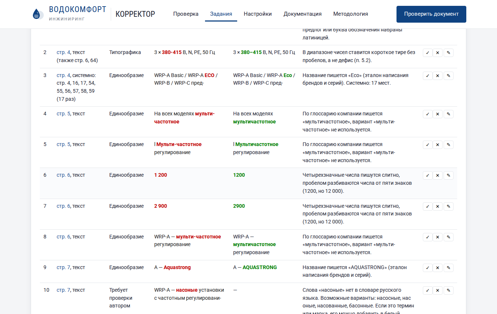
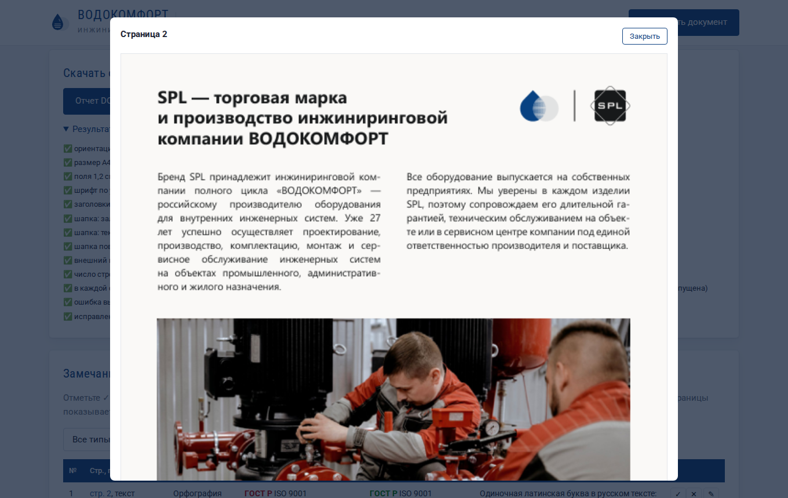
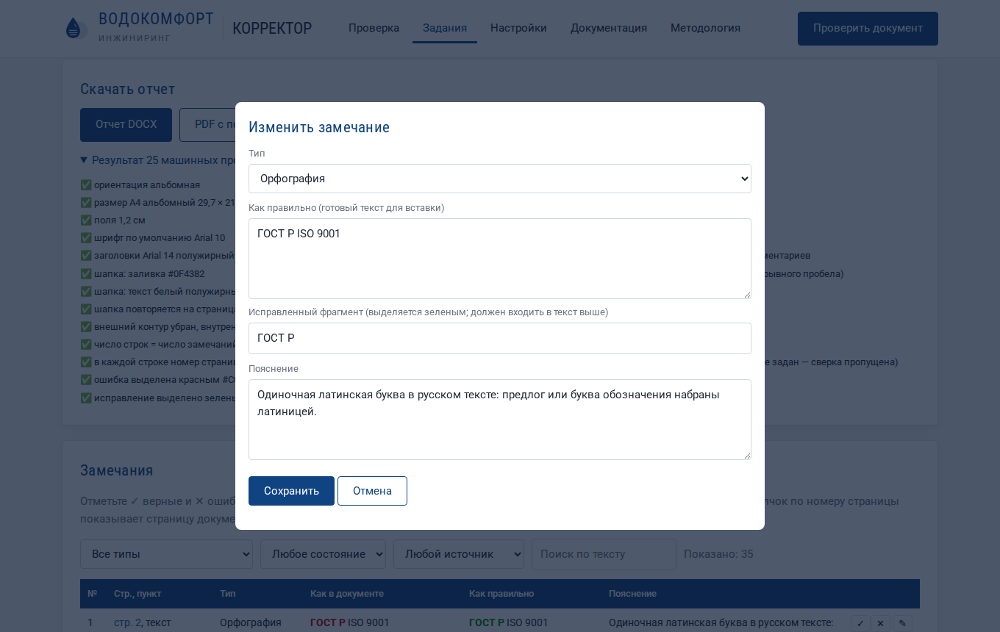
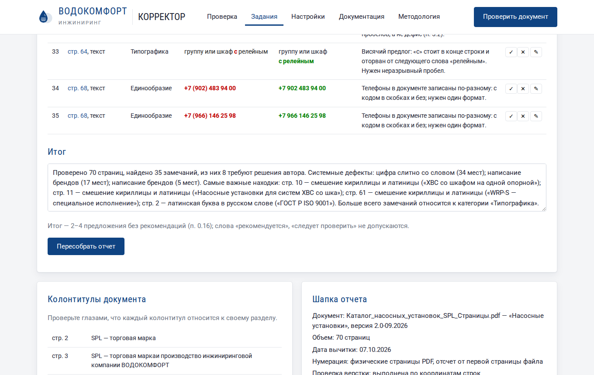
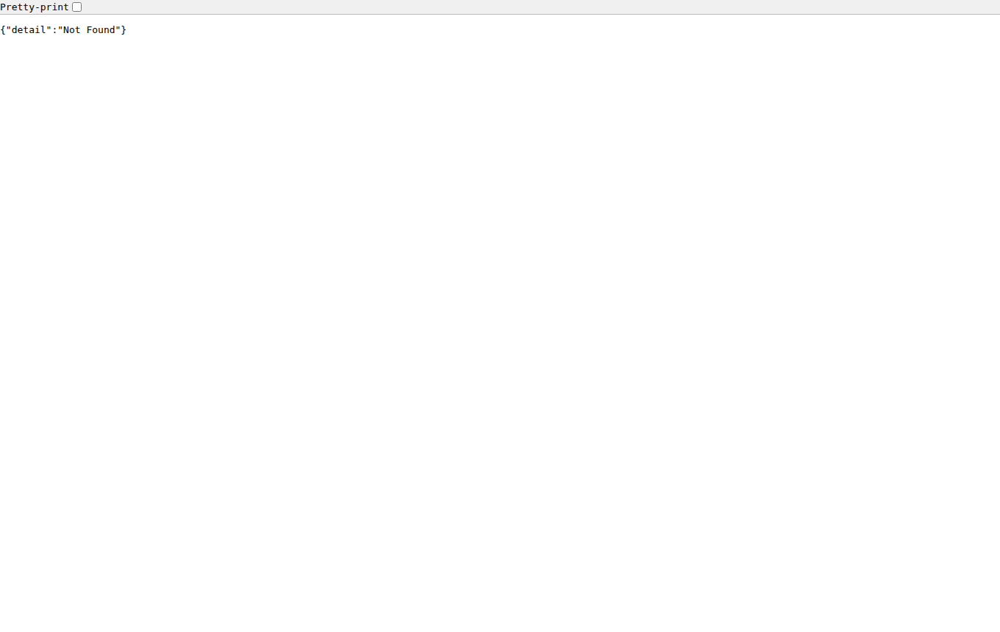
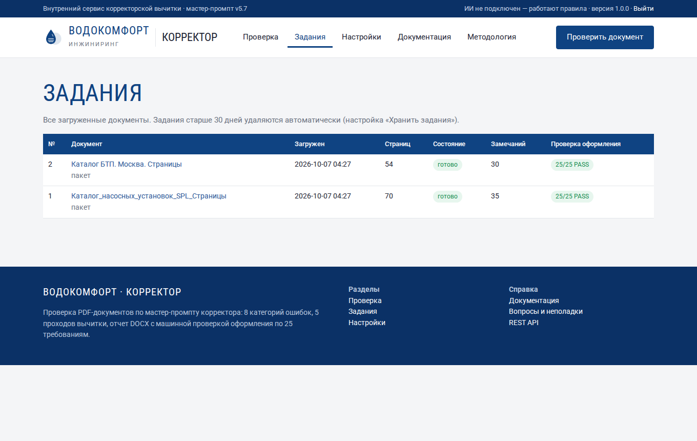

# Работа с сервисом

Пошаговое описание всех страниц и кнопок. Если вы впервые открываете сервис, начните с раздела [Обзор и быстрый старт](index.md).

## 1. Вход

Откройте адрес сервиса (например, `http://korrektor.local/` или `http://10.0.0.15:8080/`) и введите пароль администратора. После входа браузер помнит вас 14 дней. Кнопка **«Выйти»** — в правом верхнем углу темной полосы.

!!! note "Если пароль неизвестен"
    Пароль показывается в конце установки. Администратор сервера может посмотреть его командой `sudo korrektor password` или сменить командой `sudo korrektor passwd`.

## 2. Главная страница: новая проверка

Вверху — что умеет сервис, в темной полосе справа — подключена ли языковая модель («ИИ подключен» или «работают правила»).

### Загрузка файлов

1. Перетащите файлы в рамку или щелкните по ней и выберите файлы.
2. Принимаются **PDF** и **ZIP** с PDF внутри. Один файл — одно задание; несколько файлов — пакет.
3. Под рамкой можно выбрать:
   - **Профиль** — набор настроек именно для этой проверки (Стандартный, Строгий, Мягкий, Только типографика). «Как в настройках» — использовать сохраненные настройки.
   - **Режим** — только правила, правила + ИИ или автоматически.
   - **Строка в шапку отчета** — например, «Корректор: И. И. Иванов». Появится в шапке DOCX.
4. Нажмите **«Проверить»**. Полоса показывает загрузку файла; затем откроется страница задания или пакета.

!!! warning "Требования к PDF"
    Нужен PDF с текстовым слоем (такой получается при экспорте из InDesign, Word, CorelDRAW). Если PDF собран из картинок (скан), текст можно извлечь только распознаванием (OCR) — его включает администратор.

## 3. Страница задания

### Ход проверки

Пока задание выполняется, показывается текущий этап и процент: извлечение текста, изображения страниц, технический контроль, правила, словарь, ИИ, сборка отчета. Страница обновляется сама.

### Итоги и скачивание

Четыре цифры вверху:

| Цифра | Значение |
|---|---|
| страниц проверено | сколько страниц в PDF |
| замечаний в отчете | сколько строк будет в DOCX (без отклоненных) |
| требуют решения автора | замечания «Требует проверки автором» |
| машинная проверка оформления | например, 25/25 — отчет принят; зеленая — можно скачивать |

Кнопки скачивания:

- **Отчет DOCX** — основной результат по мастер-промпту.
- **PDF с пометками** — исходный документ с подсветкой ошибок.
- **XLSX**, **CSV**, **findings.json** — если включены в настройках «Отчет → Форматы отчета».
- **Все одним архивом** — ZIP со всеми файлами.

### Результат 25 машинных проверок

Раскройте «Результат 25 машинных проверок оформления». ✅ — требование выполнено, ❌ — нарушено, рядом причина.

### Технический контроль PDF

Отдельный блок с проблемами файла: невстроенные шрифты, картинки с низким разрешением, разные размеры страниц, страницы без текста, серые заглушки на месте иллюстраций. В таблицу замечаний эти пункты не входят, но перечислены в шапке отчета.

### Таблица замечаний

Колонки те же, что в DOCX: ошибка выделена красным, исправление — зеленым. Над таблицей фильтры:

- **тип** — одна из 8 категорий;
- **состояние** — не просмотрено, принято, отклонено;
- **источник** — правила, словарь, ИИ, данные и таблицы;
- **поиск по тексту**.

Кнопки справа у каждой строки:

| Кнопка | Действие |
|---|---|
| ✓ | принять замечание (зеленая метка слева) |
| ✕ | отклонить — строка зачеркивается и не попадет в отчет |
| ✎ | изменить тип, исправление и пояснение |

Повторный щелчок по ✓ или ✕ снимает отметку.

### Просмотр страницы

Щелкните по номеру страницы в колонке «Стр., пункт» — откроется изображение этой страницы документа. Закрыть — кнопкой «Закрыть» или щелчком мимо окна.

### Изменение замечания

- **Тип** — категория замечания. Если выбрать «Требует проверки автором», колонка «Как правильно» станет «—».
- **Как правильно** — готовый текст для вставки (без пояснений и вариантов на выбор — это запрещено мастер-промптом).
- **Исправленный фрагмент** — часть текста выше, которая будет выделена зеленым. Должна входить в «Как правильно» дословно.
- **Пояснение** — правило или суть расхождения.

После сохранения замечание автоматически отмечается как принятое.

### Итог и пересборка отчета

Итог (2–4 предложения) составляется автоматически. Его можно отредактировать — без рекомендаций и советов (п. 0.16 мастер-промпта; машинная проверка это контролирует). Нажмите **«Пересобрать отчет»**: сервис соберет DOCX заново с учетом ваших отметок и снова выполнит 25 проверок.

### Колонтитулы и шапка отчета

Внизу страницы — все варианты колонтитулов документа с диапазонами страниц (чужой колонтитул сразу заметен) и шапка будущего отчета. Если в документе есть ссылки «см. стр. N», они перечислены со статусом.

### Журнал, перезапуск, удаление

- **Журнал обработки** — подробности каждого этапа; пригодится администратору при неполадках.
- **Проверить заново** — выполнить проверку с текущими настройками (ручные отметки будут потеряны).
- **Удалить** — удалить задание и все его файлы.
- **Исходный PDF** — скачать загруженный документ.

## 4. Пакет документов

Если загружено несколько файлов, открывается страница пакета:

1. **Таблица заданий** — состояние каждого документа.
2. **Сводка по пакету** — страницы, замечания, результат проверки для каждого документа.
3. **Версии одного документа** — какие страницы различаются между версиями и что именно изменилось (раскройте строку).
4. **Расхождения реквизитов** — один телефон или e-mail рядом с разными адресами в разных документах. Каждое расхождение уже добавлено в отчет соответствующего документа.

## 5. Раздел «Задания»

Список всех проверок: номер, документ, время загрузки, число страниц, состояние, число замечаний, результат проверки оформления. Активные задания обновляются сами. Старые задания удаляются автоматически через срок из настройки «Хранить задания, дней».

## 6. Как пользоваться отчетом DOCX

1. Откройте отчет в Word, LibreOffice или «Мой Офис».
2. Идите по таблице сверху вниз — замечания отсортированы по страницам.
3. Для каждой строки найдите цитату из колонки «Как в документе» в исходном файле верстки (Ctrl+F) и замените ее текстом из «Как правильно».
4. Строки «Требует проверки автором» передайте автору: в «Пояснении» сформулирован вопрос.
5. Для висячих предлогов исправление — неразрывный пробел: в Word — Ctrl+Shift+Пробел, в InDesign — Ctrl+Alt+X (Windows) или ⌥⌘X (macOS).
6. Системные строки («системно: стр. …») исправляются во всех перечисленных местах; удобно делать заменой по всему документу.

## 7. Как пользоваться PDF с пометками

Откройте файл `…_пометки.pdf` в Acrobat Reader, браузере или другой программе просмотра PDF. Каждая ошибка подсвечена: желтым — ошибка, голубым — вопрос автору. Наведите указатель или щелкните по подсветке — появится комментарий с номером замечания, типом, правильным вариантом и пояснением. В Acrobat список всех комментариев открывается на панели «Комментарии».

## 8. Советы

- Загружайте **последнюю версию** PDF из программы верстки, а не печатную с метками реза.
- Для каталогов в нескольких региональных версиях загружайте **все версии одним пакетом** — получите различия и сверку реквизитов.
- После каждого отчета **пополняйте белый список и глоссарий** в настройках — следующая проверка будет точнее.
- Если нужен только контроль перед печатью, выберите профиль **«Только типографика»**.
