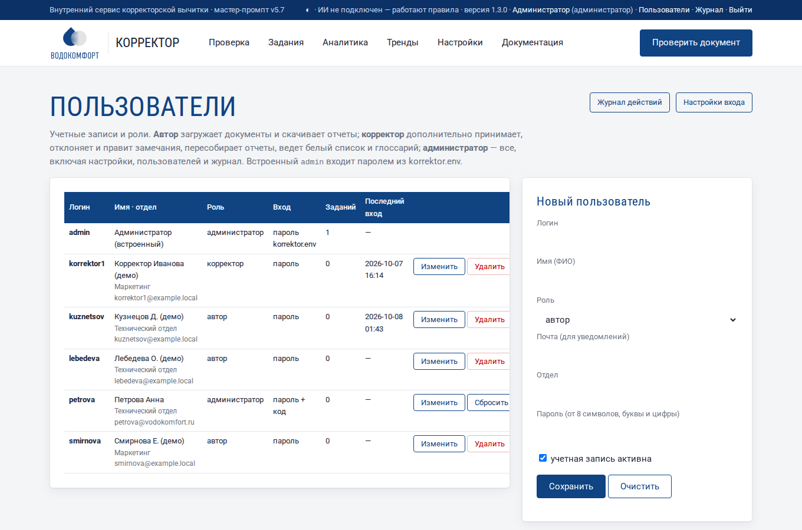
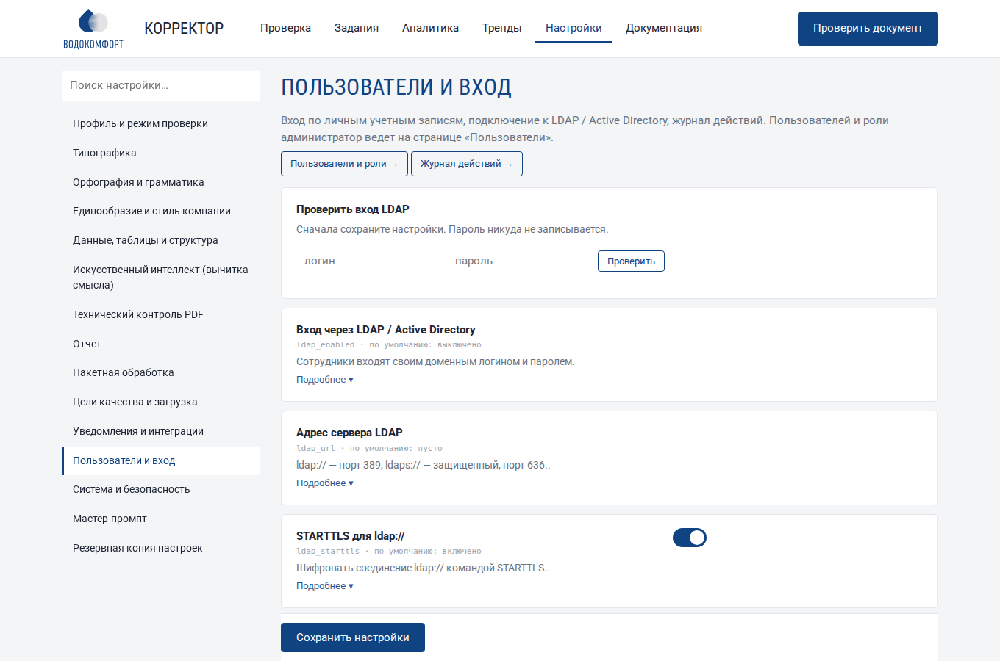
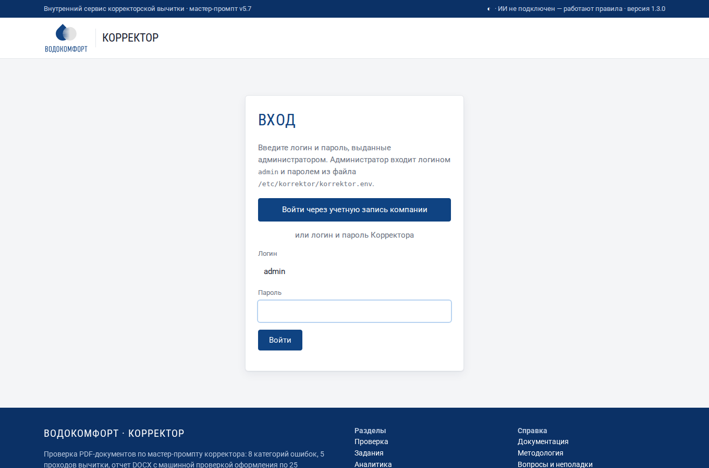
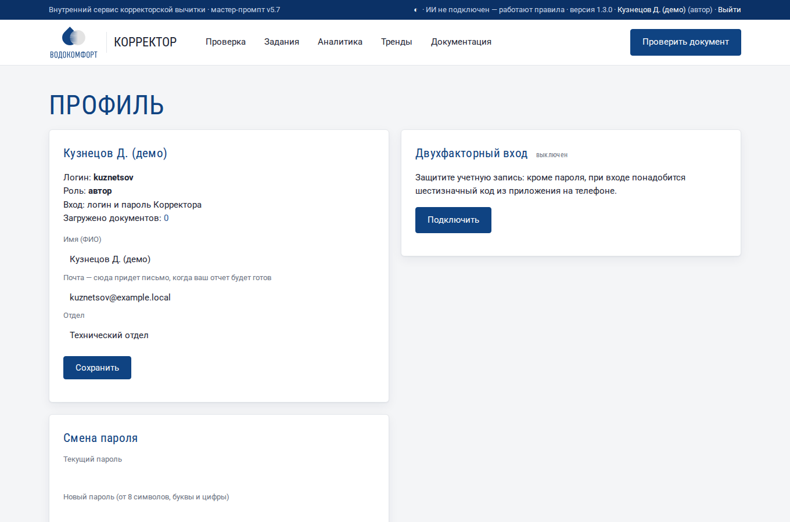
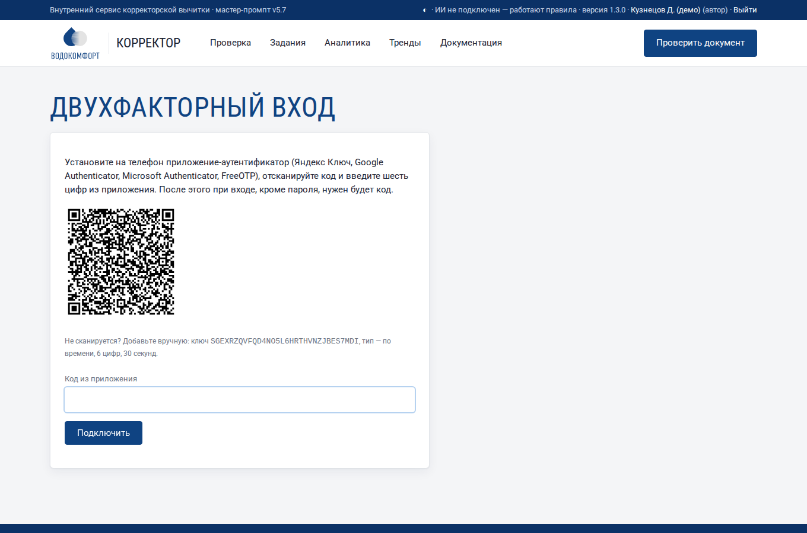
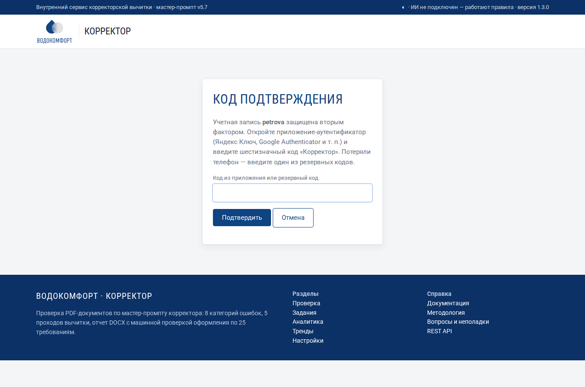
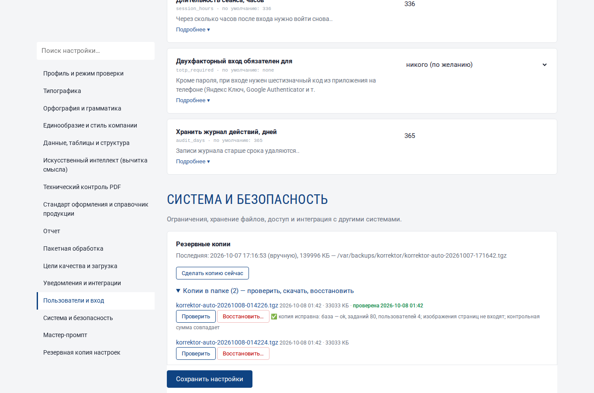
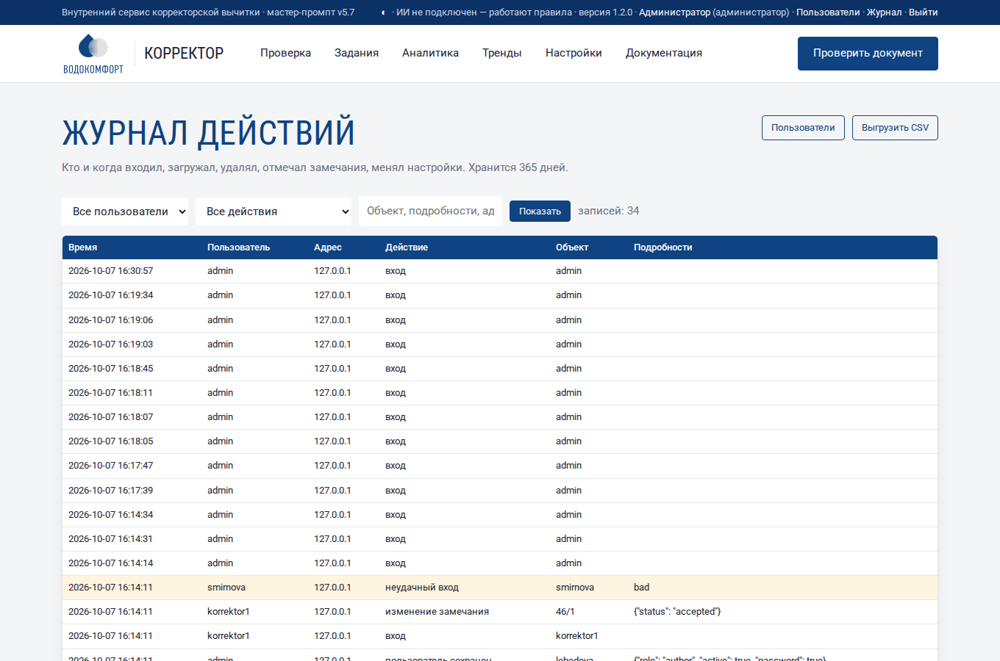

# Пользователи, роли и журнал

С версии 1.2 в Корректор входят по личным учетным записям. У каждого сотрудника своя роль, сервис запоминает, кто загрузил документ и кто отметил замечание, а все важные действия попадают в журнал.

## 1. Роли

| Роль | Что может |
|---|---|
| **Автор** | загружать документы, смотреть и скачивать отчеты, смотреть аналитику и тренды, удалять и перезапускать **свои** задания |
| **Корректор** | все, что автор, плюс: отмечать замечания ✓ ✕ ✎, пересобирать отчеты, массово отмечать замечания в аналитике, пополнять белый список и глоссарий, удалять и перезапускать любые задания |
| **Администратор** | все, плюс: настройки, пользователи, журнал действий, мастер-промпт, токен API |

Если включена настройка **«Разделение по отделам»**, авторы и корректоры видят только документы своего отдела (см. [п. 8](#8-разделение-по-отделам)). Если включена настройка **«Авторы видят только свои документы»** (Настройки → «Пользователи и вход»), автор видит в заданиях, аналитике, трендах и сравнении только документы, которые загрузил сам; чужое задание по прямой ссылке не откроется. Корректоры и администраторы видят все.

Кнопки, которые роли недоступны, на страницах не показываются. Если открыть недоступную страницу по ссылке, появится сообщение «Нет доступа».

Встроенный администратор **admin** существует всегда: он входит паролем из файла `/etc/korrektor/korrektor.env` (показать — `sudo korrektor password`, сменить — `sudo korrektor passwd`). Так сервисом можно управлять, даже если каталог LDAP недоступен.

## 2. Вход

Введите логин и пароль. После 5 неверных попыток подряд вход с этого компьютера блокируется на 5 минут. Сеанс действует 2 недели (настройка «Длительность сеанса»). Имя пользователя и роль видны в верхней строке; там же ссылки «Профиль» и «Выйти», а у администратора — «Пользователи» и «Журнал».

## 3. Учетные записи

**Пользователи** (верхняя строка → «Пользователи», только администратор):

1. В форме справа введите логин (латиница, цифры, точка, @, дефис), ФИО, роль, почту и отдел.
2. Задайте пароль: не короче 8 символов, буквы и цифры. Передайте его сотруднику — он сменит пароль в профиле.
3. Нажмите **«Сохранить»**.

**«Изменить»** заполняет форму данными сотрудника: можно сменить роль, отдел, почту, задать новый пароль (пусто — не менять) или снять флажок «учетная запись активна» — сотрудник больше не войдет, но его задания и записи журнала сохранятся. **«Удалить»** удаляет учетную запись; задания остаются.

Почта нужна для уведомлений: автор получит письмо, когда его отчет будет готов. Отдел подставляется при загрузке документа и используется в аналитике.

## 4. Вход через LDAP / Active Directory

Если в компании есть Active Directory, FreeIPA или OpenLDAP, сотрудники могут входить доменным логином и паролем. Настройки → **«Пользователи и вход»**:

| Настройка | Active Directory | OpenLDAP / FreeIPA |
|---|---|---|
| Вход через LDAP | включено | включено |
| Адрес сервера | `ldaps://dc1.компания.local` | `ldaps://ldap.компания.local` |
| Шаблон имени для входа | `{login}@компания.local` | `uid={login},cn=users,cn=accounts,dc=компания,dc=local` |
| Где искать сведения | `dc=компания,dc=local` | `cn=users,cn=accounts,dc=компания,dc=local` |
| Фильтр поиска | `(sAMAccountName={login})` | `(uid={login})` |
| Роль новых пользователей | Автор | Автор |
| Проверять сертификат сервера | включено | включено |
| Файл корневого сертификата | `/etc/korrektor/ca.pem` (корневой сертификат домена) | сертификат CA FreeIPA (`/etc/ipa/ca.crt`) |

Сохраните настройки и проверьте вход блоком **«Проверить вход LDAP»** (введите свой доменный логин и пароль; пароль никуда не записывается). При первом входе сотрудника сервис создает учетную запись с ролью по умолчанию, берет из каталога ФИО, почту и отдел. Корректорам и администраторам роль назначают на странице «Пользователи». Пароль доменной учетной записи хранится только в домене.

!!! warning "Шифрование"
    Используйте `ldaps://` или `ldap://` со STARTTLS — иначе пароли сотрудников пойдут по сети открытым текстом.

## 5. Единый вход: Keycloak, ADFS, Entra ID (OpenID Connect)

Если в компании есть сервер единого входа, сотрудники входят кнопкой **«Войти через корпоративную учетную запись»** на странице входа — без отдельного пароля Корректора.

**На сервере учетных записей** зарегистрируйте конфиденциального клиента (Client ID `korrektor`, поток «Authorization Code», PKCE S256) с адресом возврата `https://<адрес Корректора>/login/oidc/callback`. Чтобы роли назначались автоматически, передайте в токене группы:

| Сервер | Издатель (issuer) | Поле логина | Поле групп |
|---|---|---|---|
| Keycloak | `https://sso.компания/realms/<realm>` | `preferred_username` | `groups` (маппер Group Membership) или `realm_access.roles` |
| ADFS (Windows Server 2016+) | `https://adfs.компания/adfs` | `upn` или `unique_name` | `group` или `role` |
| Microsoft Entra ID | `https://login.microsoftonline.com/<tenant>/v2.0` | `preferred_username` | `groups` или `roles` |

**В Корректоре** — Настройки → «Пользователи и вход»: включите «Вход через Keycloak / ADFS / Entra ID», укажите издателя, идентификатор и секрет клиента, поля логина и групп, группы администраторов и корректоров. Заполните также «Адрес сервиса для ссылок» (раздел «Уведомления») — из него строится адрес возврата.

Как это работает:

- При первом входе создается учетная запись (источник — «единый вход») с ФИО, почтой и отделом из сервера учетных записей. Она привязывается к постоянному идентификатору пользователя (`sub`): если сотрудник позже сменит логин на сервере, он попадет в ту же учетную запись.
- Роль определяется группами при **каждом** входе: сотрудника исключили из группы корректоров — при следующем входе он станет автором. Если поля групп не заданы, роль назначает администратор на странице «Пользователи».
- Учетная запись другого типа (локальная, LDAP) с тем же логином к единому входу не присоединяется — вход будет отклонен, чтобы никто не получил чужие права. Если нужно перевести сотрудника на единый вход, удалите его локальную запись.
- Обмен данными с сервером учетных записей — только по HTTPS; проверяются издатель, получатель, срок действия и одноразовые коды входа (state, nonce, PKCE).

## 6. Профиль

В **профиле** (имя в верхней строке) сотрудник видит свою роль, меняет ФИО, почту, отдел и пароль, подключает двухфакторный вход. Новый пароль — от 8 символов, с буквами и цифрами. При разделении по отделам отдел назначает только администратор.

## 7. Двухфакторный вход

Кроме пароля, при входе запрашивается шестизначный код из приложения-аутентификатора на телефоне: **Яндекс Ключ**, Google Authenticator, Microsoft Authenticator, FreeOTP, Bitwarden и любые другие, поддерживающие стандарт TOTP. Пароль без телефона бесполезен — даже если его подсмотрели или он утек.

**Подключить**: Профиль → «Двухфакторный вход» → **«Подключить»** → отсканируйте QR-код приложением (или введите ключ вручную) → введите код из приложения. Сервис покажет **8 резервных кодов** — сохраните их: каждый срабатывает один раз, если телефон потерян. Прочие открытые сеансы этой учетной записи завершаются.

**Вход**: после пароля откроется страница «Код подтверждения». Пять неверных кодов подряд блокируют вход на 5 минут; один и тот же код дважды не принимается.

**Обязательный второй фактор**: Настройки → «Пользователи и вход» → **«Двухфакторный вход обязателен для»**: никого, администраторов, корректоров и администраторов, всех. Сотрудник без подключенного второго фактора подключает его прямо при следующем входе — без этого сеанс не начнется. Отключить обязательный второй фактор в профиле нельзя.

| Ситуация | Что делать |
|---|---|
| Потерян телефон, есть резервные коды | войдите с резервным кодом, в профиле отключите и подключите второй фактор заново |
| Потерян телефон и коды | администратор: Пользователи → **«Сбросить 2FA»**; сотрудник войдет по паролю и подключит заново |
| Потерян телефон встроенного администратора | на сервере: `sudo korrektor 2fa-off admin` |
| Коды не подходят | на телефоне должно стоять автоматическое время; часы сервера — синхронизированы (NTP) |

Встроенный администратор `admin` тоже может подключить второй фактор в профиле (он хранится в папке данных). При едином входе (OpenID Connect) второй фактор проверяет сервер учетных записей — Корректор его не запрашивает.

## 8. Разделение по отделам

Настройки → «Пользователи и вход» → **«Разделение по отделам»**. Когда включено:

- авторы и корректоры видят **свои** документы и документы **своего отдела** (поле «Отдел» учетной записи) — в заданиях, аналитике, трендах, сравнении версий, отчете для руководства; чужое задание по ссылке не открывается;
- корректор отмечает замечания и массово обрабатывает только документы своего отдела;
- загруженный документ попадает в отдел загрузившего (поле «Отдел» на форме загрузки недоступно);
- сотрудник без отдела видит только свои документы; администраторы видят все; интеграции по токену API — тоже все;
- отдел назначает администратор на странице «Пользователи» (для LDAP и единого входа — берется из каталога), в профиле его сменить нельзя.

!!! warning "Перед включением"
    Проверьте отделы на странице «Пользователи»: пока разделение выключено, сотрудники могут указать отдел в профиле сами. Каждое такое изменение записывается в журнал («профиль изменен»).

Если включены обе настройки — «Разделение по отделам» и «Авторы видят только свои документы», — авторы видят только свои документы, а корректоры — документы своего отдела.

## 9. Журнал действий

Журнал (верхняя строка → «Журнал», только администратор) хранит год (настройка «Хранить журнал действий, дней»):

| Действие | Что записывается |
|---|---|
| вход, неудачный вход, выход | логин, адрес компьютера |
| загрузка документа | номера заданий, автор, отдел |
| изменение замечания, массовая отметка, пересборка отчета | задание, замечание, новый статус или исправление |
| удаление задания, повторная проверка | номер и название документа |
| изменение настроек, загрузка и сброс настроек, мастер-промпт, новый токен API | какие настройки изменены (секреты — звездочками) |
| белый список, глоссарий | добавленные слова и пары |
| пользователь сохранен или удален | логин, роль, признак смены пароля |
| двухфакторный вход | подключен, отключен, сброшен администратором; вход по резервному коду |
| резервные копии | создание, загрузка, скачивание, восстановление |
| справочник продукции, напоминания, отчет для руководства | загрузка справочника, ручная рассылка, скачивание отчета |

Фильтры: пользователь, действие, поиск по объекту, подробностям и адресу. Неудачные входы и удаления выделены цветом. **«Выгрузить CSV»** сохраняет журнал с текущими фильтрами для разборов и аудита.
